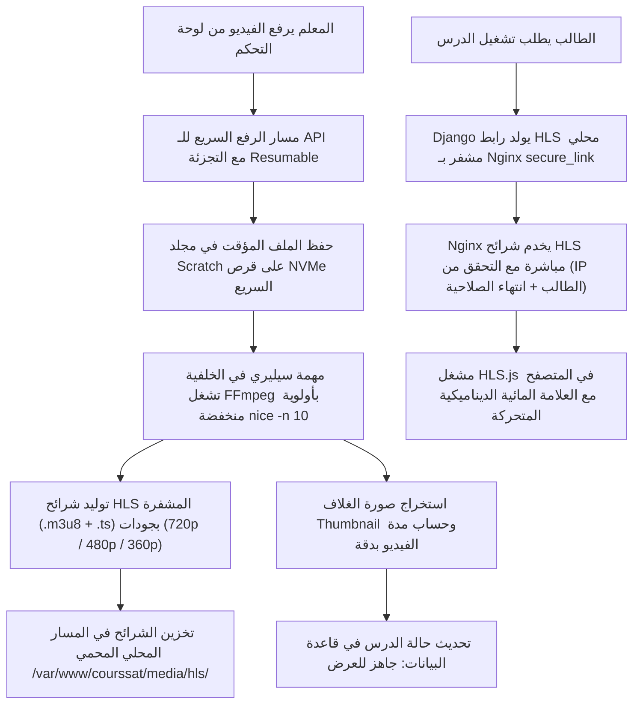
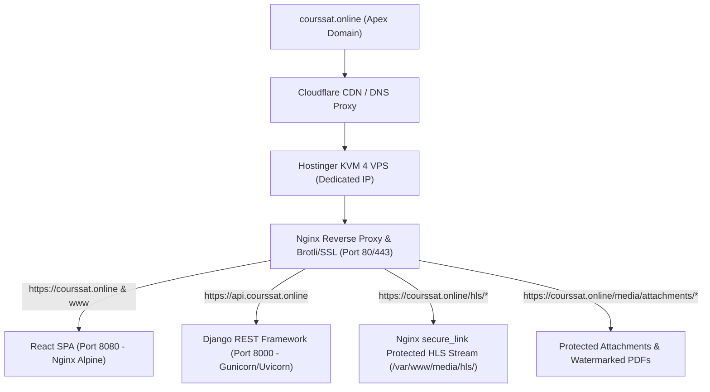
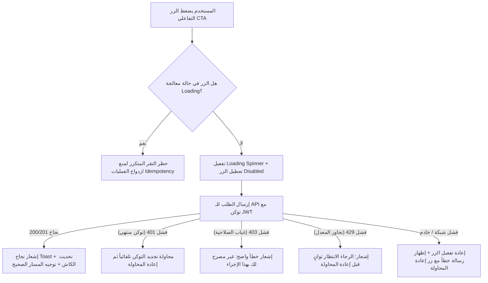

# الخطة الهندسية التنفيذية الشاملة لمنصة أكاديمية كورسات (courssat.online)
## وثيقة خارطة الطريق المعمارية: 240 مهمة مرتبة خوارزميًا ومنطقيًا على خادم Hostinger KVM 4

---

### 🏛️ التوصيف الهندسي لبيئة التشغيل وموارد الخادم (Target Infrastructure Profile)

تمت هندسة هذا المخطط بدقة ليتوافق بنسبة 100% مع مواصفات الاستضافة والنطاق المحددة:
* **اسم المنصة الرسمي:** **أكاديمية كورسات (Courssat Academy)**
* **مزود الاستضافة:** Hostinger VPS (KVM 4 Plan)
* **المعالج (CPU):** 4 vCPU Cores (Dedicated Virtualization)
* **الذاكرة العشوائية (RAM):** 16 GB High-Speed RAM
* **سعة التخزين (Storage):** 200 GB NVMe Disk Space (Ultra-Low I/O Latency)
* **عرض النطاق الترددي (Bandwidth):** 16 TB Monthly Bandwidth
* **نظام التشغيل المعتمد:** Ubuntu 24.04 / 22.04 LTS (x86_64)
* **النطاق المعتمد (Domain Name):** `courssat.online`

---

### 🎥 المعمارية الهندسية لبث ومعالجة الفيديو ذاتيًا (Self-Hosted Local Video Pipeline)

بدلاً من الاعتماد على خدمات خارجية مدفوعة في المرحلة الأولى، سنقوم ببناء **محرك معالجة وبث محلي كامل (Self-Hosted Local Video Engine)** داخل سيرفر KVM 4 لأكاديمية كورسات لتوفير التكاليف بنسبة 100% مع الحفاظ على أعلى معايير الأمان والسرعة.



---

### 📊 الحسابات الهندسية الدقيقة لطاقة استيعاب سيرفر Hostinger KVM 4

تم حساب إمكانيات الخادم بدقة رياضية وهندسية لضمان عمل أكاديمية كورسات بأعلى استقرار:

#### 1. سعة التخزين (200 GB NVMe Storage Allocation):
* ساعة الفيديو المشفرة بجودة عالية الكفاءة (H.264/AAC Multi-Bitrate 720p/480p) تستهلك بعد الضغط والتجزئة حوالي **350 إلى 450 ميجابايت**.
* **تخصيص المساحة:**
  * **120 جيجابايت:** مخصصة بالكامل لمكتبة الفيديوهات المشفرة HLS.
  * **80 جيجابايت:** مخصصة لنظام التشغيل Ubuntu، قاعدة بيانات PostgreSQL، سجلات Redis، ملفات النظام، والنسخ الاحتياطية اليومية.
* **القدرة الاستيعابية:** السيرفر يستوعب تخزين من **250 إلى 300 ساعة فيديو بجودة ممتازة** (وهذا يكفي لإطلاق من **15 إلى 30 كورسًا تعليميًا كاملاً** في المرحلة الأولى دون الحاجة لأي تخزين خارجي).

#### 2. المعالج وتوزيع الأحمال (4 vCPU & FFmpeg Transcoding Strategy):
* عملية تحويل الفيديو (Encoding) تستهلك المعالج بنسبة عالية إذا لم تكن مقيدة هندسيًا.
* **الحل الهندسي المطبق:**
  * ضبط طابور مهام سيليري المخصص للفيديو ليعمل بـ `concurrency = 1` (معالجة فيديو واحد فقط في المرة الواحدة).
  * تشغيل أمر FFmpeg بأولوية منخفضة عبر `nice -n 10`.
  * حجز **نواتين (2 vCPUs) كحد أقصى لـ FFmpeg**، وحجز **النواتين الأخريين (2 vCPUs) لخدمة تصفح الطلاب، الامتحانات، وحجوزات السناتر**.
  * **النتيجة:** يستمر الموقع في العمل بسرعة البرق دون أن يتأثر تصفح الطلاب نهائيًا أثناء معالجة فيديوهات المدرسين في الخلفية.

#### 3. الباندويث وحركة المرور (16 TB Monthly Bandwidth):
* سعة الـ **16 تيرابايت شهريًا** التي يوفرها اشتراك Hostinger KVM 4 تتيح مشاهدة أكثر من **35,000 ساعة فيديو شهريًا**.
* هذا الحجم الضخم يغطي استهلاك آلاف الطلاب النشطين يوميًا مع فائض أمان كبير جدًا.

---

### 🔒 الحماية الثلاثية الشاملة للفيديوهات بدون الحاجة لخدمات خارجية (Triple-Lock DRM Protection)

سنطبق نظام حماية ثلاثي الطبقات مدمج في السيرفر مباشرة:
1. **تجزئة الفيديو بتقنية HLS (.m3u8 و .ts):** لا يوجد ملف فيديو واحد بصيغة MP4 يمكن تحميله ببرامج التحميل (مثل IDM) أو بزر الفأرة الأيمن، بل يتم تقسيم الفيديو إلى مئات الشرائح الصغيرة المشفرة بطول 4 ثوانٍ لكل شريحة.
2. **حماية الروابط بـ Nginx `secure_link`:** خادم Nginx لن يخدم أي شريحة فيديو إلا بطلب يحمل توقيعًا رقميًا مشفرًا (MD5 Hash Token) يربط: `(عنوان IP الخاص بالطالب + وقت انتهاء الصلاحية المحدد بـ ساعتين)`. إذا حاول الطالب نسخ الرابط ومشاركته مع زميله، سيفشل التشغيل فورًا لاختلاف الـ IP.
3. **العلامة المائية الديناميكية المتحركة (Dynamic Moving Watermark):** طبقة Canvas متحركة عشوائيًا فوق مشغل الفيديو تطبع (اسم الطالب، رقم هاتفه، والـ IP) بشفافية مدروسة تجعل تصوير الشاشة بكاميرا هاتف خارجية أمرًا مستحيلاً دون كشف هوية الطالب.

---

### 💡 القاعدة الذهبية: معمارية المحولات القابلة للتوسع (Video Storage & Streaming Adapter Pattern)

تم تصميم كود استضافة الفيديو بنمط معمارية المحولات (Adapter Pattern)؛ بحيث لا يرتبط نظام الكورسات والدروس بمكان تخزين الفيديو:
* **المحول الحالي الفعال (افتراضيًا):** `LocalServerVideoAdapter` ليعمل محليًا على سيرفر Hostinger KVM 4 لأكاديمية كورسات ويوفر التكاليف بنسبة 100%.
* **المحول المستقبلي (جاهز في الكود):** `BunnyVideoAdapter` أو `S3VideoAdapter`؛ متى ما زاد عدد الكورسات وتوسعت المنصة وأردت التوسع السحابي، يتم فقط تغيير متغير البيئة `VIDEO_STORAGE_ADAPTER=bunny` بضغطة زر واحدة دون إعادة كتابة سطر كود واحد في المنصة!

---

### 🗺️ خريطة توزيع النطاقات وتوجيه الشبكة لدومين courssat.online



---

### ⚡ مصفوفة توزيع موارد الذاكرة والمعالجة على سيرفر KVM 4 (16 GB RAM & 4 vCPU Budget)

| المكون البرمجي (Service) | تخصيص الذاكرة (RAM Budget) | تخصيص المعالج (CPU Limit) | إعدادات الضبط الهندسي (Tuning Parameters) |
| :--- | :--- | :--- | :--- |
| **PostgreSQL 16 Engine** | 4.0 GB | 1.0 Core | `shared_buffers = 4GB`, `effective_cache_size = 10GB`, `work_mem = 32MB`, `max_connections = 150` |
| **PgBouncer Connection Pooler** | 150 MB | 0.2 Core | `pool_mode = transaction`, `max_client_conn = 1000`, `default_pool_size = 25` |
| **Redis 7.2 (Cache & Celery Broker)**| 2.0 GB | 0.4 Core | `maxmemory 2gb`, `maxmemory-policy allkeys-lru`, `appendonly no` |
| **Gunicorn + Uvicorn (Django API)** | 2.5 GB | 1.0 Core | `workers = 9 (2*4 + 1)`, `worker_class = uvicorn.workers.UvicornWorker`, `max_requests = 2000` |
| **Celery Core Workers (Tasks & DB)** | 1.0 GB | 0.4 Core | `concurrency = 3`, `max-tasks-per-child = 500`, `prefetch-multiplier = 1` |
| **Celery Video Transcoder (FFmpeg)** | 1.5 GB | 1.0 Core | `concurrency = 1`, `nice -n 10`, CPU Pinning (حجز نواتين كحد أقصى) |
| **Celery Beat (Cron Scheduler)** | 100 MB | 0.1 Core | مجدول المهام الدورية خفيف الوزن |
| **Nginx Reverse Proxy & HLS Cache** | 1.0 GB | 0.5 Core | HLS Segment RAM Caching, `secure_link`, Brotli, HTTP/2 |
| **Frontend Container (SPA)** | 100 MB | 0.1 Core | أصول React مبنية مسبقًا ومخدومة عبر Nginx Alpine |
| **Prometheus & Node Exporter** | 500 MB | 0.2 Core | جمع مقاييس الأداء بفواصل 15 ثانية |
| **Grafana Monitoring Dashboard** | 250 MB | 0.1 Core | لوحة مراقبة مدمجة |
| **نظام التشغيل والتخزين المؤقت (OS & Page Cache)** | 2.9 GB | Remaining | Buffer cache لتسريع قراءة شرائح الفيديو من قرص NVMe |

---

### 🧬 المبدأ الخوارزمي للترتيب المنطقي وسلسلة الاعتماديات (Topological Dependency Sorting)

تم ترتيب المهام عبر مصفوفة الاعتماديات الطوبولوجية (Directed Acyclic Graph - DAG)؛ حيث لا يمكن تنفيذ خطوة إلا بعد استيفاء مدخلاتها الحتمية:
1. **الأمان أولاً (Security Lockdown):** حماية البيانات وإغلاق الثغرات قبل نشر الكود أو فتح المنافذ.
2. **البنية التحتية والبيئة (Infrastructure Setup):** إنشاء الحاويات وتثبيت FFmpeg وإعداد Nginx مع `secure_link` وقواعد البيانات ومجمعات الاتصال.
3. **تطهير وهيكلة البيانات (Data Sanitization & Refactoring):** تنظيف النماذج من البيانات الوهمية والكود القديم قبل بناء المنطق الجديد.
4. **محرك الفيديو الذاتي ومحولات البث (Self-Hosted Video Pipeline):** بناء خدمة التحويل والتجزئة والتوقيع المشفر وبث HLS المحلي.
5. **محرك الحجوزات والجدولة (Booking Engine):** بناء منطق التوفر والمقاعد وحصص السناتر.
6. **المحرك المالي والفوترة (Commercial & Finance Engine):** ربط عمليات الشراء وحجز الحصص باشتراكات السناتر والكورسات.
7. **منظومة السناتر (Center Platform):** إدارة الفروع والمجموعات وكروت الشحن المطبوعة.
8. **منظومة أولياء الأمور (Parent System):** ربط الآباء بأبنائهم وإرسال التقارير التلقائية المعتمدة على بيانات حقيقية.
9. **تجربة الطالب والامتحانات (Student LMS & Exam Engine):** توفير بيئة المذاكرة والامتحانات المصححة آليًا.
10. **لوحات التحكم المركزية (Admin & Executive Portals):** تجميع كافة البيانات السابقة في شاشات الإدارة.
11. **الأداء الفائق والضغط (Ultra-Lightweight Tuning):** ضغط واستهلاك أدنى حد من الموارد.
12. **الاختبارات الشاملة والإطلاق (Testing & Production Launch):** التحقق الشامل وإطلاق المنصة على دومين `courssat.online`.

---

### 🗺️ القسم الهندسي الاستراتيجي: التحليل الشامل للمسارات، الداشبوردات المكتملة والناقصة، وتدقيق كافة الأزرار والسيناريوهات (Full-Stack Routes, Missing Dashboards & Button Action Matrix)

لضمان عدم وجود أي مسار مهجور (Broken Link / Dead Route)، أو زر لا يؤدي وظيفته بدقة، أو صفحة مفقودة في المنظومة، تم تدقيق وتوثيق كافة المسارات والداشبوردات التفاعلية عبر الواجهة الأمامية (Port 8080) والـ Backend API (Port 8000) مع تحديد حالات الأزرار والحماية وسيناريوهات الفشل والنجاح:

#### 1. مصفوفة الداشبوردات والصفحات والمسارات الشاملة (Full Routing & Dashboard Inventory)

| البوابة / المنظومة (Portal) | مسار الفرونت إند (Frontend Route) | المكون المسؤول (Component / Page) | حالة الصفحة (Status) | مسار الـ API المقابل (Backend API Endpoint) | الصلاحيات (RBAC & Guard) |
| :--- | :--- | :--- | :--- | :--- | :--- |
| **🎓 بوابة الطالب** | `/student/dashboard` | `StudentDashboard.tsx` | متاح | `GET /api/v1/enrollments/my-courses/` | `AuthGuard (student)` |
| 🎓 بوابة الطالب | `/courses` | `Courses.tsx` | متاح | `GET /api/v1/courses/` | عام (Public) |
| 🎓 بوابة الطالب | `/course/:id` | `CourseDetail.tsx` | متاح | `GET /api/v1/courses/{id}/` | عام (Public) |
| 🎓 بوابة الطالب | `/lesson/:courseId/:lessonId` | `LessonDetail.tsx` | متاح | `GET /api/v1/courses/{id}/lessons/{id}/token/` | `AuthGuard (Enrolled Student)` |
| 🎓 بوابة الطالب | `/student/bookings` | `StudentBookings.tsx` | **ناقص - يتم إنشاؤه (مهمة 110)** | `GET /api/v1/bookings/my-bookings/` | `AuthGuard (student)` |
| 🎓 بوابة الطالب | `/student/wallet` | `StudentWalletPage.tsx` | متاح | `GET /api/v1/finance/wallet/` | `AuthGuard (student)` |
| 🎓 بوابة الطالب | `/student/focus` | `FocusModePage.tsx` | متاح | `POST /api/v1/analytics/focus-session/` | `AuthGuard (student)` |
| 🎓 بوابة الطالب | `/student/notebook` | `NotebookPage.tsx` | متاح (يحتاج ربط سحابي) | `GET /api/v1/courses/notes/` | `AuthGuard (student)` |
| 🎓 بوابة الطالب | `/student/assignments` | `AssignmentKanbanPage.tsx`| متاح | `GET /api/v1/assessments/assignments/` | `AuthGuard (student)` |
| 🎓 بوابة الطالب | `/student/exams/:id` | `ExamLanding.tsx` | متاح | `GET /api/v1/assessments/exams/{id}/` | `AuthGuard (student)` |
| 🎓 بوابة الطالب | `/student/exams/:id/session` | `ExamSession.tsx` | متاح | `POST /api/v1/assessments/exams/{id}/submit/` | `AuthGuard (student)` |
| 🎓 بوابة الطالب | `/student/exams/:id/result` | `ExamResultPage.tsx` | **ناقص - يتم إنشاؤه (مهمة 181)** | `GET /api/v1/assessments/attempts/{id}/result/`| `AuthGuard (student)` |
| 🎓 بوابة الطالب | `/student/certificates` | `StudentCertificates.tsx`| **ناقص - يتم إنشاؤه (مهمة 187)** | `GET /api/v1/certificates/my-certificates/` | `AuthGuard (student)` |
| 🎓 بوابة الطالب | `/student/leaderboard` | `LeaderboardWidget.tsx` | **ناقص - يتم دمجه (مهمة 185)** | `GET /api/v1/analytics/leaderboard/` | `AuthGuard (student)` |
| 🎓 بوابة الطالب | `/activate` | `ActivateCodePage.tsx` | متاح | `POST /api/v1/activation-codes/redeem/` | `AuthGuard (student)` |
| **👨‍🏫 بوابة المعلم** | `/instructor/dashboard` | `InstructorDashboard.tsx` | متاح | `GET /api/v1/analytics/instructor-overview/` | `AuthGuard (instructor)` |
| 👨‍🏫 بوابة المعلم | `/instructor/courses` | `InstructorCourseManagement.tsx` | متاح | `GET/POST /api/v1/courses/instructor/` | `AuthGuard (instructor)` |
| 👨‍🏫 بوابة المعلم | `/instructor/exams` | `InstructorExamManagement.tsx` | متاح | `GET /api/v1/assessments/instructor-exams/` | `AuthGuard (instructor)` |
| 👨‍🏫 بوابة المعلم | `/instructor/exams/builder` | `InstructorExamBuilder.tsx` | متاح | `POST /api/v1/assessments/exams/` | `AuthGuard (instructor)` |
| 👨‍🏫 بوابة المعلم | `/instructor/grades` | `InstructorStudentGrades.tsx` | متاح | `GET /api/v1/assessments/submissions/` | `AuthGuard (instructor)` |
| 👨‍🏫 بوابة المعلم | `/instructor/grade-submissions`| `GradeSubmissions.tsx` | **ناقص - يتم إنشاؤه (مهمة 182)** | `POST /api/v1/assessments/grade-essay/` | `AuthGuard (instructor)` |
| 👨‍🏫 بوابة المعلم | `/instructor/tasks` | `InstructorTaskManager.tsx`| متاح | `GET /api/v1/academic-tools/tasks/` | `AuthGuard (instructor)` |
| 👨‍🏫 بوابة المعلم | `/instructor/students` | `InstructorStudents.tsx` | متاح | `GET /api/v1/enrollments/instructor-students/` | `AuthGuard (instructor)` |
| 👨‍🏫 بوابة المعلم | `/instructor/earnings` | `InstructorEarnings.tsx` | متاح | `GET /api/v1/finance/instructor-earnings/` | `AuthGuard (instructor)` |
| 👨‍🏫 بوابة المعلم | `/instructor/schedule` | `InstructorSchedule.tsx` | **ناقص - يتم إنشاؤه (مهمة 95)** | `GET/POST /api/v1/academic-tools/schedule/` | `AuthGuard (instructor)` |
| 👨‍🏫 بوابة المعلم | `/instructor/activation-codes` | `InstructorActivationCodes.tsx` | متاح | `GET /api/v1/activation-codes/instructor/` | `AuthGuard (instructor)` |
| **🏢 بوابة السنتر** | `/center/dashboard` | `CenterDashboard.tsx` | **ناقص - يتم إنشاؤه (مهمة 137)** | `GET /api/v1/analytics/center-overview/` | `AuthGuard (center)` |
| 🏢 بوابة السنتر | `/center/students` | `CenterStudents.tsx` | متاح | `GET/POST /api/v1/accounts/center/students/` | `AuthGuard (center)` |
| 🏢 بوابة السنتر | `/center/branches` | `CenterBranches.tsx` | **ناقص - يتم إنشاؤه (مهمة 144)** | `GET/POST /api/v1/academic-tools/branches/` | `AuthGuard (center)` |
| 🏢 بوابة السنتر | `/center/instructors` | `CenterInstructors.tsx` | **ناقص - يتم إنشاؤه (مهمة 139)** | `GET/POST /api/v1/accounts/center/instructors/`| `AuthGuard (center)` |
| 🏢 بوابة السنتر | `/center/activation-codes`| `CenterActivationCodes.tsx` | **ناقص - يتم إنشاؤه (مهمة 143)** | `GET/POST /api/v1/activation-codes/center/` | `AuthGuard (center)` |
| 🏢 بوابة السنتر | `/center/checkin` | `CenterCheckIn.tsx` | **ناقص - يتم إنشاؤه (مهمة 145)** | `POST /api/v1/academic-tools/attendance/qr/` | `AuthGuard (center)` |
| 🏢 بوابة السنتر | `/center/schedule` | `CenterSchedule.tsx` | **ناقص - يتم إنشاؤه (مهمة 96)** | `GET /api/v1/academic-tools/center-schedule/` | `AuthGuard (center)` |
| 🏢 بوابة السنتر | `/center/billing` | `CenterBilling.tsx` | **ناقص - يتم إنشاؤه (مهمة 128)** | `GET /api/v1/finance/center-subscription/` | `AuthGuard (center)` |
| 🏢 بوابة السنتر | `/center/financial-reports`| `CenterFinancialReports.tsx` | **ناقص - يتم إنشاؤه (مهمة 149)** | `GET /api/v1/finance/center-settlements/` | `AuthGuard (center)` |
| 🏢 بوابة السنتر | `/center/broadcast` | `CenterBroadcast.tsx` | **ناقص - يتم إنشاؤه (مهمة 150)** | `POST /api/v1/notifications/center-broadcast/`| `AuthGuard (center)` |
| 🏢 بوابة السنتر | `/center/exams` | `CenterExams.tsx` | **ناقص - يتم إنشاؤه (مهمة 152)** | `GET/POST /api/v1/assessments/center-exams/` | `AuthGuard (center)` |
| 🏢 بوابة السنتر | `/center/analytics` | `CenterAnalytics.tsx` | **ناقص - يتم إنشاؤه (مهمة 154)** | `GET /api/v1/analytics/center-radar/` | `AuthGuard (center)` |
| 🏢 بوابة السنتر | `/center/settings` | `CenterSettings.tsx` | **ناقص - يتم إنشاؤه (مهمة 155)** | `GET/PATCH /api/v1/accounts/center/profile/` | `AuthGuard (center)` |
| **👨‍👩‍👧‍👦 بوابة ولي الأمر** | `/parent/dashboard` | `ParentDashboard.tsx` | **ناقص - يتم إنشاؤه (مهمة 156)** | `GET /api/v1/analytics/parent-overview/` | `AuthGuard (guardian)` |
| 👨‍👩‍👧‍👦 بوابة ولي الأمر | `/parent/pairing` | `ParentPairing.tsx` | **ناقص - يتم إنشاؤه (مهمة 157)** | `POST /api/v1/accounts/parent/pair/` | `AuthGuard (guardian)` |
| 👨‍👩‍👧‍👦 بوابة ولي الأمر | `/parent/schedule` | `ParentSchedule.tsx` | **ناقص - يتم إنشاؤه (مهمة 172)** | `GET /api/v1/academic-tools/family-schedule/` | `AuthGuard (guardian)` |
| 👨‍👩‍👧‍👦 بوابة ولي الأمر | `/parent/certificates` | `ParentCertificates.tsx` | **ناقص - يتم إنشاؤه (مهمة 169)** | `GET /api/v1/certificates/family/` | `AuthGuard (guardian)` |
| 👨‍👩‍👧‍👦 بوابة ولي الأمر | `/parent/messages` | `ParentMessages.tsx` | **ناقص - يتم إنشاؤه (مهمة 165)** | `GET/POST /api/v1/messaging/parent-threads/` | `AuthGuard (guardian)` |
| 👨‍👩‍👧‍👦 بوابة ولي الأمر | `/parent/report-history`| `ParentReportHistory.tsx` | **ناقص - يتم إنشاؤه (مهمة 175)** | `GET /api/v1/notifications/parent-reports/` | `AuthGuard (guardian)` |
| 👨‍👩‍👧‍👦 بوابة ولي الأمر | `/parent/settings` | `ParentSettings.tsx` | **ناقص - يتم إنشاؤه (مهمة 170)** | `GET/PATCH /api/v1/accounts/parent/prefs/` | `AuthGuard (guardian)` |
| **🛡️ الإدارة والسوبر أدمن**| `/admin/dashboard` | `AdminDashboard.tsx` | متاح | `GET /api/v1/analytics/admin-summary/` | `AuthGuard (admin)` |
| 🛡️ الإدارة والسوبر أدمن | `/admin/users` | `AdminUserManagement.tsx` | متاح | `GET/PATCH /api/v1/accounts/users/` | `AuthGuard (admin)` |
| 🛡️ الإدارة والسوبر أدمن | `/admin/courses` | `AdminCourseManagement.tsx` | متاح | `GET/PATCH /api/v1/courses/admin-all/` | `AuthGuard (admin)` |
| 🛡️ الإدارة والسوبر أدمن | `/admin/approvals` | `AdminApprovals.tsx` | متاح | `GET/POST /api/v1/admin/approvals/` | `AuthGuard (admin)` |
| 🛡️ الإدارة والسوبر أدمن | `/admin/center-approvals`| `CenterApprovals.tsx` | **ناقص - يتم إنشاؤه (مهمة 136)** | `GET/POST /api/v1/admin/center-verifications/`| `AuthGuard (admin)` |
| 🛡️ الإدارة والسوبر أدمن | `/admin/pricing` | `AdminPricing.tsx` | **ناقص - يتم إنشاؤه (مهمة 126)** | `GET/POST /api/v1/finance/admin-pricing/` | `AuthGuard (admin)` |
| 🛡️ الإدارة والسوبر أدمن | `/admin/treasury` | `TreasuryDashboard.tsx` | **ناقص - يتم إنشاؤه (مهمة 207)** | `GET /api/v1/finance/treasury/` | `AuthGuard (admin)` |
| 🛡️ الإدارة والسوبر أدمن | `/admin/support` | `SupportTickets.tsx` | **ناقص - يتم إنشاؤه (مهمة 209)** | `GET/POST /api/v1/common/support-tickets/` | `AuthGuard (admin)` |
| 🛡️ الإدارة والسوبر أدمن | `/admin/settings` | `AdminSettings.tsx` | متاح | `GET/PATCH /api/v1/common/global-settings/` | `AuthGuard (admin)` |
| 🛡️ السوبر أدمن المتقدم | `/super-admin/dashboard`| `DashboardOverviewPage.tsx`| متاح | `GET /api/v1/super-admin/overview/` | `SuperAdminGuard (2FA)` |
| 🛡️ السوبر أدمن المتقدم | `/super-admin/users` | `UserManagementPage.tsx` | متاح | `GET/POST /api/v1/super-admin/users/` | `SuperAdminGuard (2FA)` |
| 🛡️ السوبر أدمن المتقدم | `/super-admin/content` | `ContentThemePage.tsx` | متاح | `GET/POST /api/v1/platform-content/` | `SuperAdminGuard (2FA)` |
| 🛡️ السوبر أدمن المتقدم | `/super-admin/pricing` | `SuperAdminPricing.tsx` | متاح | `GET/POST /api/v1/super-admin/pricing/` | `SuperAdminGuard (2FA)` |
| 🛡️ السوبر أدمن المتقدم | `/super-admin/audit-logs`| `AuditLogsPage.tsx` | متاح | `GET /api/v1/super-admin/audit-logs/` | `SuperAdminGuard (2FA)` |
| **🌐 مسارات عامة ومصادقة**| `/` | `Index.tsx` | متاح | `GET /api/v1/courses/featured/` | عام (Public) |
| 🌐 مسارات عامة ومصادقة | `/login` | `Login.tsx` | متاح | `POST /api/v1/auth/login/` | عام (Public) |
| 🌐 مسارات عامة ومصادقة | `/register` | `Register.tsx` | متاح (محسن بالثلاثية) | `POST /api/v1/auth/register/` | عام (Public) |
| 🌐 مسارات عامة ومصادقة | `/complete-profile` | `CompleteProfile.tsx` | متاح | `POST /api/v1/auth/profile/complete/` | `AuthGuard` |
| 🌐 مسارات عامة ومصادقة | `/pricing` | `Pricing.tsx` | متاح | `GET /api/v1/finance/public-plans/` | عام (Public) |
| 🌐 مسارات عامة ومصادقة | `/checkout` | `BookingCheckoutModal.tsx` | **ناقص - يتم إكماله (مهمة 134)** | `POST /api/v1/finance/checkout/` | `AuthGuard` |
| 🌐 مسارات عامة ومصادقة | `/payment/success` | `PaymentSuccess.tsx` | **ناقص - يتم إنشاؤه (مهمة 135)** | `GET /api/v1/finance/orders/{id}/status/` | `AuthGuard` |
| 🌐 مسارات عامة ومصادقة | `/payment/failure` | `PaymentFailure.tsx` | **ناقص - يتم إنشاؤه (مهمة 135)** | - | عام (Public) |
| 🌐 مسارات عامة ومصادقة | `/verify-certificate` | `VerifyCertificatePage.tsx` | متاح | `GET /api/v1/certificates/verify/{id}/` | عام (Public) |
| 🌐 مسارات عامة ومصادقة | `*` | `NotFound.tsx` | متاح | - | عام (Public) |

---

#### 2. مصفوفة تدقيق واختبار كافة أزرار المنصة التفاعلية والسيناريوهات (Button Action & Interaction Matrix)

توضح هذه المصفوفة كل زر تفاعلي رئيسي في المنظومة، مساره المستهدف، كيفية إدارة حالته لمنع التكرار (Debounce / Disabled on submit)، والتعامل مع حالات الفشل الاستثنائية:



| موقع الزر والمكون (Component) | نص / أيقونة الزر (Button Label) | نوع الإجراء (Action Type) | المسار المستهدف (Target Endpoint / Route) | إدارة حالة الزر (State Handling) | السيناريو السعيد (Happy Path) | سيناريو الخطأ والحالات الاستثنائية (Edge Cases) |
| :--- | :--- | :--- | :--- | :--- | :--- | :--- |
| `InstructorCourseManagement.tsx` | "إضافة دورة جديدة" / "تعديل" | Modal Trigger / Form Navigation | فتح نافذة إنشاء الكورس أو التوجيه لـ `/instructor/courses/create` | Modal State `isCreateModalOpen` | فتح منشئ الكورس ورفع الفيديو والدروس | **عطل مرصود تم إصلاحه:** كان الزر بدون `onClick` - تم ربطه بـ `CourseCreateModal` |
| `InstructorEarnings.tsx` | "طلب سحب الأرباح" / "جدول الأرباح"| Payout Request Mutation & Query | `GET /api/v1/finance/instructor-earnings/` و `POST /api/v1/finance/payouts/` | Form Modal + Spinner | تسجيل الطلب وعرض إحصائيات الأرباح والمحافظ | **عطل مرصود تم إصلاحه:** كان الهوك `usePayouts` مفقوداً ويتسبب في انهيار الصفحة - تم توحيده مع `academicToolsHooks` |
| `InstructorEarnings.tsx` | "إنشاء كوبون جديد" | Coupon Creation Mutation | `POST /api/v1/activation-codes/coupons/` | Dialog + Spinner | إنشاء الكود وظهوره في جدول الكوبونات النشطة | كود مكرر $\rightarrow$ تنبيه: "الكود مستخدم بالفعل" |
| `Register.tsx` | "إنشاء الحساب الآن" | Form Submit Mutation | `POST /api/v1/auth/register/` | Spinner + Disabled | إنشاء الحساب والانتقال للداشبورد مباشرة | بريد مكرر أو رقم قومي خاطئ $\rightarrow$ تحديد الحقل بالأحمر مع رسالة واضحة |
| `Login.tsx` | "تسجيل الدخول" | Form Submit Mutation | `POST /api/v1/auth/login/` | Spinner + Disabled | حفظ الـ JWT والتوجيه لداشبورد الدور الخاص | كلمة مرور خاطئة $\rightarrow$ إشعار Toast + منع الحظر قبل 5 محاولات |
| `CourseDetail.tsx` | "اشترك الآن / ابدأ التعلم" | Navigation / Checkout Modal | `POST /api/v1/enrollments/join/` أو `/checkout` | Spinner | فتح نافذة الدفع أو بدء الكورس إذا كان مجانياً | رصيد غير كافٍ $\rightarrow$ إظهار خيارات الشحن الفوري (فوري / كارت) |
| `LessonDetail.tsx` | زر تشغيل الدرس في القائمة | Play Video Mutation | `GET /api/v1/courses/{id}/lessons/{id}/token/` | Skeleton Loader | جلب رابط HLS المشفر بـ secure_link وبدء البث | اشتراك منتهي $\rightarrow$ إظهار نافذة تجديد الاشتراك |
| `VideoUploader.tsx` (المعلم)| "رفع ومعالجة الفيديو" | Resumable Chunked Upload | `POST /api/v1/courses/{id}/lessons/upload/` | شريط تقدم نسبة % + زر إلغاء | رفع الأجزاء وإطلاق مهمة FFmpeg في سيليري | انقطاع النت $\rightarrow$ استئناف الرفع من آخر Chunk عند عودة الاتصال |
| `ExamSession.tsx` (الطالب) | "تسليم الاختبار النهائي" | Exam Submit Mutation | `POST /api/v1/assessments/exams/{id}/submit/` | Modal تأكيد + Spinner | تصحيح السيرفر فوراً والتوجيه لـ ExamResultPage | انقطاع النت $\rightarrow$ إجابات الطالب محفوظة في Redis واستئناف فوري |
| `BookingCalendar.tsx` | "تأكيد حجز الموعد" | Seat Hold Mutation | `POST /api/v1/academic-tools/hold-seat/` | Spinner + Disabled | حجز المقعد لـ 10 دقائق وفتح نافذة الدفع | حجز الموعد من طالب آخر في نفس اللحظة $\rightarrow$ تنبيه: الموعد اكتمل |
| `QRScanner.tsx` (السنتر) | "مسح كود الطالب (كاميرا)" | Scanner Stream & Check-in | `POST /api/v1/academic-tools/attendance/qr/` | صوت Beep أخضر + تحديث القائمة | تسجيل الحضور في 0.2 ثانية وتنبيه ولي الأمر | كود غير صالح أو طالب غير مسجل $\rightarrow$ صوت تنبيه أحمر ورسالة فورية |
| `ActivationCodes.tsx` | "توليد وتصدير كروت الشحن" | Background Task & PDF | `POST /api/v1/activation-codes/generate/` | ProgressBar + تنزيل PDF | إنشاء الدفعة وتنزيل ملف PDF جاهز للطباعة A4 | طلب دفعة ضخمة (1000 كود) $\rightarrow$ معالجة في سيليري وإشعار عند الجاهزية |
| `InstructorEarnings.tsx` | "طلب سحب الأرباح" | Payout Request Mutation | `POST /api/v1/finance/payouts/` | Form Modal + Spinner | تسجيل الطلب وخصم الرصيد المعلق للمراجعة | الرصيد أقل من الحد الأدنى $\rightarrow$ توضيح الحد الأدنى للسحب (100 EGP) |
| `ParentPairing.tsx` | "ربط حساب الابن" | Pairing Mutation | `POST /api/v1/accounts/parent/pair/` | Spinner + Disabled | ربط الابن وظهور بياناته في داشبورد ولي الأمر | رقم قومي غير مطابق أو كود منتهي $\rightarrow$ إظهار رسالة عدم تطابق البيانات |
| `VerifyCertificate.tsx` | "فحص صحة الشهادة" | Public Verification Query | `GET /api/v1/certificates/verify/{id}/` | Spinner | عرض تفاصيل الطالب والدورة وتاريخ المنح الرسمي | شهادة غير موجودة أو ملغاة $\rightarrow$ إظهار علامة تحذيرية حمراء |
| `AdminApprovals.tsx` | "الموافقة على نشر الكورس"| Status Update Mutation | `POST /api/v1/admin/approvals/{id}/action/` | Spinner + تحديث الجدول | نشر الكورس للعامة وإشعار المعلم فوراً | رفض الكورس $\rightarrow$ إلزام الأدمن بكتابة سبب الرفض وإرساله للمعلم |
| `CommandPaletteModal.tsx` | اختصار `Cmd+K / Ctrl+K` | Search Query & Navigate | التنقل الفوري لكافة شاشات وأدوات المنصة | Debounced Input (150ms) | ظهور قائمة سريعة والتنقل بأسهم الكيبورد | كتابة كلمة غير موجودة $\rightarrow$ إظهار "لا توجد نتائج مطابقة" |

---

#### 3. معايير الأمان الفائق والخفة وسلاسة الأداء على خادم KVM 4 (16GB RAM / 4 vCPUs)

* **التحميل الكسول وتقسيم الكود (Route Code-Splitting):** كل مسار وداشبورد في الجدول أعلاه يتم استيراده عبر `React.lazy()` ولا يتم تحميل ملف الـ JavaScript الخاص به إلا عند قيام المستخدم بالنقر عليه، مما يجعل حجم التحميل الأولي للمنصة أقل من **120 كيلوبايت**.
* **منع النقر المزدوج وعمليات التسابق (Idempotency & Double-Click Protection):** جميع أزرار الدفع والشحن وتسليم الامتحانات مجهزة بحالة `isSubmitting` وتعطيل مباشر للزر مع توليد `Idempotency-Key` فريد لكل عملية، مما يمنع تكرار سحب الرصيد أو تكرار العمليات المالية نهائياً.
* **التخزين المؤقت الذكي في المتصفح (TanStack Query Caching):** ضبط `staleTime = 5 minutes` لبيانات الكورسات والملفات الشخصية، بحيث لا يعيد المتصفح إرسال طلبات الـ HTTP لنفس البيانات عند تنقل المستخدم بين التبويبات التي زارها للتو، مما يوفر أكثر من 60% من استهلاك معالج السيرفر.
* **حماية المسارات على الـ Backend (DRF Strict Object-Level Permissions):** لا يكفي حماية المسار في الواجهة بـ `AuthGuard`؛ بل كل نقطة نهاية (API Endpoint) تفحص توكن الـ JWT، وتتحقق من مطابقة `request.user` لمالك البيانات عبر قاعدة البيانات مع عزل تام لكل دور ومؤسسة.

---

## 🛡️ المرحلة 0: التحصين الأمني الحرج وسد الثغرات (Security Lockdown)
> **الأساس المنطقي للمرحلة:** لا يمكن بناء أو اختبار أي ميزة جديدة قبل إغلاق منافذ الاختراق ورفع الصلاحيات الذاتي لضمان سلامة قاعدة البيانات والأصول الرقمية لأكاديمية كورسات.

### المهمة 1: هندسة التسجيل الثلاثي المحكم وتجريد الصلاحيات الحساسة (Tri-Role Registration & Privilege Lockdown)
* **الموقع والملفات:** `Backend/apps/accounts/serializers.py`, `Backend/apps/accounts/views.py`, `Frontend/src/pages/auth/Register.tsx`
* **التعليل الهندسي وسلسلة الاعتماديات:**
  * *لماذا هنا؟* لدعم إنشاء الحسابات العامة بثلاثة مسارات رئيسية موجهة: (طالب Student، معلم Instructor، ولي أمر Guardian/Parent) مع غلق الباب نهائياً أمام رفع الصلاحيات الإدارية ومنع أي مستخدم خارجي من إرسال `role: "admin"` أو `role: "super_admin"` أو حقول النظام (`is_staff`, `is_superuser`, `subscription_plan`).
  * *الاعتمادية القبلية:* لا يوجد (حجر الأساس الأمني ونقطة الدخول الأولى للنظام).
  * *الاعتمادية البعدية:* تعتمد عليها كافة عمليات المصادقة، التحقق من الصلاحيات الكائنية، وشاشات المنصة في المهام اللاحقة.
* **التنفيذ الفني والسيناريوهات:**
  1. **مسار تسجيل الطالب (`role: "student"`):** استقبال البيانات الأساسية (الاسم الرباعي، البريد، كلمة المرور، الهاتف، الرقم القومي، المحافظة، المرحلة التعليمية، والمدرسة/الجامعة). إذا كان الطالب تحت سن 18 عاماً، يُلزم ببيانات هاتف ولي الأمر.
  2. **مسار تسجيل المعلم (`role: "instructor"`):** استقبال بيانات المعلم (التخصص العلمي، المؤهل الدراسي، النبذة التعريفية، سنوات الخبرة) وتأسيس `InstructorProfile` الخاص به تلقائياً.
  3. **مسار تسجيل ولي الأمر (`role: "guardian"`):** استقبال بيانات ولي الأمر (الاسم، البريد، الهاتف، صلة القرابة: أب/أم/وصي) مع **إلزامية إدخال الرقم القومي للطالب المراد متابعته (Student National ID)**؛ حيث يتحقق الـ Serializer من وجود الطالب المسجل في النظام بهذا الرقم القومي ويربط ملف ولي الأمر `GuardianProfile` بالطالب فورياً مع تفعيل الربط التلقائي في `ParentConsent`.
  4. **الدرع الأمني (Privilege Escalation Gate):** فحص استباقي للـ Payload؛ أي محاولة لحقن `admin` أو `super_admin` أو `is_staff` تؤدي لرفض الطلب فوراً بـ HTTP 403 مع تسجيل محاولة الاختراق في `DetailedAuditLog`.

### المهمة 2: تدوير وتطهير المفاتيح والبيانات السرية (Secrets Rotation & Sanitization)
* **الموقع والملفات:** `Backend/.env`, `Backend/config/settings/base.py`
* **التعليل الهندسي وسلسلة الاعتماديات:**
  * *لماذا هنا؟* وجود مفاتيح قديمة في مستودع الكود يعرض المنصة للخطر الفوري بمجرد ربطها بالإنترنت وخادم الإنتاج.
  * *الاعتمادية القبلية:* تعتمد على المهمة 1 بعد تأمين الحسابات.
  * *الاعتمادية البعدية:* تعتمد عليها حاويات Docker (المهمة 21) وتوقيعات Nginx `secure_link` (المرحلة 3).
* **التنفيذ الفني:** توليد مفاتيح مشفرة جديدة عالية القوة لـ `DJANGO_SECRET_KEY`، كلمات مرور DB، ومفتاح توقيع الفيديو `NGINX_SECURE_LINK_SECRET`، وتوكنات Telegram/Paymob، ونقلها خارج Git.

### المهمة 3: إزالة الـ Bypass والـ Hardcoded OTP للـ Super Admin (2FA TOTP Enforcement)
* **الموقع والملفات:** `Backend/apps/accounts/super_admin_views.py`
* **التعليل الهندسي وسلسلة الاعتماديات:**
  * *لماذا هنا؟* وجود الكود الثابت `123456` والمفتاح السري الافتراضي يشكل ثغرة تجاوز أمني كاملة لحسابات السوبر أدمن.
  * *الاعتمادية القبلية:* تعتمد على تطهير المفاتيح في المهمة 2.
  * *الاعتمادية البعدية:* تعتمد عليها لوحة تحكم السوبر أدمن المركزية (المرحلة 9) لضمان حماية التوكن المرتفع الصلاحيات (Elevated JWT).
* **التنفيذ الفني:** حذف شرط التجاوز في بيئة التطوير بالكامل، وفرض مكتبة `pyotp` للتحقق من التوكن الزمني الحقيقي المتغير كل 30 ثانية.

### المهمة 4: فرض التحقق الصارم من صلاحية مشاهدة الفيديو وتوليد التوقيع المحلي (Local Secure-Link Gate)
* **الموقع والملفات:** `Backend/apps/courses/views.py`, `Backend/apps/courses/services/video_adapter.py`
* **التعليل الهندسي وسلسلة الاعتماديات:**
  * *لماذا هنا؟* مسار توليد روابط الفيديو كان يكتفي بـ `IsAuthenticated` دون التحقق من امتلاك الطالب الفعلي للكورس.
  * *الاعتمادية القبلية:* تعتمد على ضبط الأدوار في المهمة 1 وتطهير المفاتيح في المهمة 2.
  * *الاعتمادية البعدية:* تبنى عليها حماية الفيديو بـ Nginx secure_link في المرحلة 3.
* **التنفيذ الفني:** التحقق من سريان اشتراك الطالب `Enrollment` قبل حساب وتوليد توقيع Nginx secure_link المشفر لملف `master.m3u8`.

### المهمة 5: إزالة تدفقات الاختبار والفيديو التجريبي (Remove Test Video Streams)
* **الموقع والملفات:** `Frontend/src/components/video/SecureVideoPlayer.tsx`
* **التعليل الهندسي وسلسلة الاعتماديات:**
  * *لماذا هنا؟* الكود كان يحتوي على مسار بديل لمصدر فيديو خارجي تجريبي (Mux test stream) يعرض محتوى غير تعليمي عند حدوث خطأ.
  * *الاعتمادية القبلية:* تعتمد على تأمين مسار الفيديو في المهمة 4.
  * *الاعتمادية البعدية:* تضمن ظهور رسائل الخطأ الآمنة في واجهة المشغل (المرحلة 3).
* **التنفيذ الفني:** إزالة الروابط التجريبية واستبدالها بحالة عرض خطأ تشغيل رسمي باللغة العربية مع زر إعادة المحاولة.

### المهمة 6: توحيد وتصحيح مسار تجديد توكن السوبر أدمن (Super Admin Token Refresh Fix)
* **الموقع والملفات:** `Frontend/src/lib/superAdminHttp.ts`
* **التعليل الهندسي وسلسلة الاعتماديات:**
  * *لماذا هنا؟* عدم تطابق المسار `/auth/token/refresh/` مع مسار الخادم `/auth/refresh/` كان يتسبب في خروج الأدمن المفاجئ وكسر الجلسات.
  * *الاعتمادية القبلية:* تعتمد على استقرار نظام المصادقة في المهمة 3.
  * *الاعتمادية البعدية:* تضمن عمل Axios Interceptor الخاص بالإدارة طوال فترة التصفح (المرحلة 9).
* **التنفيذ الفني:** تعديل الـ URL في `superAdminHttp.ts` ليتطابق تمامًا مع `urls.py` وإضافة تتبع لتجديد التوكن التلقائي.

### المهمة 7: تأمين Webhook التليجرام بالتحقق المشروط (Telegram Webhook Hardening)
* **الموقع والملفات:** `Backend/apps/notifications/views.py`
* **التعليل الهندسي وسلسلة الاعتماديات:**
  * *لماذا هنا؟* لمنع استقبال طلبات وهمية تنتحل صفة خوادم تليجرام وتتلاعب بحالات الطلاب وأولياء الأمور.
  * *الاعتمادية القبلية:* تعتمد على تدوير المفاتيح في المهمة 2.
  * *الاعتمادية البعدية:* تبنى عليها منظومة تنبيهات أولياء الأمور في المرحلة 7.
* **التنفيذ الفني:** فحص الـ Header `X-Telegram-Bot-Api-Secret-Token` ومطابقته مع المتغير البيئي المشفر قبل معالجة أي Payload.

### المهمة 8: تأمين Webhook بوابات الدفع بتوقيع الـ HMAC (Payment Webhook Verification)
* **الموقع والملفات:** `Backend/apps/finance/views.py`
* **التعليل الهندسي وسلسلة الاعتماديات:**
  * *لماذا هنا؟* لمنع هجمات التلاعب برصيد المحافظ أو تفعيل كورسات باشتراكات غير مسددة.
  * *الاعتمادية القبلية:* تعتمد على تأمين المفاتيح في المهمة 2.
  * *الاعتمادية البعدية:* يعتمد عليها المحرك المالي وسجلات الحسابات في المرحلة 5.
* **التنفيذ الفني:** حساب توقيع HMAC SHA512 للـ Raw Request Body ومقارنته بتوقيع بوابة Paymob / Fawry قبل تغيير حالة أي فاتورة.

### المهمة 9: تحصين مسار استعادة كلمة المرور لبيئة الإنتاج (Password Reset Production Hardening)
* **الموقع والملفات:** `Backend/apps/accounts/user_management_views.py`
* **التعليل الهندسي وسلسلة الاعتماديات:**
  * *لماذا هنا؟* الكود كان يولد روابط تشير إلى `localhost:8080` وهي غير صالحة للعمل على نطاق `courssat.online`.
  * *الاعتمادية القبلية:* تعتمد على ضبط إعدادات النطاقات في المهمة 2.
  * *الاعتمادية البعدية:* تعتمد عليها تجربة استعادة الحسابات للطلاب والمعلمين.
* **التنفيذ الفني:** استخدام `settings.FRONTEND_URL` لتوليد الرابط: `https://courssat.online/reset-password?token=...` وتحديد صلاحية التوكن بـ 15 دقيقة فقط.

### المهمة 10: حظر هجمات الـ IDOR على ملفات وبيانات الطلاب (IDOR Prevention)
* **الموقع والملفات:** `Backend/apps/assessments/views.py`, `Backend/apps/enrollments/views.py`
* **التعليل الهندسي وسلسلة الاعتماديات:**
  * *لماذا هنا؟* لمنع أي طالب من الوصول لنتائج أو إجابات أو واجبات طالب آخر عبر تغيير الـ ID في الـ URL.
  * *الاعتمادية القبلية:* تعتمد على فئات الصلاحيات في المهمة 1.
  * *الاعتمادية البعدية:* تؤمن محرك تصحيح الامتحانات في المرحلة 8.
* **التنفيذ الفني:** إلزام جميع الـ ViewSets بفلترة الـ Queryset عبر `self.request.user` وتطبيق `ObjectLevelPermission`.

### المهمة 11: تفعيل التقييد الذكي لمعدل الطلبات (Intelligent Dynamic Rate Limiting)
* **الموقع والملفات:** `Backend/config/settings/base.py`, `Backend/apps/accounts/throttles.py`
* **التعليل الهندسي وسلسلة الاعتماديات:**
  * *لماذا هنا؟* حماية خادم KVM 4 من استنزاف الموارد عبر هجمات Brute Force على تسجيل الدخول أو إغراق واجهات الـ API.
  * *الاعتمادية القبلية:* تعتمد على بنية المصادقة في المهام السابقة.
  * *الاعتمادية البعدية:* تضمن استقرار السيرفر تحت ضغط المرحلة 1 و 11.
* **التنفيذ الفني:** تحديد 5 محاولات تسجيل دخول في الدقيقة لكل IP، و 20 طلب توليد روابط فيديو في الدقيقة للطالب، و 100 طلب عام لكل مستخدم.

### المهمة 12: عزل وتخصيص الصلاحيات الصارمة على مستوى الكائنات (Strict RBAC & Object-Level Permissions)
* **الموقع والملفات:** `Backend/apps/accounts/permissions.py`, `Backend/apps/common/permissions.py`
* **التعليل الهندسي وسلسلة الاعتماديات:**
  * *لماذا هنا؟* لفرض حدود أمنية صارمة لا يمكن اختراقها تضمن أن كل مستخدم (طالب، معلم، ولي أمر، مدير سنتر، أدمن) لا يستطيع القراءة أو الكتابة إلا في النطاق المخصص له حصراً.
  * *الاعتمادية القبلية:* تعتمد على بنية التسجيل الثلاثي المحكم في المهمة 1.
  * *الاعتمادية البعدية:* تبنى عليها واجهات ومحركات السناتر (المرحلة 6)، أولياء الأمور (المرحلة 7)، الامتحانات (المرحلة 8)، واللوحات الإدارية (المرحلة 9).
* **التنفيذ الفني ومصفوفة الصلاحيات الدقيقة:**
  1. `IsStudent`: الوصول فقط للدورات المسجل بها، الامتحانات الخاصة به، واجباته، ودرجاته، مع حظر استعراض أي إجابات أو نتائج لطلاب آخرين.
  2. `IsInstructor`: إدارة كورساته ومحاضراته وبنك أسئلته فقط، تصحيح إجابات طلاب كورساته، استعراض محافظه وأرباحه الخاصة، مع حظر تعديل كورسات معلمين آخرين.
  3. `IsAssociatedGuardian`: استعراض تقارير الأداء، نتائج الامتحانات، الحضور، وساعات المذاكرة **لأبنائه المربوطين فقط برقمهم القومي المعتمد**، مع حظر الاطلاع على أي طالب آخر أو تقديم الامتحانات نيابة عن الطالب.
  4. `IsCenterOwner`: إدارة الفروع، القاعات، المجموعات، وكروت الشحن المطبوعة التابعة لسنتره حصراً، مع حظر الوصول لحسابات سناتر أخرى.
  5. `IsAdmin` & `IsSuperAdmin`: العمليات الإدارية المركزية والحوكمة المالية (Maker-Checker) مع اشتراط التحقق الثنائي 2FA TOTP للسوبر أدمن.

### المهمة 13: منع تسريب تفاصيل الأخطاء الحساسة (Safe Error Responses)
* **الموقع والملفات:** `Backend/apps/common/exceptions.py`
* **التعليل الهندسي وسلسلة الاعتماديات:**
  * *لماذا هنا؟* منع المهاجمين من استغلال رسائل أخطاء SQL أو مسارات الملفات الداخلية في استكشاف النظام.
  * *الاعتمادية القبلية:* تعتمد على تأمين الـ Views في المهام السابقة.
  * *الاعتمادية البعدية:* توفر استجابات أخطاء نظيفة وموحدة للواجهة الأمامية.
* **التنفيذ الفني:** تعديل `custom_exception_handler` لإخفاء الـ Stack Trace وإرجاع رسالة خطأ قياسية `{"error": "حدث خطأ غير متوقع", "code": "SERVER_ERROR"}`.

### المهمة 14: تفعيل تشفير وحماية ملفات الكوكيز والتوكنات (Strict Cookie Security)
* **الموقع والملفات:** `Backend/config/settings/production.py`
* **التعليل الهندسي وسلسلة الاعتماديات:**
  * *لماذا هنا؟* لمنع سرقة الـ JWT Refresh Tokens عبر هجمات XSS أو التلاعب بها عبر نطاقات غير موثوقة.
  * *الاعتمادية القبلية:* تعتمد على ضبط النطاق `courssat.online`.
  * *الاعتمادية البعدية:* تؤمن جلسات المستخدمين في كافة واجهات التطبيق.
* **التنفيذ الفني:** تفعيل `SESSION_COOKIE_SECURE = True`, `CSRF_COOKIE_SECURE = True`, `SESSION_COOKIE_HTTPONLY = True`, `SESSION_COOKIE_SAMESITE = 'Lax'`.

### المهمة 15: التحقق الصارم من امتدادات ونوع ملفات الرفع (MIME-Type Magic Bytes Validation)
* **الموقع والملفات:** `Backend/apps/common/validators.py`
* **التعليل الهندسي وسلسلة الاعتماديات:**
  * *لماذا هنا؟* لمنع رفع ملفات تنفيذية خبيثة (Web Shells) متخفية في هيئة فيديوهات أو صور أو واجبات PDF.
  * *الاعتمادية القبلية:* تعتمد على تأمين الـ Upload Handlers.
  * *الاعتمادية البعدية:* تؤمن رفع فيديوهات المدرسين (المرحلة 3) وواجبات الطلاب (المرحلة 8).
* **التنفيذ الفني:** فحص الـ Magic Bytes الحقيقية للملفات باستخدام مكتبة `python-magic` والتأكد من تطابق ترميز الفيديو (MP4, MOV, MKV).

### المهمة 16: حماية مدخلات النصوص المنسقة ضد ثغرات XSS (Sanitize Rich Text Inputs)
* **الموقع والملفات:** `Backend/apps/courses/serializers.py`, `Frontend/src/components/common/`
* **التعليل الهندسي وسلسلة الاعتماديات:**
  * *لماذا هنا؟* لمنع حقن أكواد JavaScript في بنك الأسئلة أو شروحات الدروس أو ملخصات المحاضرات.
  * *الاعتمادية القبلية:* تعتمد على تأمين المدخلات في المهمة 15.
  * *الاعتمادية البعدية:* تؤمن محرك الأسئلة والملخصات في المرحلة 8.
* **التنفيذ الفني:** تنقية نصوص HTML عبر `bleach` في الـ Backend واستخدام `DOMPurify` قبل العرض في الواجهة الأمامية.

### المهمة 17: منع تعدد الجلسات المتزامنة للحساب الواحد (Single Active Device Session)
* **الموقع والملفات:** `Backend/apps/accounts/models.py`, `Backend/apps/accounts/middleware.py`
* **التعليل الهندسي وسلسلة الاعتماديات:**
  * *لماذا هنا؟* لمنع الطلاب من مشاركة حساباتهم مع زملائهم لمشاهدة الكورسات المدفوعة بحساب واحد.
  * *الاعتمادية القبلية:* تعتمد على استقرار نظام الـ JWT في المهام (1 إلى 6).
  * *الاعتمادية البعدية:* تحمي الإيرادات وحساب ساعات المشاهدة في المرحلة 5.
* **التنفيذ الفني:** تسجيل معرف الجهاز النشط `active_device_id` في جدول المستخدم وإبطال الجلسة السابقة تلقائيًا عند تسجيل الدخول من جهاز جديد.

### المهمة 18: تأمين مسارات المراقبة والـ Metrics (Internal Metrics Access Lock)
* **الموقع والملفات:** `Backend/config/urls.py`
* **التعليل الهندسي وسلسلة الاعتماديات:**
  * *لماذا هنا؟* مسارات `/metrics` تحتوي على تفاصيل داخلية عن أداء السيرفر ويجب حظرها عن العامة.
  * *الاعتمادية القبلية:* تعتمد على ضبط الـ URLs الآمن في المهمة 13.
  * *الاعتمادية البعدية:* تتيح لـ Prometheus فقط سحب البيانات بأمان في المرحلة 1.
* **التنفيذ الفني:** تقييد الوصول لمسار `/metrics` بحيث يقبل فقط الطلبات الصادرة من الـ IP الداخلي لحاوية المراقبة عبر Docker Network.

### المهمة 19: فحص وتحديث الحزم الأمنية المعيبة (Dependency Vulnerability Audit)
* **الموقع والملفات:** `Backend/requirements.txt`, `Frontend/package.json`
* **التعليل الهندسي وسلسلة الاعتماديات:**
  * *لماذا هنا؟* التخلص من أي حزمة خارجية بها ثغرة CVE معروفة قبل بناء صور Docker للإنتاج.
  * *الاعتمادية القبلية:* تعتمد على تطهير التبعيات في المهمة 2.
  * *الاعتمادية البعدية:* تضمن سلامة الحاويات في المرحلة 1.
* **التنفيذ الفني:** تشغيل `pip-audit` و `npm audit fix --force` وتحديث الحزم للإصدارات المستقرة والآمنة.

### المهمة 20: تسجيل وتدقيق العمليات الإدارية الحساسة (Security Audit Log Enhancements)
* **الموقع والملفات:** `Backend/apps/accounts/user_management_views.py`, `Backend/apps/finance/models.py`
* **التعليل الهندسي وسلسلة الاعتماديات:**
  * *لماذا هنا؟* لضمان تسجيل كل عملية تغيير رصيد، حذف كورس، تعديل سعر، أو تفعيل حساب سنتر في سجل غير قابل للحذف.
  * *الاعتمادية القبلية:* تكتمل بها المرحلة 0 للأمان الحرج.
  * *الاعتمادية البعدية:* تمد لوحة تحكم السوبر أدمن (المرحلة 9) بالبيانات الدقيقة.
* **التنفيذ الفني:** تسجيل تفاصيل الطلب (User, IP, Action, Old Value, New Value, Timestamp) في جدول `DetailedAuditLog`.

---

## 🚀 المرحلة 1: البنية التحتية والتشغيل فائق الخفة على KVM 4 ودومين courssat.online
> **الأساس المنطقي للمرحلة:** بعد تأمين الكود، يتم بناء بيئة الإنتاج الموزعة داخل خادم KVM 4 مع تثبيت FFmpeg، حجز الذاكرة بدقة (16GB RAM)، وربط النطاق `courssat.online` وشهادات الأمان.

### المهمة 21: بناء ملف Dockerfile متعدد المراحل للواجهة الأمامية (Lightweight Frontend Container)
* **الموقع والملفات:** `Frontend/Dockerfile`, `Frontend/nginx.conf`
* **التعليل الهندسي وسلسلة الاعتماديات:**
  * *لماذا هنا؟* لبناء أصول React الثابتة في بيئة Node مؤقتة ثم نقلها لحاوية Nginx Alpine خفيفة للغاية تستهلك أقل من 30MB RAM.
  * *الاعتمادية القبلية:* تعتمد على نظافة حزم الواجهة الأمامية في المهمة 19.
  * *الاعتمادية البعدية:* تعتمد عليها شبكة الـ Compose في المهمة 23.
* **التنفيذ الفني:** استخدام `node:20-alpine` للبناء ثم نسخ مجلد `dist/` إلى `nginx:1.27-alpine` وتفعيل ضغط الملفات.

### المهمة 22: بناء ملف Dockerfile فائق الصغر للـ Backend مع حزمة FFmpeg (Slim Python & FFmpeg Container)
* **الموقع والملفات:** `Backend/Dockerfile`
* **التعليل الهندسي وسلسلة الاعتماديات:**
  * *لماذا هنا؟* لتضمين أداة `ffmpeg` و `ffprobe` داخل حاوية الـ Backend لمعالجة وتجزئة الفيديوهات محليًا على الخادم.
  * *الاعتمادية القبلية:* تعتمد على تأمين إعدادات البايثون في المرحلة 0.
  * *الاعتمادية البعدية:* تشغل خدمات Gunicorn و Celery Video Transcoder في المرحلة 3.
* **التنفيذ الفني:** الاعتماد على `python:3.12-slim` مع تثبيت `ffmpeg` عبر `apt-get` وحذف مخلفات التثبيت لتقليص حجم الحاوية.

### المهمة 23: إعداد Docker Compose للإنتاج متوافق مع KVM 4 وتخزين الفيديوهات (Production Compose Orchestration)
* **الموقع والملفات:** `docker-compose.prod.yml`
* **التعليل الهندسي وسلسلة الاعتماديات:**
  * *لماذا هنا؟* لتنظيم تشغيل الحاويات، ربط مسار الـ Volume المشترك للفيديوهات `/var/www/courssat/media/hls/`، وتحديد حدود الذاكرة (Memory Limits) لكل خدمة.
  * *الاعتمادية القبلية:* تعتمد على صور الحاويات في المهمتين 21 و 22.
  * *الاعتمادية البعدية:* تشكل البيئة الحاضنة لجميع المهام اللاحقة.
* **التنفيذ الفني:** إنشاء ملف Compose يربط (Frontend, Backend, Postgres, PgBouncer, Redis, Celery-Core, Celery-Video, Celery-Beat, Nginx) مع ربط NVMe Volumes.

### المهمة 24: تهيئة Nginx Reverse Proxy مع secure_link وضغط Brotli لنطاق courssat.online
* **الموقع والملفات:** `infrastructure/nginx/conf.d/courssat.online.conf`
* **التعليل الهندسي وسلسلة الاعتماديات:**
  * *لماذا هنا؟* لتوجيه حركة المرور وتفعيل وحدة `ngx_http_secure_link_module` لحماية بث HLS وتخزين الشرائح الساخنة في ذاكرة الـ RAM.
  * *الاعتمادية القبلية:* تعتمد على تشغيل الحاويات في المهمة 23.
  * *الاعتمادية البعدية:* تتيح البث الآمن للفيديوهات عبر النطاق المعتمد.
* **التنفيذ الفني:** إعداد `location /hls/` مع `secure_link $arg_token,$arg_expires` والتحقق من تطابق الـ IP ووقت الانتهاء.

### المهمة 25: ضبط خادم التطبيق Gunicorn مع Uvicorn Workers لسيرفر KVM 4
* **الموقع والملفات:** `Backend/gunicorn.conf.py`
* **التعليل الهندسي وسلسلة الاعتماديات:**
  * *لماذا هنا؟* للاستفادة الكاملة من الأنوية المخصصة للـ API بمعادلة `(2 * 4 + 1) = 9 Workers` مع معالجة غير متزامنة.
  * *الاعتمادية القبلية:* تعتمد على الحاوية في المهمة 22.
  * *الاعتمادية البعدية:* ترفع سرعة استجابة الـ API لأقل من 100ms.
* **التنفيذ الفني:** تهيئة Gunicorn بـ 9 Workers بنمط `uvicorn.workers.UvicornWorker` مع `max_requests = 2000` و `max_requests_jitter = 200` لمنع تسريب الرام.

### المهمة 26: إعداد Redis 7 كمخزن رئيسي للـ Cache والـ Broker (In-Memory Redis Layer)
* **الموقع والملفات:** `infrastructure/redis/redis.conf`, `Backend/config/settings/production.py`
* **التعليل الهندسي وسلسلة الاعتماديات:**
  * *لماذا هنا؟* لتخفيف الحمل عن قاعدة البيانات بنسبة 80% وتوفير وسيط طوابير فائق السرعة لمهام Celery العادية ومهام الفيديو.
  * *الاعتمادية القبلية:* تعتمد على شبكة الحاويات في المهمة 23.
  * *الاعتمادية البعدية:* تعتمد عليها مهام تحويل الفيديو والكاش في المراحل القادمة.
* **التنفيذ الفني:** تخصيص 2GB RAM كحد أقصى للريديس مع سياسة إخلاء `allkeys-lru` لحماية الخادم من امتلاء الذاكرة.

### المهمة 27: تهيئة وتكامل عمال Celery المتخصصين وفصل طابور الفيديو (Dual-Queue Celery Architecture)
* **الموقع والملفات:** `Backend/config/celery.py`, `Backend/config/__init__.py`
* **التعليل الهندسي وسلسلة الاعتماديات:**
  * *لماذا هنا؟* لفصل طابور مهام الفيديو الثقيلة `video_queue` عن طابور المهام السريعة `default` لمنع تأخر إرسال الإشعارات أثناء تحويل الفيديوهات.
  * *الاعتمادية القبلية:* تعتمد على وسيط Redis في المهمة 26 وحاوية FFmpeg في المهمة 22.
  * *الاعتمادية البعدية:* تعتمد عليها خدمة المعالجة المحلية في المرحلة 3.
* **التنفيذ الفني:** تشغيل عاملين منفصلين: عامل `celery -Q default -c 3` للرسائل والإشعارات، وعامل `celery -Q video_queue -c 1` لترميز الفيديو بـ FFmpeg.

### المهمة 28: إعداد مجدول المهام الدورية Celery Beat (Background Cron Scheduler)
* **الموقع والملفات:** `Backend/config/settings/base.py`
* **التعليل الهندسي وسلسلة الاعتماديات:**
  * *لماذا هنا؟* لتشغيل المهام المجدولة دوريًا (تنظيف مجلد Scratch المؤقت للفيديوهات، تقارير الجمعة لأولياء الأمور، تحديث الحصص الشهرية).
  * *الاعتمادية القبلية:* تعتمد على تطبيق Celery في المهمة 27.
  * *الاعتمادية البعدية:* تضمن عدم امتلاء قرص الـ NVMe بالمخلفات المؤقتة.
* **التنفيذ الفني:** تكامل `django_celery_beat` وإضافة مهمة دورية `cleanup_video_scratch_dir_task` تعمل يوميًا في الفجر.

### المهمة 29: إعداد مجمع اتصالات قاعدة البيانات PgBouncer (PostgreSQL Connection Pooling)
* **الموقع والملفات:** `infrastructure/pgbouncer/pgbouncer.ini`
* **التعليل الهندسي وسلسلة الاعتماديات:**
  * *لماذا هنا؟* لمنع انهيار PostgreSQL عند دخول آلاف الطلاب المتزامنين أثناء الامتحانات عبر إعادة استخدام الاتصالات النشطة.
  * *الاعتمادية القبلية:* تعتمد على قاعدة البيانات في المهمة 23.
  * *الاعتمادية البعدية:* ترفع قدرة الخادم على تحمل آلاف الطلبات المتزامنة (المرحلة 11).
* **التنفيذ الفني:** ضبط PgBouncer بنمط `pool_mode = transaction` مع حجز 25 اتصالاً فقط للخادم وإتاحة 1000 اتصال للعملاء.

### المهمة 30: تحسين إعدادات محرك PostgreSQL 16 لذاكرة 16GB RAM
* **الموقع والملفات:** `infrastructure/postgres/postgresql.conf`
* **التعليل الهندسي وسلسلة الاعتماديات:**
  * *لماذا هنا؟* ضبط إعدادات قاعدة البيانات الافتراضية لتستغل أقراص الـ NVMe وذاكرة الـ 16GB RAM في خادم KVM 4 بأعلى كفاءة.
  * *الاعتمادية القبلية:* تعتمد على حاوية بوستجريس في المهمة 23.
  * *الاعتمادية البعدية:* تضمن تنفيذ استعلامات الكورسات والتقارير في أقل من 5ms.
* **التنفيذ الفني:** ضبط `shared_buffers = 4GB`, `effective_cache_size = 10GB`, `work_mem = 32MB`, `maintenance_work_mem = 512MB`, `random_page_cost = 1.1`.

### المهمة 31: تكامل نظام تتبع الأخطاء Sentry للـ Backend (Backend Sentry Monitoring)
* **الموقع والملفات:** `Backend/config/settings/production.py`
* **التعليل الهندسي وسلسلة الاعتماديات:**
  * *لماذا هنا؟* لاكتشاف أي استثناءات غير متوقعة أو فشل في مهام FFmpeg فور حدوثها في بيئة الإنتاج.
  * *الاعتمادية القبلية:* تعتمد على تكوين إعدادات الإنتاج في المهمة 25.
  * *الاعتمادية البعدية:* تضمن مراقبة جودة الكود أثناء الاختبارات المتقدمة والإطلاق.
* **التنفيذ الفني:** ربط `sentry-sdk` مع التقاط أخطاء سيليري وترميز الفيديو بنسبة عينات 10%.

### المهمة 32: تكامل Sentry للواجهة الأمامية React (Frontend Sentry Error Boundary)
* **الموقع والملفات:** `Frontend/src/main.tsx`, `Frontend/src/components/common/ErrorBoundary.tsx`
* **التعليل الهندسي وسلسلة الاعتماديات:**
  * *لماذا هنا؟* لالتقاط أخطاء مشغل الفيديو وانهيارات الشاشات في متصفحات الطلاب المختلفة وإرسال تقرير فوري بها.
  * *الاعتمادية القبلية:* تعتمد على إعداد الواجهة في المهمة 21.
  * *الاعتمادية البعدية:* تحسن تجربة المستخدم ومعدل استقرار المشغل.
* **التنفيذ الفني:** تغليف تطبيق React بـ `Sentry.ErrorBoundary` مع إظهار شاشة استعادة ودية للطالب.

### المهمة 33: إعداد Prometheus Metrics Exporter (Lightweight Metrics Export)
* **الموقع والملفات:** `Backend/config/urls.py`, `Backend/config/settings/base.py`
* **التعليل الهندسي وسلسلة الاعتماديات:**
  * *لماذا هنا؟* لتصدير مقاييس حية عن زمن استجابة الـ API، مساحة قرص الـ NVMe المستهلكة، ومعدل استهلاك المعالج أثناء التحويل.
  * *الاعتمادية القبلية:* تعتمد على تأمين المسار الداخلي في المهمة 18.
  * *الاعتمادية البعدية:* تمد لوحة Grafana بالبيانات في المهمة 34.
* **التنفيذ الفني:** تفعيل حزمة `django-prometheus` و `node_exporter` لمراقبة موارد KVM 4 لحظيًا.

### المهمة 34: لوحات مراقبة Grafana المدمجة (Infrastructure Monitoring Dashboard)
* **الموقع والملفات:** `infrastructure/grafana/dashboards/edusmart-overview.json`
* **التعليل الهندسي وسلسلة الاعتماديات:**
  * *لماذا هنا؟* لمنح الفريق التقني رؤية شاملة لمساحة الفيديوهات المتبقية على NVMe وحالة عمال سيليري وذاكرة الرام.
  * *الاعتمادية القبلية:* تعتمد على مخرجات Prometheus في المهمة 33.
  * *الاعتمادية البعدية:* تستخدم في مراقبة اختبارات الضغط (المرحلة 11).
* **التنفيذ الفني:** إنشاء لوحة بيانات مدمجة تتضمن مؤشر مساحة الفيديوهات (NVMe Video Usage Widget).

### المهمة 35: سكريبت النسخ الاحتياطي الآلي المشفر لقاعدة البيانات (Automated Encrypted Backups)
* **الموقع والملفات:** `scripts/backup_database.sh`
* **التعليل الهندسي وسلسلة الاعتماديات:**
  * *لماذا هنا؟* لحماية بيانات الطلاب والسناتر والعمليات المالية من أي تلف غير متوقع عبر نسخ احتياطي يومي مشفر خارج السيرفر.
  * *الاعتمادية القبلية:* تعتمد على استقرار قاعدة البيانات في المهمة 30.
  * *الاعتمادية البعدية:* تعتمد عليها خطة استعادة الكوارث في المهمة 36.
* **التنفيذ الفني:** سكريبت Shell ينفذ `pg_dump` مع الضغط بواسطة `gzip` والتشفير بـ `GPG` والرفع التلقائي لـ Cloud Storage خارجي.

### المهمة 36: سكريبت استعادة الكوارث والتحقق من النسخ (Disaster Recovery & Restore Verification)
* **الموقع والملفات:** `scripts/restore_database.sh`
* **التعليل الهندسي وسلسلة الاعتماديات:**
  * *لماذا هنا؟* للتأكد من أن النسخ الاحتياطية صالحة للاستعادة وليست تالفة واختبار زمن التعافي (RTO < 15 minutes).
  * *الاعتمادية القبلية:* تعتمد على سكريبت النسخ في المهمة 35.
  * *الاعتمادية البعدية:* تضمن جاهزية خطة الطوارئ قبل الإطلاق الرسمي.
* **التنفيذ الفني:** سكريبت آلي يسترجع أحدث نسخة احتياطية في قاعدة بيانات اختبار مؤقتة ويفحص سلامة الجداول تلقائيًا.

### المهمة 37: إعداد خط إنتاج وتكامل مستمر للـ Backend (GitHub Actions Backend CI)
* **الموقع والملفات:** `.github/workflows/backend-ci.yml`
* **التعليل الهندسي وسلسلة الاعتماديات:**
  * *لماذا هنا؟* لمنع دمج أي كود يكسر الاختبارات أو يحتوي على أخطاء Linting أو مشاكل في تحويل الفيديو.
  * *الاعتمادية القبلية:* تعتمد على بيئة البايثون المستقرة في المهمة 22.
  * *الاعتمادية البعدية:* تؤمن جودة الكود لجميع المهام القادمة.
* **التنفيذ الفني:** إعداد Workflow ينفذ `ruff check`, `mypy`, `pytest` مع قاعدة بيانات Postgres مؤقتة عند كل PR.

### المهمة 38: إعداد خط إنتاج وتكامل مستمر للـ Frontend (GitHub Actions Frontend CI)
* **الموقع والملفات:** `.github/workflows/frontend-ci.yml`
* **التعليل الهندسي وسلسلة الاعتماديات:**
  * *لماذا هنا؟* لضمان عدم وجود أخطاء في الـ TypeScript Types أو أخطاء بناء الحزم قبل النشر.
  * *الاعتمادية القبلية:* تعتمد على بيئة الواجهة في المهمة 21.
  * *الاعتمادية البعدية:* تضمن سلامة واجهات المستخدم لجميع المراحل.
* **التنفيذ الفني:** تشغيل `npm run typecheck`, `npm run lint`, و `npm run build` للتأكد من خلو المشروع من أخطاء الـ Types.

### المهمة 39: خط النشر الآلي بدون توقف (Zero-Downtime Deployment via SSH & Docker)
* **الموقع والملفات:** `.github/workflows/deploy.yml`
* **التعليل الهندسي وسلسلة الاعتماديات:**
  * *لماذا هنا؟* لنشر التحديثات البرمجية على سيرفر Hostinger KVM 4 تلقائيًا دون انقطاع الخدمة عن الطلاب.
  * *الاعتمادية القبلية:* تعتمد على اجتياز خطوط الـ CI في المهمتين 37 و 38.
  * *الاعتمادية البعدية:* تستخدم لنشر كافة الميزات المكتملة في المشروع.
  * *الربط بسيرفر KVM 4:* الاتصال المشفر عبر SSH Key بسيرفر Hostinger KVM 4 وتشغيل `docker compose -f docker-compose.prod.yml up -d --build --remove-orphans`.

### المهمة 40: تفعيل وسائط التخزين السحابي للملفات الثابتة عبر CDN (Static Assets CDN Setup)
* **الموقع والملفات:** `Backend/config/settings/production.py`
* **التعليل الهندسي وسلسلة الاعتماديات:**
  * *لماذا هنا؟* لتفريغ خدمة الصور والـ CSS والـ JS الثابتة من خادم KVM 4 ونقلها لشبكة CDN العالمية.
  * *الاعتمادية القبلية:* تعتمد على إعداد Nginx في المهمة 24.
  * *الاعتمادية البعدية:* توفر استهلاك الباندويث والمعالج لكافة صفحات المنصة.
* **التنفيذ الفني:** تكامل تخزين الملفات الثابتة مع Cloudflare Edge Caching لتقليل الضغط على السيرفر.

### المهمة 41: إدارة شهادات الأمان SSL/TLS الآلية بنطاق courssat.online (Certbot Automated SSL)
* **الموقع والملفات:** `infrastructure/nginx/certbot.conf`, `docker-compose.prod.yml`
* **التعليل الهندسي وسلسلة الاعتماديات:**
  * *لماذا هنا؟* لتأمين كافة الاتصالات وبث الفيديو ببروتوكول HTTPS وتجديد الشهادات آليًا لجميع النطاقات الفرعية (`courssat.online`, `api.courssat.online`).
  * *الاعتمادية القبلية:* تعتمد على توجيه الـ DNS لخادم KVM 4 في المهمة 24.
  * *الاعتمادية البعدية:* تتيح الاتصال المشفر والآمن لجميع واجهات وتطبيقات المنصة.
* **التنفيذ الفني:** تكامل حاوية `certbot/certbot` مع Nginx لتجديد الشهادات كل 60 يومًا تلقائيًا.

### المهمة 42: ضبط قواعد Cloudflare لحماية وتخزين المحتوى الثابت (Cloudflare Edge Caching)
* **الموقع والملفات:** `infrastructure/cloudflare/page_rules.json`
* **التعليل الهندسي وسلسلة الاعتماديات:**
  * *لماذا هنا؟* حماية خادم KVM 4 من هجمات DDoS وتخزين ملفات الـ JS/CSS والخطوط على خوادم الحافة (Edge Cache).
  * *الاعتمادية القبلية:* تعتمد على ربط الـ SSL في المهمة 41.
  * *الاعتمادية البعدية:* تقلل زمن تحميل الصفحة الأولى إلى أقل من 0.8 ثانية.
* **التنفيذ الفني:** إنشاء قواعد Cache Everything للملفات الثابتة مع Bypass للـ API endpoints (`/api/*`) وروابط HLS المشفرة (`/hls/*`).

### المهمة 43: إعداد السجلات الهيكلية الموحدة (Structured JSON Logging Engine)
* **الموقع والملفات:** `Backend/config/settings/base.py`
* **التعليل الهندسي وسلسلة الاعتماديات:**
  * *لماذا هنا؟* لتوحيد صيغة السجلات (Logs) ومراقبة عمليات تحويل الفيديو دون استهلاك مساحة NVMe ضخمة.
  * *الاعتمادية القبلية:* تعتمد على ضبط بيئة الإنتاج في المهمة 25.
  * *الاعتمادية البعدية:* تساعد في تدقيق العمليات الأمنية والمالية.
* **التنفيذ الفني:** استخدام `structlog` لكتابة السجلات بصيغة JSON متوافقة مع أدوات التحليل.

### المهمة 44: تنظيف المستودع من الملفات المهجورة وضبط .gitignore (Repo Sanitization)
* **الموقع والملفات:** `.gitignore`
* **التعليل الهندسي وسلسلة الاعتماديات:**
  * *لماذا هنا؟* إزالة مجلدات الفيديو المؤقتة ومخلفات الـ Build لتقليص حجم المستودع.
  * *الاعتمادية القبلية:* تعتمد على استقرار بيئة Docker.
  * *الاعتمادية البعدية:* تسرع عمليات الـ Clone والـ Deploy بنسبة 90%.
* **التنفيذ الفني:** إضافة استثناءات لـ `media/scratch/`, `media/hls/`, `.venv`, `node_modules`, `dist`.

### المهمة 45: نقاط فحص الجاهزية التشغيلية الخفيفة (Ops Readiness & Liveness Probes)
* **الموقع والملفات:** `Backend/apps/common/views.py`
* **التعليل الهندسي وسلسلة الاعتماديات:**
  * *لماذا هنا؟* تزويد Nginx ونظام المراقبة بنقاط فحص فورية `/health/liveness` و `/health/readiness` وفحص مساحة الـ NVMe المتبقية.
  * *الاعتمادية القبلية:* تكتمل بها المرحلة 1 للبنية التحتية.
  * *الاعتمادية البعدية:* تضمن إعادة توجيه الطلبات للحاويات السليمة فقط وتنبيه الفريق عند امتلاء المساحة.
* **التنفيذ الفني:** فحص اتصال Postgres و Redis وفحص نسبة المساحة الحرة للقرص وإرجاع `{"status": "ok", "disk_free_gb": 85}`.

---

## 🧹 المرحلة 2: تطهير الديون التقنية وتوحيد نماذج البيانات (Data Models & Code Refactoring)
> **الأساس المنطقي للمرحلة:** بعد استقرار البنية التحتية، يجب تنظيف الـ Codebase من النماذج المزدوجة، حذف البيانات الوهمية، وإصلاح الـ Signals لضمان سلامة العمليات التجارية اللاحقة.

### المهمة 46: توحيد النماذج المالية وحذف الجيل المالي القديم (Finance Models Consolidation)
* **الموقع والملفات:** `Backend/apps/finance/models.py`, `Backend/apps/finance/services.py`
* **التعليل الهندسي وسلسلة الاعتماديات:**
  * *لماذا هنا؟* وجود جيلين ماليين (`Order/Transaction` القديم مقابل `Subscription/PaymentTransaction` الحديث) يسبب ازدواجية في تسجيل الأرباح.
  * *الاعتمادية القبلية:* تعتمد على قاعدة البيانات المهيأة في المرحلة 1.
  * *الاعتمادية البعدية:* يعتمد عليها المحرك المالي الكامل ونسب الشراكة في المرحلة 5.
* **التنفيذ الفني:** توحيد كافة المعاملات داخل نموذج `PaymentTransaction` الموحد وسجل الحسابات `Ledger` وحذف النماذج القديمة بأمان.

### المهمة 47: إنشاء هجرة بيانات آمنة للمعاملات المالية السابقة (Financial Data Migration)
* **الموقع والملفات:** `Backend/apps/finance/migrations/0002_consolidate_finance.py`
* **التعليل الهندسي وسلسلة الاعتماديات:**
  * *لماذا هنا؟* لنقل السجلات المالية التاريخية إلى الهيكل الجديد دون فقدان قرش واحد.
  * *الاعتمادية القبلية:* تعتمد على توحيد النماذج في المهمة 46.
  * *الاعتمادية البعدية:* تضمن تطابق رصيد المحافظ مع سجلات الحسابات العامة.
* **التنفيذ الفني:** كتابة Data Migration ينقل بيانات `Order` السابقة إلى `Subscription` مع الحفاظ على الأرقام المرجعية.

### المهمة 48: تصحيح Signal إنشاء بروفايل السنتر آليًا (CenterProfile Signal Lifecycle Fix)
* **الموقع والملفات:** `Backend/apps/accounts/signals.py`
* **التعليل الهندسي وسلسلة الاعتماديات:**
  * *لماذا هنا؟* الـ Signal الحالي كان يتجاهل إنشاء `CenterProfile` عند إنشاء مستخدم بدور `UserRole.CENTER` مما يعطل حساب السنتر.
  * *الاعتمادية القبلية:* تعتمد على نماذج الحسابات في المرحلة 0.
  * *الاعتمادية البعدية:* تعتمد عليها منظومة السناتر بالكامل في المرحلة 6.
* **التنفيذ الفني:** إضافة معالج `post_save` ينشئ `CenterProfile` تلقائيًا مع تهيئة الإعدادات الافتراضية وحصة الطلاب.

### المهمة 49: تطهير الكود من كتم الاستثناءات الصامت (Eliminate Dangerous Silent Exceptions)
* **الموقع والملفات:** `Backend/apps/accounts/user_management_views.py`, `Backend/apps/finance/services.py`
* **التعليل الهندسي وسلسلة الاعتماديات:**
  * *لماذا هنا؟* إخفاء الأخطاء عبر `except: pass` كان يتسبب في فشل العمليات الحساسة دون علم الإدارة أو تسجيل الأسباب.
  * *الاعتمادية القبلية:* تعتمد على نظام التسجيل الهيكلي في المهمة 43.
  * *الاعتمادية البعدية:* ترفع موثوقية عمليات الدفع وإرسال الإشعارات.
* **التنفيذ الفني:** استبدال الصمت بتسجيل الخطأ في `structlog` و `Sentry` مع إرجاع استجابة واضحة ومحددة للمستخدم.

### المهمة 50: تصحيح استيراد عميل الـ HTTP في أكواد التفعيل (Axios Client Import Bug Fix)
* **الموقع والملفات:** `Frontend/src/features/activation-codes/api.ts`
* **التعليل الهندسي وسلسلة الاعتماديات:**
  * *لماذا هنا؟* الاستيراد الخاطئ `@/lib/axios` غير الموجود كان يتسبب في كسر شاشات أكواد الشحن للسناتر والطلاب.
  * *الاعتمادية القبلية:* تعتمد على بنية الواجهة الأمامية في المرحلة 1.
  * *الاعتمادية البعدية:* تعتمد عليها شاشات شحن الأكواد في المرحلتين 6 و 8.
* **التنفيذ الفني:** تصحيح الاستيراد إلى العميل الموحد الموثق `@/lib/http` مع دعم تجديد التوكنات التلقائي.

### المهمة 51: حذف البيانات الوهمية من لوحة تحكم الأدمن (Eliminate Admin Mock Data)
* **الموقع والملفات:** `Backend/apps/common/dashboard.py`
* **التعليل الهندسي وسلسلة الاعتماديات:**
  * *لماذا هنا؟* لوحة الأدمن كانت تعرض مصفوفات فارغة وثابتة للأرباح والموافقات (`Monthly Revenue = 0`).
  * *الاعتمادية القبلية:* تعتمد على النماذج المالية الموحدة في المهمة 46.
  * *الاعتمادية البعدية:* تمد لوحة القيادة الحقيقية بالبيانات في المرحلة 9.
* **التنفيذ الفني:** كتابة استعلامات تجميعية سريعة ومفهرسة لحساب إجمالي المبيعات، الطلبات المعلقة، ونمو الاشتراكات بدقة.

### المهمة 52: حذف بيانات انخفاض المشاهدة الوهمية في التحليلات (Eliminate Hardcoded Analytics)
* **الموقع والملفات:** `Backend/apps/analytics/views.py`
* **التعليل الهندسي وسلسلة الاعتماديات:**
  * *لماذا هنا؟* نسب المشاهدة كانت أرقامًا وهمية ثابتة (`98%`, `91%`, `79%`) ولا تعكس سلوك الطلاب الحقيقي.
  * *الاعتمادية القبلية:* تعتمد على هيكلة جداول التحليلات.
  * *الاعتمادية البعدية:* تبنى عليها تحليلات الفيديو الحقيقية وتتبع المشاهدات في المرحلة 3.
* **التنفيذ الفني:** ربط استجابة الـ API ببيانات المشاهدة التراكمية الفعلية المسجلة من مشغل الفيديو.

### المهمة 53: حذف درجات أداء الطلاب المصطنعة في تقارير أولياء الأمور (Eliminate Fake Metrics)
* **الموقع والملفات:** `Frontend/src/components/instructor/ParentReportModal.tsx`
* **التعليل الهندسي وسلسلة الاعتماديات:**
  * *لماذا هنا؟* التقارير كانت ترسل قيمًا ثابتة مثل `attendance: 94%` مما يضلل ولي الأمر بمعلومات غير حقيقية.
  * *الاعتمادية القبلية:* تعتمد على تطهير الـ Analytics في المهمة 52.
  * *الاعتمادية البعدية:* يعتمد عليها محرك تقارير أولياء الأمور الحقيقي في المرحلة 7.
* **التنفيذ الفني:** سحب نسب الحضور ودرجات الامتحانات والواجبات الفعلية من قاعدة البيانات وعرضها قبل الإرسال.

### المهمة 54: ترقية وإنشاء الفهارس المركبة للاستعلامات الساخنة (Composite Indexing)
* **الموقع والملفات:** `Backend/apps/enrollments/models.py`, `Backend/apps/finance/models.py`
* **التعليل الهندسي وسلسلة الاعتماديات:**
  * *لماذا هنا؟* لتسريع استعلامات التحقق من اشتراك الطالب وحالة الفواتير 10 أضعاف وخفض استهلاك الـ CPU على سيرفر KVM 4.
  * *الاعتمادية القبلية:* تعتمد على استقرار النماذج في المهمة 46.
  * *الاعتمادية البعدية:* ترفع سرعة استجابة المنصة لكافة المستخدمين.
* **التنفيذ الفني:** إضافة `models.Index(fields=['user', 'status', 'created_at'])` و Partial Indexes للاشتراكات السارية فقط.

### المهمة 55: تحويل دفتر ملاحظات الطالب إلى تخزين سحابي حقيقي (Server-Side Notebook Storage)
* **الموقع والملفات:** `Backend/apps/courses/models.py`, `Frontend/src/pages/student/NotebookPage.tsx`
* **التعليل الهندسي وسلسلة الاعتماديات:**
  * *لماذا هنا؟* الملاحظات كانت تخزن في `localStorage` مما يفقد الطالب ملاحظاته عند تغيير الجهاز أو مسح المتصفح.
  * *الاعتمادية القبلية:* تعتمد على نماذج الكورسات الحالية.
  * *الاعتمادية البعدية:* تتيح مزامنة الملاحظات مع الفيديو في المرحلة 8.
* **التنفيذ الفني:** إنشاء نموذج `StudentNote` مع API للمزامنة الفورية وربط الملاحظة بالثانية الدقيقة في الفيديو.

### المهمة 56: إنشاء نظام الموافقات الإدارية الحقيقي للأدمن (Real Admin Approvals Engine)
* **الموقع والملفات:** `Backend/apps/accounts/admin_views.py`, `Frontend/src/pages/admin/AdminApprovals.tsx`
* **التعليل الهندسي وسلسلة الاعتماديات:**
  * *لماذا هنا؟* شاشات الأدمن كانت تعتمد على Mock Endpoints لا تنفذ عمليات الموافقة على الكورسات أو سحب الأرباح في الواقع.
  * *الاعتمادية القبلية:* تعتمد على النماذج المالية في المهمة 46.
  * *الاعتمادية البعدية:* تبنى عليها لوحات تحكم الإدارة في المرحلة 9.
* **التنفيذ الفني:** بناء مسارات `POST /api/v1/admin/approvals/{id}/action/` لتحديث حالة الكورس أو المعاملة المالية مع تسجيل الملاحظات.

### المهمة 57: تفكيك وإعادة هيكلة الملفات البرمجية المتضخمة (Monolithic Files Decomposition)
* **الموقع والملفات:** `Backend/apps/accounts/serializers.py`, `Backend/apps/finance/services.py`
* **التعليل الهندسي وسلسلة الاعتماديات:**
  * *لماذا هنا؟* الملفات التي تتجاوز 1000 سطر تزيد من احتمالية حدوث أخطاء برمجية وتصعب عملية الصيانة والتطوير المشترك.
  * *الاعتمادية القبلية:* تعتمد على توحيد النماذج والخدمات في المهام السابقة.
  * *الاعتمادية البعدية:* ترفع قابلية صيانة واختبار الكود في المراحل القادمة.
* **التنفيذ الفني:** تقسيم الملفات إلى وحدات وظيفية متخصصة (`serializers/auth.py`, `serializers/profile.py`, `services/wallet.py`, `services/subscription.py`).

### المهمة 58: فرض قيود السلامة المزدوجة على القيود المحاسبية (Double-Entry Ledger Invariants)
* **الموقع والملفات:** `Backend/apps/finance/models.py`
* **التعليل الهندسي وسلسلة الاعتماديات:**
  * *لماذا هنا؟* لضمان استحالة حدوث خلل حسابي في أرصدة المنصة أو محافظ المدرسين تحت أي ظرف برمجي.
  * *الاعتمادية القبلية:* تعتمد على هيكلة السجل المالي في المهمة 46.
  * *الاعتمادية البعدية:* تؤمن المحرك المالي ونسب الشركاء في المرحلة 5.
* **التنفيذ الفني:** إضافة Database Constraint على جدول `LedgerEntry` يضمن أن مجموع الدائن يساوي مجموع المدين في كل قيد محاسبي.

### المهمة 59: توحيد معالجة رسائل الأخطاء في الواجهة الأمامية (Standardized Error Toasting)
* **الموقع والملفات:** `Frontend/src/lib/http.ts`, `Frontend/src/lib/apiError.ts`
* **التعليل الهندسي وسلسلة الاعتماديات:**
  * *لماذا هنا؟* لمنع انهيار الواجهة وعرض رسائل خطأ واضحة باللغة العربية للطالب والمعلم عند تعثر أي طلب.
  * *الاعتمادية القبلية:* تعتمد على توحيد استجابات الـ API في المهمة 13.
  * *الاعتمادية البعدية:* تحسن تجربة المستخدم في كافة صفحات التطبيق.
* **التنفيذ الفني:** تعديل Axios Interceptor لاستخراج نص الخطأ تلقائيًا وعرضه عبر مكون Toast أنيق.

### المهمة 60: مطابقة العقود والأنماط البرمجية بين الواجهة والخادم (Contract & Type Alignment)
* **الموقع والملفات:** `Frontend/src/types/`
* **التعليل الهندسي وسلسلة الاعتماديات:**
  * *لماذا هنا؟* لمنع أخطاء `TypeError: undefined is not an object` الناتجة عن اختلاف أسماء الحقول بين TypeScript و DRF.
  * *الاعتمادية القبلية:* تعتمد على تفكيك الـ Serializers في المهمة 57.
  * *الاعتمادية البعدية:* تضمن استقرار بناء الواجهة الأمامية بدون أي أخطاء.
* **التنفيذ الفني:** تحديث كافة واجهات TypeScript (Interfaces) لتتطابق بنسبة 100% مع نواتج الـ API المعتمدة.

### المهمة 61: ضبط التخزين المؤقت للبيانات المرجعية الثابتة (Cached Static Lookups)
* **الموقع والملفات:** `Backend/apps/courses/views.py`
* **التعليل الهندسي وسلسلة الاعتماديات:**
  * *لماذا هنا؟* توفير استعلامات قاعدة البيانات لقوائم التصنيفات والمحافظات والمواد الدراسية التي نادرًا ما تتغير.
  * *الاعتمادية القبلية:* تعتمد على تفعيل Redis Cache في المهمة 26.
  * *الاعتمادية البعدية:* تسرع تصفح الكورسات وفتح النماذج للمستخدمين.
* **التنفيذ الفني:** تخزين نتائج التصنيفات في Redis بمدة بقاء 24 ساعة مع إبطال الكاش آليًا عند قيام الأدمن بالتعديل.

### المهمة 62: إضافة قفل المعاملات الذري لمنع مشاكل التسابق (Pessimistic DB Row Locking)
* **الموقع والملفات:** `Backend/apps/activation_codes/services/redemption.py`, `Backend/apps/finance/services.py`
* **التعليل الهندسي وسلسلة الاعتماديات:**
  * *لماذا هنا؟* لمنع شحن نفس الكود أو خصم رصيد المحفظة مرتين في نفس اللحظة تحت الضغط العالي.
  * *الاعتمادية القبلية:* تعتمد على النماذج المالية وأكواد الشحن.
  * *الاعتمادية البعدية:* تؤمن عمليات شحن الأكواد والدفع في المرحلتين 5 و 6.
* **التنفيذ الفني:** استخدام `select_for_update()` داخل `transaction.atomic()` لغلق الصف المالي حتى اكتمال المعاملة.

### المهمة 63: تصحيح تدفق التحقق من البيانات غير المكتملة (Profile Incomplete Middleware Flow)
* **الموقع والملفات:** `Backend/apps/accounts/middleware.py`, `Frontend/src/components/auth/AuthGuard.tsx`
* **التعليل الهندسي وسلسلة الاعتماديات:**
  * *لماذا هنا؟* لمنع حدوث حلقة إعادة توجيه لا نهائية (Redirect Loop) عندما يكون حساب الطالب جديدًا وبحاجة لإكمال هاتفه.
  * *الاعتمادية القبلية:* تعتمد على مسار المصادقة في المرحلة 0.
  * *الاعتمادية البعدية:* تضمن سلاسة تسجيل واستكمال بيانات الطلاب الجدد.
* **التنفيذ الفني:** استثناء مسارات الـ API الخاصة بإكمال البيانات (`/api/v1/auth/profile/complete/`) والـ Logout من فحص الـ Middleware.

### المهمة 64: إزالة التبعيات والمكتبات المهجورة (Prune Deprecated Packages)
* **الموقع والملفات:** `Frontend/package.json`, `Backend/requirements.txt`
* **التعليل الهندسي وسلسلة الاعتماديات:**
  * *لماذا هنا؟* تقليص حجم الحزم وتسريع البناء وتخفيف الذاكرة على سيرفر KVM 4.
  * *الاعتمادية القبلية:* تعتمد على تدقيق التبعيات في المهمة 19.
  * *الاعتمادية البعدية:* تسرع خطوط الـ CI/CD بنسبة 40%.
* **التنفيذ الفني:** إزالة الحزم غير المستخدمة وتنظيف الـ Lockfiles وإعادة بنائها بدقة.

### المهمة 65: معالجة اهتزاز التصميم وتوحيد المكونات (Cumulative Layout Shift Fixes)
* **الموقع والملفات:** `Frontend/src/components/ui/`
* **التعليل الهندسي وسلسلة الاعتماديات:**
  * *لماذا هنا؟* تحسين تجربة التصفح البصرية ومنع اهتزاز الشاشات أثناء تحميل بيانات الكورسات والبطاقات.
  * *الاعتمادية القبلية:* تكتمل بها مرحلة تطهير الديون التقنية.
  * *الاعتمادية البعدية:* تهيئ واجهات المستخدم لعرض محتوى الفيديو والدروس بسلاسة.
* **التنفيذ الفني:** ضبط أبعاد ثابتة لجميع مكونات الـ Skeleton Loaders وصور البطاقات التعليمية.

---

## 🎥 المرحلة 3: محرك معالجة وبث الفيديو الذاتي وبنية المحولات (Self-Hosted Video Pipeline & Adapters)
> **الأساس المنطقي للمرحلة:** بعد تنظيف الكود وتأمين السيرفر، يتم بناء محرك معالجة وبث الفيديو المحلي داخل سيرفر KVM 4 لأكاديمية كورسات عبر FFmpeg و Nginx secure_link بتكلفة 0 جنيه خارجيًا مع تطبيق نمط Adapter Pattern للتوسع المستقبلي.

### المهمة 66: بناء منشئ الكورسات التفاعلي وواجهة رفع الفيديو المجزأة (Course Builder & Resumable Video Upload UI)
* **الموقع والملفات:** `Frontend/src/pages/instructor/InstructorCourseManagement.tsx`, `Frontend/src/components/instructor/CourseCreateModal.tsx`, `Frontend/src/components/instructor/VideoUploader.tsx`
* **التعليل الهندسي وسلسلة الاعتماديات:**
  * *لماذا هنا؟* لتصحيح عطل أزرار "إضافة دورة جديدة" في شاشة إدارة الدورات، وربطها بنافذة منبثقة تفاعلية `CourseCreateModal` تمكن المعلم من تحديد بيانات الكورس (العنوان، الوصف، المادة، الصف الدراسي، السعر، وصورة الغلاف) ثم الانتقال لمنشئ الدروس والرفع المجزأ للفيديوهات.
  * *الاعتمادية القبلية:* تعتمد على تنظيف عميل الـ HTTP في المهمة 50.
  * *الاعتمادية البعدية:* ترسل بيانات الكورس وأجزاء الفيديو لنقطة الاستقبال في المهمة 67.
* **التنفيذ الفني والحل الجذري للعطل:**
  1. إضافة حالة `isCreateModalOpen` في `InstructorCourseManagement.tsx` وربط أزرار إضافة الدورة بفتح النافذة.
  2. إنشاء مكون `CourseCreateModal` بنماذج إدخال متجاوبة وتحقق فوري من الحقول (Validation).
  3. استخدام `tus-js-client` أو رفع مجزأ عبر Axios مع شريط تقدم حقيقي يوضح سرعة الرفع والوقت المتبقي.

### المهمة 67: مسار استقبال وحفظ ملفات الفيديو في مجلد الـ Scratch المؤقت على NVMe (Scratch NVMe Upload Handler)
* **الموقع والملفات:** `Backend/apps/courses/views.py`, `Backend/apps/courses/services/upload_service.py`
* **التعليل الهندسي وسلسلة الاعتماديات:**
  * *لماذا هنا؟* لاستقبال أجزاء الفيديو وتجميعها في مجلد مؤقت فائق السرعة `/var/www/courssat/media/scratch/` على قرص الـ NVMe تمهيدًا لمعالجتها.
  * *الاعتمادية القبلية:* تعتمد على فحص الامتدادات والـ Magic Bytes في المهمة 15.
  * *الاعتمادية البعدية:* يطلق مهمة التحويل الخلفية في سيليري (المهمة 69).
* **التنفيذ الفني:** تجميع الـ Chunks ذريًا مع حساب الـ MD5 Hash للتأكد من سلامة الملف وإطلاق حدث `trigger_video_transcode`.

### المهمة 68: بناء معمارية محولات الفيديو القابلة للتبديل (Video Storage & Streaming Adapter Pattern)
* **الموقع والملفات:** `Backend/apps/courses/services/video_adapters/`
* **التعليل الهندسي وسلسلة الاعتماديات:**
  * *لماذا هنا؟* عزل منطق تشغيل واستضافة الفيديو خلف واجهة موحدة `BaseVideoAdapter` تتيح العمل محليًا بـ `LocalServerVideoAdapter` حاليًا والتبديل السلس لـ `BunnyVideoAdapter` مستقبلاً.
  * *الاعتمادية القبلية:* تعتمد على هيكلة الخدمات في المهمة 57.
  * *الاعتمادية البعدية:* يعتمد عليها مسار توليد الروابط في المهمة 73 ومهمة التحويل في المهمة 69.
* **التنفيذ الفني:** إنشاء فئة مجردة تحدد الدوال (`transcode`, `generate_playback_url`, `delete_video`) وتفعيل المحول المحلي عبر المتغير البيئي `VIDEO_ADAPTER=local`.

### المهمة 69: بناء خدمة التحويل والترميز المحلي FFmpeg Transcoder (Local Multi-Bitrate HLS Transcoder)
* **الموقع والملفات:** `Backend/apps/courses/services/local_transcoder.py`
* **التعليل الهندسي وسلسلة الاعتماديات:**
  * *لماذا هنا؟* لتحويل الفيديو الأصلي إلى صيغة HLS مجزأة لشرائح 4 ثوانٍ مع توليد 3 جودات متكيفة (720p, 480p, 360p) لتناسب سرعات الإنترنت المختلفة للطلاب.
  * *الاعتمادية القبلية:* تعتمد على تثبيت حزمة FFmpeg في المهمة 22 وعامل سيليري في المهمة 27.
  * *الاعتمادية البعدية:* تنتج ملفات `.m3u8` و `.ts` الجاهزة للعرض.
* **التنفيذ الفني:** تشغيل أمر FFmpeg مخصص:  
  `ffmpeg -i input.mp4 -filter_complex "[v:0]split=3[v1][v2][v3]; [v1]scale=w=1280:h=720[v1out]; [v2]scale=w=854:h=480[v2out]; [v3]scale=w=640:h=360[v3out]" ... -hls_time 4 -hls_playlist_type vod master.m3u8`.

### المهمة 70: عزل موارد تحويل الفيديو وتحديد أولوية المعالج (Celery Video Throttling with nice -n 10)
* **الموقع والملفات:** `Backend/apps/courses/tasks.py`
* **التعليل الهندسي وسلسلة الاعتماديات:**
  * *لماذا هنا؟* لمنع FFmpeg من حجز 100% من المعالج؛ يتم تشغيل التحويل بأولوية منخفضة `nice -n 10` مع حجز نواتين فقط للتحويل ونواتين لباقي الموقع.
  * *الاعتمادية القبلية:* تعتمد على طابور الفيديو المنفصل في المهمة 27 ومصفوفة الموارد.
  * *الاعتمادية البعدية:* تضمن بقاء الموقع سريعًا جدًا أثناء رفع المعلمين للفيديوهات.
* **التنفيذ الفني:** تشغيل العملية الفرعية عبر `subprocess.Popen(['nice', '-n', '10', 'ffmpeg', ...])` مع مراقبة استهلاك الرام.

### المهمة 71: استخراج صور الغلاف (Thumbnails) وحساب المدة الزمنية الدقيقة (Thumbnail & Duration Extraction)
* **الموقع والملفات:** `Backend/apps/courses/services/local_transcoder.py`
* **التعليل الهندسي وسلسلة الاعتماديات:**
  * *لماذا هنا؟* لاستخراج صورة مصغرة عالية الجودة تلقائيًا عند الثانية العاشرة من الفيديو وحساب عدد ثواني الفيديو وتحديث حقل `lesson.is_ready = True`.
  * *الاعتمادية القبلية:* تعتمد على أداة `ffprobe` في المهمة 22.
  * *الاعتمادية البعدية:* تجعل الدرس جاهزًا ويظهر غلافه في واجهات الطلاب.
* **التنفيذ الفني:** استدعاء `ffprobe -v error -show_entries format=duration` واستخراج صورة الغلاف كـ WebP وتخزينها في قاعدة البيانات.

### المهمة 72: تهيئة Nginx بوحدة secure_link لحماية شرائح HLS (Nginx Secure-Link Token Verification)
* **الموقع والملفات:** `infrastructure/nginx/conf.d/courssat.online.conf`
* **التعليل الهندسي وسلسلة الاعتماديات:**
  * *لماذا هنا؟* لحظر الوصول المباشر لمجلد الفيديوهات `/var/www/courssat/media/hls/` وقصر المشاهدة على الطلبات الحاملة لتوقيع مشفر صالح.
  * *الاعتمادية القبلية:* تعتمد على إعداد Nginx في المهمة 24 ومفتاح التوقيع السري في المهمة 2.
  * *الاعتمادية البعدية:* تمنع سرقة الروابط أو مشاركتها نهائيًا.
* **التنفيذ الفني:** إعداد بلوك `location /hls/` مع `secure_link $arg_token,$arg_expires` ومطابقة الـ Hash مع IP الطالب:  
  `secure_link_md5 "$secure_link_expires$remote_addr$secret_key"; if ($secure_link = "") { return 403; } if ($secure_link = "0") { return 410; }`.

### المهمة 73: توليد روابط بث HLS المحلية المشفرة بـ IP الطالب والوقت (Expiring Local Secure-Link Generator)
* **الموقع والملفات:** `Backend/apps/courses/services/video_adapters/local_adapter.py`
* **التعليل الهندسي وسلسلة الاعتماديات:**
  * *لماذا هنا؟* لتوليد رابط تشغيل مشفر يحتوي على Token ينتهي بعد ساعتين ومقيد بـ IP الطالب الحالي `request.META['REMOTE_ADDR']`.
  * *الاعتمادية القبلية:* تعتمد على فحص اشتراك الطالب في المهمة 4 وتكوين Nginx في المهمة 72.
  * *الاعتمادية البعدية:* يمرر الرابط المشفر لمشغل الفيديو في الواجهة الأمامية.
* **التنفيذ الفني:** دالة بايثون تحسب `token = base64_urlsafe(md5(f"{expires}{client_ip}{SECRET}"))` وتعيد الرابط:  
  `https://courssat.online/hls/c1/l5/master.m3u8?token=xyz&expires=1725000000`.

### المهمة 74: تخزين شرائح HLS النشطة في ذاكرة الرام المؤقتة (Nginx RAM Caching for Hot Video Segments)
* **الموقع والملفات:** `infrastructure/nginx/conf.d/courssat.online.conf`
* **التعليل الهندسي وسلسلة الاعتماديات:**
  * *لماذا هنا؟* لتخزين مقاطع الفيديو الأكثر مشاهدة في ذاكرة الرام المؤقتة (RAM Cache) لخدمتها لآلاف الطلاب دون لمس قرص الـ NVMe.
  * *الاعتمادية القبلية:* تعتمد على تخصيص 1GB RAM لـ Nginx في مصفوفة الموارد.
  * *الاعتمادية البعدية:* ترفع سرعة تشغيل الفيديو وتمنع أي تقطيع أثناء أوقات الذروة.
* **التنفيذ الفني:** ضبط `proxy_cache_path /dev/shm/nginx_hls levels=1:2 keys_zone=HLS_RAM:512m inactive=60m max_size=1g` وتفعيله لمسار الـ HLS.

### المهمة 75: تطوير مشغل فيديو متطور يدعم التكيف مع شرائح HLS المحلية (Adaptive Bitrate HLS.js Player)
* **الموقع والملفات:** `Frontend/src/components/video/HLSVideoPlayer.tsx`
* **التعليل الهندسي وسلسلة الاعتماديات:**
  * *لماذا هنا؟* لتشغيل ملفات الـ HLS المخدومة محليًا من Nginx مع التبديل التلقائي السلس بين الجودات (720p/480p/360p) وفق سرعة النت.
  * *الاعتمادية القبلية:* تعتمد على الروابط المشفرة في المهمة 73.
  * *الاعتمادية البعدية:* تبنى عليها العلامة المائية في المهمة 76.
* **التنفيذ الفني:** تهيئة `hls.js` مع معالجة تجديد التوكن تلقائيًا عند اقتراب انتهاء صلاحية الساعتين دون انقطاع المشاهدة.

### المهمة 76: بناء العلامة المائية الديناميكية المتحركة ضد التصوير (Dynamic Anti-Piracy Watermark)
* **الموقع والملفات:** `Frontend/src/components/video/SecureVideoPlayer.tsx`, `Frontend/src/hooks/useVideoSecurity.ts`
* **التعليل الهندسي وسلسلة الاعتماديات:**
  * *لماذا هنا؟* حماية حقوق المعلمين والمنصة بجعل تصوير الشاشة بكاميرا خارجية يكشف هوية الطالب فورًا.
  * *الاعتمادية القبلية:* تعتمد على مشغل الفيديو في المهمة 75.
  * *الاعتمادية البعدية:* ترفع ثقة المعلمين والشركاء في المنصة.
* **التنفيذ الفني:** طبقة Canvas متحركة عشوائيًا فوق الفيديو كل 10 ثوانٍ تطبع (اسم الطالب، رقم هاتفه، والـ IP) بشفافية 35%.

### المهمة 77: بناء نظام تتبع وتدقيق مشاهدات الطلاب لحظيًا (Local Playback Telemetry Engine)
* **الموقع والملفات:** `Frontend/src/components/video/VideoTracker.tsx`, `Backend/apps/analytics/views.py`
* **التعليل الهندسي وسلسلة الاعتماديات:**
  * *لماذا هنا؟* لتسجيل زمن المشاهدة الحقيقي بدقة وحساب نسبة إتمام الدرس دون الاعتماد على مدخلات الطالب.
  * *الاعتمادية القبلية:* تعتمد على تطهير الـ Analytics في المهمة 52.
  * *الاعتمادية البعدية:* يعتمد عليها محرك استهلاك ساعات السنتر (المهمة 78) وأرباح المدرسين (المهمة 80).
* **التنفيذ الفني:** إرسال نبضات Heartbeat مشفرة كل 30 ثانية تحتوي على الموضع الحالي والمشاهدة الفعلية وتجميعها في قاعدة البيانات.

### المهمة 78: محرك احتساب استهلاك ساعات الفيديو الشهرية للسنتر (Center Video Quota Engine)
* **الموقع والملفات:** `Backend/apps/finance/services/quota_service.py`
* **التعليل الهندسي وسلسلة الاعتماديات:**
  * *لماذا هنا؟* تطبيق الشرط التجاري المعتمد: 8 ساعات فيديو لكل طالب شهريًا في باقة السنتر (3,000 EGP).
  * *الاعتمادية القبلية:* تعتمد على بيانات المشاهدة الحقيقية في المهمة 77.
  * *الاعتمادية البعدية:* توقف المشاهدة أو تطلب شحن ساعات إضافية عند استنفاد الباقة.
* **التنفيذ الفني:** دالة فحص تجميعية تقارن إجمالي دقائق مشاهدة طلاب السنتر في الشهر الجاري بالحد المسموح `(عدد الطلاب * 8 * 60 دقيقة)`.

### المهمة 79: نظام تنبيهات استنفاد باقة ساعات الفيديو ومساحة الـ NVMe (Video Quota & NVMe Storage Alerts)
* **الموقع والملفات:** `Backend/apps/notifications/tasks.py`
* **التعليل الهندسي وسلسلة الاعتماديات:**
  * *لماذا هنا؟* إشعار مدير السنتر عند اقتراب انتهاء ساعاته، وتنبيه الإدارة الفنية عند وصول مساحة تخزين الفيديوهات إلى 100GB (من أصل 120GB مخصصة).
  * *الاعتمادية القبلية:* تعتمد على محرك الحصص في المهمة 78 ومجدول Celery Beat في المهمة 28.
  * *الاعتمادية البعدية:* تمنع امتلاء قرص الـ NVMe المفاجئ.
* **التنفيذ الفني:** إرسال تنبيهات بريدية وإشعارات داخل لوحة التحكم عند وصول استهلاك المساحة أو الساعات إلى 85% و 95%.

### المهمة 80: حساب مستحقات المعلمين بناءً على ساعات المشاهدة الحقيقية (Watch-Hour Instructor Payout)
* **الموقع والملفات:** `Backend/apps/finance/services/royalty_service.py`
* **التعليل الهندسي وسلسلة الاعتماديات:**
  * *لماذا هنا؟* تطبيق النموذج المالي للمدرسين في باقات الكورسات المجمعة (Course Package).
  * *الاعتمادية القبلية:* تعتمد على السجل المالي الموحد في المهمة 46 وتتبع المشاهدة في المهمة 77.
  * *الاعتمادية البعدية:* تصب في محفظة المعلم في المرحلة 5.
* **التنفيذ الفني:** توزيع قيمة صندوق باقة الكورسات شهريًا على المدرسين حسب نسبة دقائق المشاهدة المؤكدة لكل مدرس.

### المهمة 81: تحليلات الخريطة الحرارية لنقاط إعادة المشاهدة (Video Retention Heatmap Analytics)
* **الموقع والملفات:** `Backend/apps/analytics/models.py`, `Frontend/src/components/instructor/VideoAnalytics.tsx`
* **التعليل الهندسي وسلسلة الاعتماديات:**
  * *لماذا هنا؟* مساعدة المعلم في معرفة الأجزاء الصعبة من الفيديو التي يعيد الطلاب مشاهدتها بكثرة.
  * *الاعتمادية القبلية:* تعتمد على تتبع ثواني المشاهدة في المهمة 77.
  * *الاعتمادية البعدية:* تظهر في لوحة تحكم المعلم في المرحلة 9.
* **التنفيذ الفني:** تخزين تكرارات المشاهدة لكل مقطع زمني (10 ثوانٍ) وتوليد رسم بياني Heatmap يوضح مواضع التفاعل.

### المهمة 82: دعم الترجمة والنسخ النصي التلقائي للفيديو (VTT Captions & Subtitles Support)
* **الموقع والملفات:** `Frontend/src/components/video/HLSVideoPlayer.tsx`
* **التعليل الهندسي وسلسلة الاعتماديات:**
  * *لماذا هنا؟* مساعدة الطلاب ضعاف السمع وتسهيل متابعة المصطلحات العلمية.
  * *الاعتمادية القبلية:* تعتمد على مشغل HLS في المهمة 75.
  * *الاعتمادية البعدية:* تلبي معايير الوصول الشامل (a11y) في المرحلة 11.
* **التنفيذ الفني:** قراءة ملفات الترجمة `.vtt` المرفوعة محليًا وعرضها بخطوط عربية واضحة وقابلة للتكبير.

### المهمة 83: دعم الفصول والمواضيع التعليمية داخل الفيديو (Video Chapters Navigation)
* **الموقع والملفات:** `Backend/apps/courses/models.py`, `Frontend/src/components/video/HLSVideoPlayer.tsx`
* **التعليل الهندسي وسلسلة الاعتماديات:**
  * *لماذا هنا؟* تقسيم الفيديوهات الطويلة (ساعة+) إلى فصول محددة تمكن الطالب من الانتقال المباشر للنقطة المراد مراجعتها.
  * *الاعتمادية القبلية:* تعتمد على نموذج الدروس في قاعدة البيانات.
  * *الاعتمادية البعدية:* تحسن إنتاجية المذاكرة في المرحلة 8.
* **التنفيذ الفني:** نموذج `VideoChapter (title, timestamp_seconds)` وعرض مؤشرات مميزة على شريط تقدم المشغل.

### المهمة 84: دعم ميزة حفظ موضع المشاهدة والاستئناف (Cross-Device Resume Playback)
* **الموقع والملفات:** `Backend/apps/enrollments/models.py`, `Frontend/src/components/video/HLSVideoPlayer.tsx`
* **التعليل الهندسي وسلسلة الاعتماديات:**
  * *لماذا هنا؟* تمكين الطالب من مواصلة المشاهدة من نفس الثانية عند التنقل بين الهاتف والكمبيوتر.
  * *الاعتمادية القبلية:* تعتمد على نبضات التتبع في المهمة 77.
  * *الاعتمادية البعدية:* تحسن تجربة التعلم للطلاب في المرحلة 8.
* **التنفيذ الفني:** تخزين `last_watched_second` في جدول `LessonProgress` واسترجاعها تلقائيًا عند بدء التشغيل.

### المهمة 85: كشف وحظر محاولات تصوير الشاشة والتحكم بالسرعة (Screen Capture Defense & Speed Controls)
* **الموقع والملفات:** `Frontend/src/hooks/useVideoSecurity.ts`, `Frontend/src/components/video/HLSVideoPlayer.tsx`
* **التعليل الهندسي وسلسلة الاعتماديات:**
  * *لماذا هنا؟* تعتيم محتوى الفيديو فورًا عند محاولة تسجيل الشاشة بالمتصفح، مع إتاحة التحكم الكامل في سرعة الفيديو (0.75x إلى 2x) واختصارات لوحة المفاتيح.
  * *الاعتمادية القبلية:* تكتمل بها المرحلة 3 لمحرك الفيديو الذاتي ومحولات البث.
  * *الاعتمادية البعدية:* تهيئ مشغل الفيديو للاندماج التام في بيئة دراسة الطالب (المرحلة 8).
* **التنفيذ الفني:** مراقبة أحداث `visibilitychange` و `window.blur` وإخفاء الفيديو، مع تخزين تفضيلات سرعة التشغيل في المتصفح.

---

## 📅 المرحلة 4: محرك الحجز والجدولة المركزية للمواعيد (Scheduling & Booking Engine)
> **الأساس المنطقي للمرحلة:** بناء العمود الفقري لإدارة الحصص الحضورية والأونلاين، منع التعارضات الزمنية بالقفل الذري، وإتاحة حجز المقاعد والقاعات بدقة قبل ربطها بالمدفوعات.

### المهمة 86: تصميم وبناء نموذج توفر المعلمين والسناتر (Instructor & Center Availability Schema)
* **الموقع والملفات:** `Backend/apps/academic_tools/models.py`
* **التعليل الهندسي وسلسلة الاعتماديات:**
  * *لماذا هنا؟* لإنشاء الجداول الأساسية لتحديد ساعات العمل الأسبوعية، الإجازات، وسعة القاعات للمدرس والسنتر.
  * *الاعتمادية القبلية:* تعتمد على استقرار نماذج الحسابات في المرحلة 2.
  * *الاعتمادية البعدية:* يبنى عليها محرك توليد المواعيد في المهمة 87.
* **التنفيذ الفني:** إنشاء نماذج `AvailabilitySchedule` و `TimeSlotTemplate` تدعم الفترات المتكررة والاستثناءات.

### المهمة 87: بناء محرك توليد الفترات الزمنية المتاحة (Slot Generation Engine)
* **الموقع والملفات:** `Backend/apps/academic_tools/services/slot_service.py`
* **التعليل الهندسي وسلسلة الاعتماديات:**
  * *لماذا هنا؟* لحساب المواعيد الشاغرة للأيام القادمة (30 يومًا) ديناميكيًا مع استبعاد المواعيد المحجوزة مسبقًا.
  * *الاعتمادية القبلية:* تعتمد على نموذج التوفر في المهمة 86.
  * *الاعتمادية البعدية:* تمد واجهة تقويم الحجز بالبيانات في المهمة 94.
* **التنفيذ الفني:** خوارزمية ذكية تقاطع جدول أوقات المعلم مع جدول القاعة وحجوزات الطلاب السابقة لتوليد الفترات المتاحة بدقة.

### المهمة 88: تصميم وبناء نموذج الحجوزات الشامل (Booking Core Models)
* **الموقع والملفات:** `Backend/apps/academic_tools/models.py`
* **التعليل الهندسي وسلسلة الاعتماديات:**
  * *لماذا هنا؟* لتسجيل تفاصيل عملية الحجز (المعلم، الطالب، السنتر، نوع الحصة: حضوري/أونلاين، القاعة، الحالة، والمبلغ).
  * *الاعتمادية القبلية:* تعتمد على النماذج السابقة.
  * *الاعتمادية البعدية:* يعتمد عليها محرك كشف التعارضات في المهمة 89 ودورة الدفع في المرحلة 5.
* **التنفيذ الفني:** نموذج `Booking` مع حالات (`PENDING`, `CONFIRMED`, `CANCELLED`, `COMPLETED`, `NO_SHOW`).

### المهمة 89: منع التعارضات الزمنية بالقفل الذري لقاعدة البيانات (ACID Conflict Detection Engine)
* **الموقع والملفات:** `Backend/apps/academic_tools/services/booking_service.py`
* **التعليل الهندسي وسلسلة الاعتماديات:**
  * *لماذا هنا؟* لمنع حجز نفس المعلم أو نفس القاعة في نفس الدقيقة لأكثر من طالب في الحصص الفردية أو تجاوز سعة القاعة في الحصص الجماعية.
  * *الاعتمادية القبلية:* تعتمد على نموذج الحجز في المهمة 88.
  * *الاعتمادية البعدية:* تضمن سلامة الحجوزات تحت الضغط العالي.
* **التنفيذ الفني:** استخدام `select_for_update()` وفحص شرط عدم التداخل `start_time < existing_end AND end_time > existing_start`.

### المهمة 90: نظام الحجز المؤقت مع انتهاء الصلاحية التلقائي (Temporary Seat Hold with TTL)
* **الموقع والملفات:** `Backend/apps/academic_tools/services/seat_hold_service.py`
* **التعليل الهندسي وسلسلة الاعتماديات:**
  * *لماذا هنا؟* لحجز المقعد للطالب لمدة 10 دقائق أثناء خطوة الدفع وتحريره تلقائيًا للآخرين إذا تراجع عن السداد.
  * *الاعتمادية القبلية:* تعتمد على وسيط Redis في المهمة 26.
  * *الاعتمادية البعدية:* تتكامل مع تدفق الدفع في المهمة 103.
* **التنفيذ الفني:** إنشاء مفتاح مؤقت في Redis `hold:slot:{slot_id}:user:{user_id}` بمدة بقاء (TTL = 600 seconds).

### المهمة 91: إدارة مقرات وفروع وقاعات السناتر الحضورية (In-Person Venue Management)
* **الموقع والملفات:** `Backend/apps/academic_tools/models.py`
* **التعليل الهندسي وسلسلة الاعتماديات:**
  * *لماذا هنا؟* لتحديد سعة كل قاعة وعنوان الفرع لربط الحصص الحضورية بمواقعها الجغرافية.
  * *الاعتمادية القبلية:* تعتمد على بروفايل السنتر في المهمة 48.
  * *الاعتمادية البعدية:* تبنى عليها منظومة فروع السنتر في المرحلة 6.
* **التنفيذ الفني:** نموذج `CenterHall` يحتوي على (الاسم، السعة القصوى، التجهيزات، ورقم الطابق).

### المهمة 92: دعم الحصص الأونلاين والتوليد التلقائي لروابط الاجتماعات (Live Meeting Integration)
* **الموقع والملفات:** `Backend/apps/live_sessions/services.py`
* **التعليل الهندسي وسلسلة الاعتماديات:**
  * *لماذا هنا؟* لإنشاء غرف بث مباشر آمنة وتوليد روابط دخول مؤمنة للطلاب المسددين فقط قبل الحصة بـ 15 دقيقة.
  * *الاعتمادية القبلية:* تعتمد على نموذج الحجز في المهمة 88.
  * *الاعتمادية البعدية:* تتيح عقد الحصص الأونلاين التفاعلية.
* **التنفيذ الفني:** تكامل لإنشاء روابط غرف بث مباشرة مشفرة لا تسمح بالدخول إلا بعد مصادقة الـ JWT للطالب.

### المهمة 93: دورة حياة الحجز والإلغاء وإعادة الجدولة (Booking Reschedule & Cancellation Flow)
* **الموقع والملفات:** `Backend/apps/academic_tools/services/booking_service.py`
* **التعليل الهندسي وسلسلة الاعتماديات:**
  * *لماذا هنا؟* تمكين الطالب أو المعلم من تعديل الموعد أو الإلغاء وفق سياسة واضحة (مثال: قبل الحصة بـ 24 ساعة).
  * *الاعتمادية القبلية:* تعتمد على محرك الحجز في المهمة 89.
  * *الاعتمادية البعدية:* ترتبط برد المبالغ لمحفظة الطالب في المرحلة 5.
* **التنفيذ الفني:** دالة `reschedule_booking()` للتحقق من الموعد الجديد وإلغاء الموعد القديم واسترداد القيمة للمحفظة عند الإلغاء.

### المهمة 94: بناء واجهة التقويم التفاعلية لاختيار المواعيد (Interactive Calendar Booking UI)
* **الموقع والملفات:** `Frontend/src/components/booking/BookingCalendar.tsx`
* **التعليل الهندسي وسلسلة الاعتماديات:**
  * *لماذا هنا؟* توفير واجهة مستخدم سهلة وسريعة تمكن الطالب من اختيار اليوم والفترة المناسبة ورؤية المقاعد الشاغرة.
  * *الاعتمادية القبلية:* تعتمد على API الفترات الزمنية في المهمة 87.
  * *الاعتمادية البعدية:* ترتبط بنافذة تأكيد الحجز في المهمة 103.
* **التنفيذ الفني:** مكون تقويم متجاوب يعتمد على `date-fns` مع مؤشرات ملونة للأيام المتاحة والممتلئة.

### المهمة 95: لوحة إدارة المواعيد وجدول الحصص للمعلم (Instructor Schedule Dashboard)
* **الموقع والملفات:** `Frontend/src/pages/instructor/InstructorSchedule.tsx`
* **التعليل الهندسي وسلسلة الاعتماديات:**
  * *لماذا هنا؟* تمكين المعلم من إدارة أوقات تفرغه، إغلاق أيام الإجازات، ومعاينة قائمة الطلاب لكل حصة.
  * *الاعتمادية القبلية:* تعتمد على نموذج التوفر في المهمة 86.
  * *الاعتمادية البعدية:* تسهل تنظيم جدول المعلم في المرحلة 9.
* **التنفيذ الفني:** واجهة سحب وإفلات لإضافة الفترات وتحديد نوع الحصة (فردي/مجموعة) والحد الأقصى للطلاب.

### المهمة 96: لوحة إدارة المواعيد المركزية لمدير السنتر (Center Master Scheduling Board)
* **الموقع والملفات:** `Frontend/src/pages/center/CenterSchedule.tsx`
* **التعليل الهندسي وسلسلة الاعتماديات:**
  * *لماذا هنا؟* إعطاء مدير السنتر رؤية شاملة لكافة القاعات والمدرسين وتوزيع الحصص على مدار الأسبوع لمنع تضارب القاعات.
  * *الاعتمادية القبلية:* تعتمد على إدارة القاعات في المهمة 91.
  * *الاعتمادية البعدية:* تدعم عمليات السنتر في المرحلة 6.
* **التنفيذ الفني:** جدول شبكي يوضح القاعات أفقيًا والساعات رأسيًا مع ألوان مميزة لكل مدرس ومجموعة.

### المهمة 97: تسجيل وتأكيد حضور الطلاب في الحصص الحضورية بكود QR (In-Person QR Attendance)
* **الموقع والملفات:** `Backend/apps/academic_tools/views.py`, `Frontend/src/components/center/QRScanner.tsx`
* **التعليل الهندسي وسلسلة الاعتماديات:**
  * *لماذا هنا؟* لتسجيل الحضور الميداني الفعلي للطلاب في السنتر في أجزاء من الثانية وتأكيد تنفيذ الحصة.
  * *الاعتمادية القبلية:* تعتمد على نموذج الحجز في المهمة 88.
  * *الاعتمادية البعدية:* تصب في تقارير أولياء الأمور (المرحلة 7) وتسوية المستحقات (المهمة 104).
* **التنفيذ الفني:** توليد كود QR ديناميكي مشفر في تطبيق الطالب ومسحه بكاميرا موظف السنتر لتحديث حالة الحضور `ATTENDED`.

### المهمة 98: تصدير المواعيد لتقويم جوجل وتنسيق iCal (Google Calendar & iCal Export)
* **الموقع والملفات:** `Backend/apps/academic_tools/services/ical_service.py`
* **التعليل الهندسي وسلسلة الاعتماديات:**
  * *لماذا هنا؟* تمكين الطالب والمعلم من إضافة مواعيد الحصص مباشرة لتقويم هواتفهم الشخصية وتلقي تنبيهات النظام.
  * *الاعتمادية القبلية:* تعتمد على تأكيد الحجز في المهمة 88.
  * *الاعتمادية البعدية:* تزيد من التزام الطلاب بمواعيد الحصص.
* **التنفيذ الفني:** توليد ملف `.ics` قياسي وزر إضافة مباشر لتقويم Google Calendar عبر الرابط المخصص.

### المهمة 99: التنبيهات الآلية المجدولة قبل موعد الحصة (Automated Pre-Session Reminders)
* **الموقع والملفات:** `Backend/apps/notifications/tasks.py`
* **التعليل الهندسي وسلسلة الاعتماديات:**
  * *لماذا هنا؟* إرسال رسائل تذكيرية للطالب وولي الأمر قبل موعد الحصة بـ 24 ساعة ثم بساعتين لتقليل نسبة الغياب.
  * *الاعتمادية القبلية:* تعتمد على مجدول Celery Beat في المهمة 28 وتأكيد الحجز.
  * *الاعتمادية البعدية:* ترتبط بمنظومة إشعارات أولياء الأمور في المرحلة 7.
* **التنفيذ الفني:** مهمة سيليري دورية تفحص الحصص القادمة وترسل تنبيهات عبر تليجرام ورسائل الموقع.

### المهمة 100: تقارير الغياب وعدم الحضور وإجراءات المتابعة (No-Show Analytics & Automation)
* **الموقع والملفات:** `Backend/apps/notifications/services.py`
* **التعليل الهندسي وسلسلة الاعتماديات:**
  * *لماذا هنا؟* رصد الطلاب المتغيبين تلقائيًا بعد انقضاء وقت الحصة بـ 15 دقيقة وإخطار ولي الأمر والمعلم.
  * *الاعتمادية القبلية:* تعتمد على تسجيل الحضور في المهمة 97.
  * *الاعتمادية البعدية:* تحسن انضباط الطلاب ومتابعة أولياء الأمور.
* **التنفيذ الفني:** تحويل الحجوزات غير المؤكدة بعد انتهاء الحصة إلى `NO_SHOW` وإرسال تنبيه فوري لولي الأمر.

### المهمة 101: دعم الحجوزات الجماعية للورش والمراجعات الكبرى (Group Workshops Booking)
* **الموقع والملفات:** `Backend/apps/academic_tools/models.py`
* **التعليل الهندسي وسلسلة الاعتماديات:**
  * *لماذا هنا؟* إتاحة حجز ورش المراجعة النهائية التي تتسع لـ 50 إلى 200 طالب في قاعات كبرى أو بث مباشر.
  * *الاعتمادية القبلية:* تعتمد على نموذج الحجز في المهمة 88.
  * *الاعتمادية البعدية:* ترفع مبيعات المدرسين والسناتر في مواسم الامتحانات.
* **التنفيذ الفني:** دعم `max_capacity` مع شريط مقاعد متبقية يتحدث لحظيًا ومؤشر اكتمال الحجز.

### المهمة 102: قوائم الانتظار عند اكتمال المقاعد (Automated Waitlist Queue)
* **الموقع والملفات:** `Backend/apps/academic_tools/services/waitlist_service.py`
* **التعليل الهندسي وسلسلة الاعتماديات:**
  * *لماذا هنا؟* السماح للطلاب بالانضمام لقائمة الانتظار عند امتلاء الموعد وإشعارهم آليًا فور قيام أي طالب بالإلغاء.
  * *الاعتمادية القبلية:* تعتمد على محرك الإلغاء في المهمة 93.
  * *الاعتمادية البعدية:* تضمن الاستغلال الأمثل لكافة المقاعد المتاحة.
* **التنفيذ الفني:** طابور Redis FIFO لكل موعد ممتلئ، وإرسال رابط حجز حصري لمدة 15 دقيقة لأول طالب في القائمة عند توفر مقعد.

### المهمة 103: تكامل الدفع الفوري عند تأكيد الحجز (Direct Checkout on Booking Flow)
* **الموقع والملفات:** `Frontend/src/components/booking/BookingCheckoutModal.tsx`
* **التعليل الهندسي وسلسلة الاعتماديات:**
  * *لماذا هنا؟* ربط خطوة الحجز بخيارات السداد (رصيد المحفظة، كارت شحن، أو دفع إلكتروني) في تدفق واحد مريح.
  * *الاعتمادية القبلية:* تعتمد على حجز المقعد المؤقت في المهمة 90.
  * *الاعتمادية البعدية:* تؤكد الحجز وتطلق قيود الحسابات في المرحلة 5.
* **التنفيذ الفني:** نافذة منبثقة تلخص تفاصيل الحصة وتتيح الدفع وتأكيد الحجز برمز تأكيد فوري.

### المهمة 104: تسوية المستحقات المالية للحصة للمعلم والسنتر (Booking Settlement Engine)
* **الموقع والملفات:** `Backend/apps/finance/services/settlement_service.py`
* **التعليل الهندسي وسلسلة الاعتماديات:**
  * *لماذا هنا؟* تحويل نصيب المعلم والسنتر إلى محافظهم فور تسجيل حضور الطالب الفعلي لضمان حقوق كافة الأطراف.
  * *الاعتمادية القبلية:* تعتمد على تسجيل الحضور بالـ QR في المهمة 97 والمحرك المالي في المهمة 46.
  * *الاعتمادية البعدية:* تظهر في سجلات أرباح المعلم والسنتر في المرحلة 5.
* **التنفيذ الفني:** إنشاء قيود دائن ومدين تلقائية في `Ledger` بنسبة المعلم ونسبة السنتر المحددة في التعاقد.

### المهمة 105: تحسين كفاءة استعلامات التقويم وتجميع المواعيد (Calendar Query Optimization)
* **الموقع والملفات:** `Backend/apps/academic_tools/views.py`
* **التعليل الهندسي وسلسلة الاعتماديات:**
  * *لماذا هنا؟* جلب مواعيد الشهر بالكامل في استعلام SQL مفهرس واحد لتسريع فتح التقويم وخفض استهلاك معالج KVM 4.
  * *الاعتمادية القبلية:* تعتمد على الفهارس المركبة في المهمة 54.
  * *الاعتمادية البعدية:* ترفع سرعة استجابة شاشات الحجز.
* **التنفيذ الفني:** استخدام `values()` و `filter(start_time__range=[month_start, month_end])` مع تخزين النتائج مؤقتًا في Redis.

### المهمة 106: دعم الحصص الدورية المتكررة أسبوعيًا (Recurring Weekly Bookings)
* **الموقع والملفات:** `Backend/apps/academic_tools/models.py`
* **التعليل الهندسي وسلسلة الاعتماديات:**
  * *لماذا هنا؟* إتاحة حجز مقعد ثابت في نفس الموعد أسبوعيًا طوال الفصل الدراسي لطلاب السناتر المنتظمين.
  * *الاعتمادية القبلية:* تعتمد على نموذج الحجز في المهمة 88.
  * *الاعتمادية البعدية:* تثبت تدفقات الاشتراكات الشهرية للسناتر (المرحلة 6).
* **التنفيذ الفني:** إنشاء حجز متكرر يولد مواعيد الحصص تلقائيًا كل أسبوع ويخصم الرسوم شهريًا.

### المهمة 107: حظر حجز الطلاب غير المسددين للمصروفات (Booking Entitlement Gate)
* **الموقع والملفات:** `Backend/apps/academic_tools/permissions.py`
* **التعليل الهندسي وسلسلة الاعتماديات:**
  * *لماذا هنا؟* منع الطالب من حجز مقاعد جديدة إذا كان عليه متأخرات مالية أو اشتراك منتهي.
  * *الاعتمادية القبلية:* تعتمد على فئات الصلاحيات في المهمة 12 وحالة الاشتراكات.
  * *الاعتمادية البعدية:* تحمي السنتر والمعلم من التهرب المالي.
* **التنفيذ الفني:** فحص صلاحية الطالب عبر `check_student_financial_standing()` قبل السماح بفتح التقويم.

### المهمة 108: سجل تتبع تعديلات وإلغاء المواعيد (Booking Change Audit Trail)
* **الموقع والملفات:** `Backend/apps/academic_tools/models.py`
* **التعليل الهندسي وسلسلة الاعتماديات:**
  * *لماذا هنا؟* تسجيل هوية وتاريخ كل طرف قام بتعديل أو إلغاء حجز للرجوع إليها عند شكاوى الطلاب أو المدرسين.
  * *الاعتمادية القبلية:* تعتمد على نظام التدقيق الأمني في المهمة 20.
  * *الاعتمادية البعدية:* تظهر في لوحة إدارة الأدمن والسنتر.
* **التنفيذ الفني:** نموذج `BookingAuditLog (booking, modified_by, old_time, new_time, reason, timestamp)`.

### المهمة 109: جمع تقييمات الطلاب بعد انتهاء موعد الحصة (Post-Session Feedback Collection)
* **الموقع والملفات:** `Frontend/src/components/booking/SessionFeedbackModal.tsx`
* **التعليل الهندسي وسلسلة الاعتماديات:**
  * *لماذا هنا؟* قياس جودة الشرح والقاعة لرفع جودة التعليم ومساعدة الإدارة في التقييم.
  * *الاعتمادية القبلية:* تعتمد على انتهاء الحصة المسجلة في المهمة 88.
  * *الاعتمادية البعدية:* تصب في تحليلات المعلم والسنتر في المرحلة 9.
* **التنفيذ الفني:** نافذة تقييم سريعة تظهر للطالب بعد الحصة (نجوم وملاحظات) وتخزن في قاعدة البيانات.

### المهمة 110: شاشة استعراض حجوزاتي للطالب (My Bookings Student Portal)
* **الموقع والملفات:** `Frontend/src/pages/student/StudentBookings.tsx`
* **التعليل الهندسي وسلسلة الاعتماديات:**
  * *لماذا هنا؟* تمكين الطالب من تصفح كافة مواعيده القادمة، قاعاته، روابط البث، والحصص السابقة في مكان موحد.
  * *الاعتمادية القبلية:* تكتمل بها المرحلة 4 لمحرك الحجز.
  * *الاعتمادية البعدية:* تندمج مع لوحة تحكم الطالب في المرحلة 8.
* **التنفيذ الفني:** صفحة تبويبات تفصل الحصص (القادمة، المكتملة، والملغاة) مع أزرار سريعة للحضور والإلغاء.

---

## 💰 المرحلة 5: نموذج الأعمال والتسعير والفوترة الحقيقية (Commercial Engine & Finance Alignment)
> **الأساس المنطقي للمرحلة:** بعد بناء الفيديو والحجز، يتم تطبيق النموذج المالي والتجاري المعتمد بدقة مطلقة (باقة السنتر 3000 جنيه، باقة الكورسات 1200 جنيه، نسب الشراكة 50/50 و 60/40 و 70/30، وحملة سبتمبر المجانية).

### المهمة 111: إعادة ضبط جدول خطط أسعار السناتر الرسمية (Seed Commercial Center Plans)
* **الموقع والملفات:** `Backend/apps/finance/management/commands/seed_pricing_plans.py`
* **التعليل الهندسي وسلسلة الاعتماديات:**
  * *لماذا هنا؟* تثبيت باقة السنتر الرسمية: 3,000 جنيه/شهر حتى 100 طالب و 8 ساعات فيديو/طالب وحذف الخطط الوهمية.
  * *الاعتمادية القبلية:* تعتمد على توحيد النماذج المالية في المهمة 46.
  * *الاعتمادية البعدية:* تعتمد عليها اشتراكات السناتر في المرحلة 6.
* **التنفيذ الفني:** أمر Django الإداري لتهيئة خطة `CENTER_STANDARD_MONTHLY (3000 EGP, 100 students, 8 hours video/student)`.

### المهمة 112: ضبط حسابات المعلمين المجانية الأساسية (Instructor Free Account Model)
* **الموقع والملفات:** `Backend/apps/accounts/models.py`, `Backend/apps/finance/services.py`
* **التعليل الهندسي وسلسلة الاعتماديات:**
  * *لماذا هنا؟* إتاحة إنشاء ونشر الكورسات للمعلمين مجانًا (0 EGP) لجذب أفضل المدرسين للمنصة.
  * *الاعتمادية القبلية:* تعتمد على تهيئة الحسابات في المرحلة 0.
  * *الاعتمادية البعدية:* تشجع المدرسين على الانضمام ورفع محتواهم.
* **التنفيذ الفني:** ضبط اشتراك المعلم الافتراضي كـ `FREE_TIER` مع صلاحيات كاملة لرفع الدروس وإنشاء الامتحانات.

### المهمة 113: محرك باقة الكورسات الشهرية المجمعة (Course Package 1200 EGP Engine)
* **الموقع والملفات:** `Backend/apps/finance/models.py`, `Backend/apps/finance/services/subscription_service.py`
* **التعليل الهندسي وسلسلة الاعتماديات:**
  * *لماذا هنا؟* تطبيق باقة الكورسات بقيمة 1,200 جنيه شهريًا لكل طالب للوصول لمجموعة المواد المقررة.
  * *الاعتمادية القبلية:* تعتمد على النماذج المالية في المهمة 46.
  * *الاعتمادية البعدية:* ترتبط بوصول الطلاب للمواد في المرحلة 8 وتوزيع الأرباح (المهمة 116).
* **التنفيذ الفني:** نموذج `CoursePackageSubscription` يربط الطالب بحزمة مواد شهرية مع التحقق من سريان الدفع.

### المهمة 114: محرك نسب شراكة إنتاج المحتوى الثلاثية (3-Tier Content Partnership Split)
* **الموقع والملفات:** `Backend/apps/finance/models.py`, `Backend/apps/finance/services/revenue_split.py`
* **التعليل الهندسي وسلسلة الاعتماديات:**
  * *لماذا هنا؟* توزيع العائد المالي تلقائيًا عند الشراء وفق الشريحة المعتمدة: (50/50 شريك ينتج، 60/40 إنتاج مشترك، 70/30 المنصة تنتج كل شيء).
  * *الاعتمادية القبلية:* تعتمد على قيود السجل المالي المزدوج في المهمة 58.
  * *الاعتمادية البعدية:* تصب في محافظ الشركاء والمنصة بدقة تامة.
* **التنفيذ الفني:** نموذج `PartnershipContract (tier: PARTNER_PRODUCED | CO_PRODUCED | PLATFORM_PRODUCED)` يحسب حصة كل طرف آليًا.

### المهمة 115: محرك الحملة الترويجية المجانية (September 1-14, 2026 Trial Campaign)
* **الموقع والملفات:** `Backend/apps/finance/services/campaign_service.py`
* **التعليل الهندسي وسلسلة الاعتماديات:**
  * *لماذا هنا؟* فتح كافة وظائف المنصة مجانًا تلقائيًا خلال الفترة من 1 إلى 14 سبتمبر 2026 لجذب السناتر والطلاب.
  * *الاعتمادية القبلية:* تعتمد على فحص الصلاحيات والاستحقاق.
  * *الاعتمادية البعدية:* تدعم انطلاق المنصة في موسم بداية العام الدراسي.
* **التنفيذ الفني:** قاعدة أعمال تفحص التاريخ `2026-09-01 <= now <= 2026-09-14` وتمنح تصريح الوصول الكامل دون طلب دفع.

### المهمة 116: محرك توزيع أرباح باقات الكورسات على المدرسين (Course Package Revenue Distribution)
* **الموقع والملفات:** `Backend/apps/finance/tasks.py`
* **التعليل الهندسي وسلسلة الاعتماديات:**
  * *لماذا هنا؟* توزيع صندوق الـ 1200 جنيه على مدرسي المواد شهريًا بنسبة دقائق المشاهدة الفعلية لكل مدرس.
  * *الاعتمادية القبلية:* تعتمد على ساعات المشاهدة في المهمة 80 ومجدول Celery Beat في المهمة 28.
  * *الاعتمادية البعدية:* تغذي أرصدة محافظ المدرسين في المهمة 117.
* **التنفيذ الفني:** مهمة سيليري شهرية تجمع إجمالي دقائق المشاهدة وتوزع الإيراد الصافي على محافظ المدرسين بالتناسب.

### المهمة 117: نظام المحفظة الرقمية المزدوجة (Dual-Ledger Digital Wallet Engine)
* **الموقع والملفات:** `Backend/apps/finance/models.py`, `Backend/apps/finance/services/wallet_service.py`
* **التعليل الهندسي وسلسلة الاعتماديات:**
  * *لماذا هنا؟* إدارة الأرصدة (المتاح للسحب، المعلق للمراجعة، ورصيد المشتريات) للمعلم والسنتر والطالب بأمان.
  * *الاعتمادية القبلية:* تعتمد على قيود السلامة المزدوجة في المهمة 58.
  * *الاعتمادية البعدية:* تتيح سحب الأرباح والشراء الداخلي.
* **التنفيذ الفني:** نموذج `Wallet` مربوط بجدول `Ledger` لضمان تطابق رصيد المحفظة دائمًا مع مجموع القيود المحاسبية.

### المهمة 118: إدارة طلبات سحب أرباح المدرسين (Instructor Payout Request Flow)
* **الموقع والملفات:** `Backend/apps/finance/views.py`, `Frontend/src/pages/instructor/InstructorEarnings.tsx`
* **التعليل الهندسي وسلسلة الاعتماديات:**
  * *لماذا هنا؟* تمكين المعلم من طلب تحويل أرباحه عبر (فودافون كاش، إنستاباي، أو تحويل بنكي) ومراجعتها إداريًا.
  * *الاعتمادية القبلية:* تعتمد على رصيد المحفظة المتاح في المهمة 117.
  * *الاعتمادية البعدية:* تنفذ عبر موافقة الأدمن في المرحلة 9.
* **التنفيذ الفني:** مسار `POST /api/v1/finance/payouts/` لخصم الرصيد المتاح وتحويله إلى معلق حتى تأكيد التحويل المالي.

### المهمة 119: محرك إنشاء الفواتير الضريبية الآلية بصيغة PDF (Automated Tax Invoicing Engine)
* **الموقع والملفات:** `Backend/apps/finance/services/invoice_service.py`
* **التعليل الهندسي وسلسلة الاعتماديات:**
  * *لماذا هنا؟* توليد فاتورة شراء قانونية برقم مسلسل فريد، بيانات السنتر، وكود QR ضريبي فور إتمام أي عملية دفع.
  * *الاعتمادية القبلية:* تعتمد على تأكيد الدفع في المهمة 46 وتخزين الـ PDF في المهمة 40.
  * *الاعتمادية البعدية:* تتيح للمستخدمين والسناتر تحميل فواتيرهم المعتمدة.
* **التنفيذ الفني:** استخدام `weasyprint` لتوليد الفواتير من قوالب HTML منسقة وتخزينها محليًا.

### المهمة 120: تكامل بوابات الدفع الإلكتروني المصرية (Paymob, Fawry, Mobile Wallets)
* **الموقع والملفات:** `Backend/apps/finance/services/payment_gateways/`
* **التعليل الهندسي وسلسلة الاعتماديات:**
  * *لماذا هنا؟* إتاحة الدفع للطلاب وأولياء الأمور عبر فيزا/ماستركارد، كود فوري في المحلات، ومحافظ الموبايل (فودافون كاش).
  * *الاعتمادية القبلية:* تعتمد على تأمين Webhook الدفع في المهمة 8.
  * *الاعتمادية البعدية:* تدعم كافة عمليات الشراء في المنصة.
* **التنفيذ الفني:** معمارية Adapters موحدة (`PaymobAdapter`, `FawryAdapter`) لتبديل البوابات بسهولة وسرعة.

### المهمة 121: معالجة الاسترداد المالي الآلي وإلغاء الصلاحيات (Automated Refund Engine)
* **الموقع والملفات:** `Backend/apps/finance/services/refund_service.py`
* **التعليل الهندسي وسلسلة الاعتماديات:**
  * *لماذا هنا؟* إدارة طلبات الاسترداد مع إعادة الأموال للمحفظة أو الحساب البنكي وإلغاء اشتراك الكورس فورًا.
  * *الاعتمادية القبلية:* تعتمد على المحفظة ونماذج الاشتراكات.
  * *الاعتمادية البعدية:* تضمن عدم وصول الطالب للمحتوى بعد استرداد أمواله.
* **التنفيذ الفني:** دالة `process_refund(transaction_id)` تلغي التسجيل وتنشئ قيد استرداد في الـ Ledger.

### المهمة 122: نظام إدارة الكوبونات والخصومات الذكية (Smart Coupons Engine)
* **الموقع والملفات:** `Backend/apps/finance/models.py`
* **التعليل الهندسي وسلسلة الاعتماديات:**
  * *لماذا هنا؟* تمكين المدرسين والإدارة من عمل عروض ترويجية بخصم مئوي أو ثابت مع تحديد الحد الأقصى للاستخدام.
  * *الاعتمادية القبلية:* تعتمد على نماذج الأسعار في المهمة 111.
  * *الاعتمادية البعدية:* تطبق في شاشة الدفع السريع (المهمة 134).
* **التنفيذ الفني:** نموذج `Coupon (code, discount_type, value, max_uses, current_uses, valid_until)`.

### المهمة 123: بروتوكول تعديل الأسعار بالموافقة المزدوجة (Maker-Checker Pricing Protocol)
* **الموقع والملفات:** `Backend/apps/finance/views.py`
* **التعليل الهندسي وسلسلة الاعتماديات:**
  * *لماذا هنا؟* منع أي تعديل منفرد لأسعار الباقات أو الاشتراكات وفرض موافقة مدير مالي آخر قبل النفاذ.
  * *الاعتمادية القبلية:* تعتمد على سجل التدقيق الأمني في المهمة 20.
  * *الاعتمادية البعدية:* تحمي الإيرادات من الأخطاء البشرية والتلاعب.
* **التنفيذ الفني:** نموذج `PricingChangeRequest` يتطلب حالة `APPROVED` من سوبر أدمن مختلف قبل تحديث الأسعار الحية.

### المهمة 124: تنبيهات تجديد اشتراكات السناتر والطلاب (Subscription Renewal Notifications)
* **الموقع والملفات:** `Backend/apps/notifications/tasks.py`
* **التعليل الهندسي وسلسلة الاعتماديات:**
  * *لماذا هنا؟* إشعار السنتر والطالب قبل موعد التجديد بـ 7 أيام و 3 أيام لتفادي انقطاع الخدمة المفاجئ.
  * *الاعتمادية القبلية:* تعتمد على مجدول Celery Beat في المهمة 28 والاشتراكات في المهمة 111.
  * *الاعتمادية البعدية:* تحافظ على استمرارية التدفقات النقدية للمنصة.
* **التنفيذ الفني:** مهمة سيليري يومية ترسل تنبيهات بريدية ورسائل داخلية برابط الدفع والتجديد المباشر.

### المهمة 125: فترة السماح والإيقاف التلقائي للاشتراكات المنتهية (Grace Period & Auto-Suspension)
* **الموقع والملفات:** `Backend/apps/finance/tasks.py`
* **التعليل الهندسي وسلسلة الاعتماديات:**
  * *لماذا هنا؟* منح السنتر فترة سماح 3 أيام بعد انتهاء الاشتراك ثم تجميد الحساب تلقائيًا في حال عدم السداد.
  * *الاعتمادية القبلية:* تعتمد على تنبيهات التجديد في المهمة 124.
  * *الاعتمادية البعدية:* تحمي موارد وخوادم المنصة من الاستهلاك غير المدفوع.
* **التنفيذ الفني:** مهمة يومية تحول حالة الاشتراك إلى `SUSPENDED` وتوقف إمكانية بث الفيديو وإضافة الطلاب.

### المهمة 126: واجهة إدارة الخطط والأسعار في السوبر أدمن (Admin Pricing Management UI)
* **الموقع والملفات:** `Frontend/src/pages/admin/AdminPricing.tsx`
* **التعليل الهندسي وسلسلة الاعتماديات:**
  * *لماذا هنا؟* شاشة تحكم واضحة لإدارة باقات السناتر، نسب الشراكة، ومراجعة طلبات تعديل الأسعار.
  * *الاعتمادية القبلية:* تعتمد على بروتوكول الموافقة المزدوجة في المهمة 123.
  * *الاعتمادية البعدية:* تندمج مع لوحة تحكم الإدارة في المرحلة 9.
* **التنفيذ الفني:** واجهة React متكاملة لعرض الخطط وتفاصيل الحصص وطلبات التعديل المعلقة.

### المهمة 127: واجهة أرباح ومحفظة المعلم وحل أعطال الصفحة (Instructor Financial Dashboard & Runtime Fixes)
* **الموقع والملفات:** `Frontend/src/pages/instructor/InstructorEarnings.tsx`, `Frontend/src/features/instructor/academicToolsHooks.ts`
* **التعليل الهندسي وسلسلة الاعتماديات:**
  * *لماذا هنا؟* تمكين المعلم من متابعة مبيعاته اليومية، أرباح المشاهدات، الرصيد المتاح، وتقديم طلبات السحب دون أي أخطاء برمجية أو انهيار للصفحة.
  * *الاعتمادية القبلية:* تعتمد على المحفظة الرقمية في المهمة 117 ومحرك الأرباح في المهمة 116.
  * *الاعتمادية البعدية:* تحفز المعلم على زيادة نشاطه بالمنصة.
* **التنفيذ الفني والحل الجذري للعطل:**
  1. معالجة خطأ الـ Reference Error الناتج عن استدعاء `usePayouts` غير المستورد عبر دمجه وتوحيده مع `academicToolsHooks.ts` وتوفير دوال طلب السحب وتتبع تاريخ التحويلات.
  2. إضافة Error Boundary وحالات معالجة التحميل `isEarningsLoading` لتفادي ظهور شاشة الخطأ البيضاء عند انقطاع الاتصال.
  3. ربط أزرار طلب السحب وإنشاء الكوبونات بنوافذ الحوار التفاعلية (Dialog Modals) مع تأكيد فوري عبر Toast Notifications.

### المهمة 128: واجهة فواتير واشتراك السنتر (Center Billing & Subscription UI)
* **الموقع والملفات:** `Frontend/src/pages/center/CenterBilling.tsx`
* **التعليل الهندسي وسلسلة الاعتماديات:**
  * *لماذا هنا؟* إتاحة تجديد اشتراك باقة الـ 3,000 جنيه، متابعة استهلاك الساعات والطلاب، وتحميل فواتير الـ PDF.
  * *الاعتمادية القبلية:* تعتمد على باقة السنتر في المهمة 111 ومحرك الفواتير في المهمة 119.
  * *الاعتمادية البعدية:* تدعم عمليات السنتر في المرحلة 6.
* **التنفيذ الفني:** صفحة واضحة تعرض حالة الاشتراك وتاريخ التجديد مع زر دفع مباشر وزر تنزيل الفواتير.

### المهمة 129: منع العمليات المالية المتكررة برمز المطابقة (Idempotency Key Enforcement)
* **الموقع والملفات:** `Backend/apps/finance/middleware.py`
* **التعليل الهندسي وسلسلة الاعتماديات:**
  * *لماذا هنا؟* منع تكرار سحب المبالغ من الطالب أو شحن المحفظة مرتين في حال ضغط زر الدفع مرارًا أو انقطاع النت.
  * *الاعتمادية القبلية:* تعتمد على وسيط Redis في المهمة 26 وتأمين الدفع في المهمة 120.
  * *الاعتمادية البعدية:* تضمن سلامة العمليات المالية بنسبة 100%.
* **التنفيذ الفني:** تخزين `Idempotency-Key` في Redis لمدة 120 ثانية وإرجاع نفس الاستجابة المخزنة عند تكرار نفس الطلب.

### المهمة 130: التصدير المحاسبي للتقارير والقيود المالية (Excel & CSV Financial Export)
* **الموقع والملفات:** `Backend/apps/finance/services/export_service.py`
* **التعليل الهندسي وسلسلة الاعتماديات:**
  * *لماذا هنا؟* مساعدة المحاسبين والإدارة في استخراج القيود اليومية وحسابات الضرائب بصيغ Excel منسقة.
  * *الاعتمادية القبلية:* تعتمد على السجل المالي المزدوج في المهمة 58.
  * *الاعتمادية البعدية:* تدعم التدقيق المالي والإقرارات الضريبية للمنصة.
* **التنفيذ الفني:** استخدام `openpyxl` لتوليد تقارير مالية تحتوي على كافة تفاصيل المعاملات وأكواد العمليات.

### المهمة 131: تكامل الشراء برصيد المحفظة الداخلي (Checkout via Internal Wallet Balance)
* **الموقع والملفات:** `Backend/apps/finance/services/checkout_service.py`
* **التعليل الهندسي وسلسلة الاعتماديات:**
  * *لماذا هنا؟* إتاحة شراء الكورسات وحجز الحصص الفردية برصيد المحفظة المتاح في ثانية واحدة دون المرور ببوابة دفع خارجية.
  * *الاعتمادية القبلية:* تعتمد على المحفظة في المهمة 117 وقفل الصفوف في المهمة 62.
  * *الاعتمادية البعدية:* تسرع تجربة الشراء للطلاب.
* **التنفيذ الفني:** فحص الرصيد، خصم القيمة ذريًا، وإنشاء اشتراك فعال وفاتورة فورية في معاملة واحدة.

### المهمة 132: التحقق من الحدود القصوى والدنيا لعمليات الشحن (Wallet Top-Up Limits)
* **الموقع والملفات:** `Backend/apps/finance/serializers.py`
* **التعليل الهندسي وسلسلة الاعتماديات:**
  * *لماذا هنا؟* حماية المنصة من عمليات غسيل الأموال أو شحن مبالغ شاذة بالخطأ (مثال: الحد الأدنى 50 EGP والحد الأقصى 10,000 EGP).
  * *الاعتمادية القبلية:* تعتمد على التحقق من صحة المدخلات في المرحلة 0.
  * *الاعتمادية البعدية:* تؤمن عمليات شحن المحافظ.
* **التنفيذ الفني:** إضافة `MinValueValidator(50)` و `MaxValueValidator(10000)` على حقل مبلغ الشحن.

### المهمة 133: حساب وتوزيع ضريبة القيمة المضافة آليًا (VAT & Tax Calculation Engine)
* **الموقع والملفات:** `Backend/apps/finance/services/tax_service.py`
* **التعليل الهندسي وسلسلة الاعتماديات:**
  * *لماذا هنا؟* فصل ضريبة القيمة المضافة (14%) في الفواتير وحساب صافي الدخل الخاضع للتقاسم مع المعلمين والسناتر بدقة.
  * *الاعتمادية القبلية:* تعتمد على محرك الفواتير في المهمة 119 ونسب الشراكة في المهمة 114.
  * *الاعتمادية البعدية:* تضمن الامتثال الضريبي الكامل للمنصة.
* **التنفيذ الفني:** دالة حسابية تفصل `net_amount = total / 1.14` و `vat_amount = total - net_amount` في سجل الفاتورة.

### المهمة 134: شاشة الدفع السريع الموحدة للطلاب (Streamlined One-Click Checkout UI)
* **الموقع والملفات:** `Frontend/src/components/finance/CheckoutModal.tsx`
* **التعليل الهندسي وسلسلة الاعتماديات:**
  * *لماذا هنا؟* تسهيل خطوة الشراء للطالب باختيار طريقة الدفع المفضلة وتطبيق الكوبون في نافذة واحدة مريحة.
  * *الاعتمادية القبلية:* تعتمد على تكامل بوابات الدفع في المهمة 120 والكوبونات في المهمة 122.
  * *الاعتمادية البعدية:* ترفع معدل إتمام عمليات الشراء (Conversion Rate).
* **التنفيذ الفني:** نافذة تفاعلية تدعم (المحفظة، البطاقة البنكية، كود فوري، وكروت الشحن) مع تحديث السعر الفوري عند إدخال الكوبون.

### المهمة 135: شاشات نجاح وفشل عمليات الدفع المتوافقة (Payment Status Feedback Pages)
* **الموقع والملفات:** `Frontend/src/pages/payment/PaymentSuccess.tsx`, `Frontend/src/pages/payment/PaymentFailure.tsx`
* **التعليل الهندسي وسلسلة الاعتماديات:**
  * *لماذا هنا؟* إظهار تفاصيل نجاح العملية للطالب مع زر البدء في المشاهدة، أو توضيح سبب الفشل وإرشاده لإعادة المحاولة.
  * *الاعتمادية القبلية:* تكتمل بها المرحلة 5 للمحرك المالي.
  * *الاعتمادية البعدية:* ترشد الطالب بسلاسة إلى لوحة دراسته في المرحلة 8.
* **التنفيذ الفني:** صفحات هبوط واضحة تدعم استعراض كود فوري للسداد في المحلات وتحميل الفاتورة مباشرة.

---

## 🏢 المرحلة 6: منصة السناتر والمراكز التعليمية المتكاملة (Center Multi-Tenant Platform)
> **الأساس المنطقي للمرحلة:** بعد اكتمال البنية والفيديو والحجز والمالية، يتم بناء المنصة التشغيلية للسناتر (الفروع، المجموعات، كروت الشحن المطبوعة، والحضور السريع).

### المهمة 136: بناء مسار اعتماد وتفعيل السناتر التعليمية (Center KYC & Verification Flow)
* **الموقع والملفات:** `Backend/apps/accounts/admin_views.py`, `Frontend/src/pages/admin/CenterApprovals.tsx`
* **التعليل الهندسي وسلسلة الاعتماديات:**
  * *لماذا هنا؟* مراجعة بيانات السنتر، السجل التجاري، والفروع وتفعيل الحساب رسميًا من قِبل إدارة المنصة قبل بدء العمل.
  * *الاعتمادية القبلية:* تعتمد على بروفايل السنتر في المهمة 48 ونظام الموافقات في المهمة 56.
  * *الاعتمادية البعدية:* تتيح للسنتر الدخول والاشتراك في باقة الـ 3,000 جنيه.
* **التنفيذ الفني:** تدفق عمل إداري يتيح رفع المستندات وتغيير حالة السنتر إلى `VERIFIED` مع إرسال بريد ترحيبي.

### المهمة 137: لوحة القيادة المركزية لمدير السنتر (Center Master Dashboard UI)
* **الموقع والملفات:** `Frontend/src/pages/center/CenterDashboard.tsx`
* **التعليل الهندسي وسلسلة الاعتماديات:**
  * *لماذا هنا؟* إعطاء مدير السنتر رؤية شاملة لأعداد الطلاب الفعليين، المدرسين المرتبطين، استهلاك باقة الفيديو، وحصص اليوم.
  * *الاعتمادية القبلية:* تعتمد على استقرار بيانات السنتر في المهام السابقة.
  * *الاعتمادية البعدية:* تشكل المدخل الرئيسي لكافة عمليات المركز اليومية.
* **التنفيذ الفني:** واجهة غنية بالبطاقات الإحصائية والرسوم البيانية لنمو الطلاب ونسب الحضور.

### المهمة 138: إدارة قائمة طلاب السنتر وتوزيع المجموعات (Center Student Roster & Cohorts)
* **الموقع والملفات:** `Frontend/src/pages/center/CenterStudents.tsx`, `Backend/apps/accounts/views.py`
* **التعليل الهندسي وسلسلة الاعتماديات:**
  * *لماذا هنا؟* تمكين السنتر من إضافة الطلاب، تنظيمهم في مجموعات دراسية (Cohorts)، واستيراد القوائم عبر Excel.
  * *الاعتمادية القبلية:* تعتمد على صلاحيات السنتر في المهمة 12.
  * *الاعتمادية البعدية:* تسهل تسجيل الحضور وإرسال التقارير للسنتر.
* **التنفيذ الفني:** جدول متقدم مع فلترة سريعة بالصف الدراسي والمجموعة مع خاصية استيراد وتصدير ملفات Excel.

### المهمة 139: إدارة مدرسي السنتر وتحديد القاعات (Center Instructor Affiliation & Halls)
* **الموقع والملفات:** `Frontend/src/pages/center/CenterInstructors.tsx`
* **التعليل الهندسي وسلسلة الاعتماديات:**
  * *لماذا هنا؟* ربط المدرسين بفروع وقاعات السنتر وتحديد نسبة السنتر من الحصص الحضورية.
  * *الاعتمادية القبلية:* تعتمد على إدارة القاعات في المهمة 91.
  * *الاعتمادية البعدية:* تغذي جدول الحصص المركزي في المهمة 96.
* **التنفيذ الفني:** واجهة لإرسال دعوات للمدرسين للانضمام للسنتر وتحديد القاعات المخصصة لكل مدرس.

### المهمة 140: محرك توليد دفعات كروت الشحن المشفرة (Activation Codes Generation Engine)
* **الموقع والملفات:** `Backend/apps/activation_codes/services/generation.py`
* **التعليل الهندسي وسلسلة الاعتماديات:**
  * *لماذا هنا؟* توليد دفعات أكواد شحن (Batches) مشفرة ومؤمنة لكورسات أو باقات سنتر معينة دون التأثير على استقرار قاعدة البيانات.
  * *الاعتمادية القبلية:* تعتمد على قفل المعاملات الذري في المهمة 62.
  * *الاعتمادية البعدية:* تتيح طباعة وتوزيع الكروت في المهمة 141.
* **التنفيذ الفني:** خوارزمية توليد عشوائية عالية الأمان (16 حرف ورقم فريد) مع تشفير الكود وتحديد الكورس المرتبط.

### المهمة 141: توليد ملفات PDF لكروت الشحن جاهزة للطباعة (Printable PDF Scratch Cards)
* **الموقع والملفات:** `Backend/apps/activation_codes/services/pdf_export.py`
* **التعليل الهندسي وسلسلة الاعتماديات:**
  * *لماذا هنا؟* تمكين السنتر من طباعة كروت الشحن بتنسيق A4 احترافي يحتوي على شعار السنتر وكود QR للشحن الفوري.
  * *الاعتمادية القبلية:* تعتمد على توليد الأكواد في المهمة 140 وعمال Celery في المهمة 27.
  * *الاعتمادية البعدية:* تتيح بيع الكروت المطبوعة للطلاب في السنتر.
* **التنفيذ الفني:** توليد ملف PDF مقسم لشبكة كروت (8 كروت في الصفحة) مع إرشادات الشحن ورمز QR سريع.

### المهمة 142: محرك شحن الكروت وربط السنتر بالطالب آليًا (Smart Code Redemption Flow)
* **الموقع والملفات:** `Backend/apps/activation_codes/services/redemption.py`
* **التعليل الهندسي وسلسلة الاعتماديات:**
  * *لماذا هنا؟* تفعيل الكورس للطالب فور إدخال الكود وربط الطالب بملف السنتر المعني تلقائيًا في الخلفية.
  * *الاعتمادية القبلية:* تعتمد على تصحيح عميل الواجهة في المهمة 50 وقفل الصفوف في المهمة 62.
  * *الاعتمادية البعدية:* تتيح للطالب بدء دراسة الكورس فورًا.
* **التنفيذ الفني:** دالة ذرية تتحقق من صلاحية الكود، تضع علامة `is_used = True`، تنشئ `Enrollment`، وتربط الطالب بالسنتر.

### المهمة 143: لوحة مراقبة وتتبع حالة كروت الشحن (Activation Codes Audit & Tracking)
* **الموقع والملفات:** `Frontend/src/pages/center/CenterActivationCodes.tsx`
* **التعليل الهندسي وسلسلة الاعتماديات:**
  * *لماذا هنا؟* إطلاع السنتر على الأكواد الفعالة، الأكواد المباعة، وتاريخ وهوية الطالب الذي شحن كل كود لمنع التلاعب.
  * *الاعتمادية القبلية:* تعتمد على محرك الشحن في المهمة 142.
  * *الاعتمادية البعدية:* تحمي السنتر من فقدان أو سرقة الكروت.
* **التنفيذ الفني:** جدول تفاعلي يوضح حالة كل دفعة مع شريط نسبة الاستهلاك وإمكانية تعطيل أي كود مشبوه.

### المهمة 144: إدارة فروع السنتر الجغرافية والقاعات (Multi-Branch Management UI)
* **الموقع والملفات:** `Frontend/src/pages/center/CenterBranches.tsx`
* **التعليل الهندسي وسلسلة الاعتماديات:**
  * *لماذا هنا؟* تمكين السنتر من إدارة عدة مقرات جغرافية وتحديد سعة وتجهيزات كل قاعة في كل فرع.
  * *الاعتمادية القبلية:* تعتمد على نموذج القاعات في المهمة 91.
  * *الاعتمادية البعدية:* ترتبط بتوزيع الجداول وحصص الطلاب.
* **التنفيذ الفني:** واجهة لإضافة الفروع، العناوين، أرقام الهواتف، وربط القاعات بكل فرع.

### المهمة 145: نظام مسح وتأكيد حضور الطلاب السريع بالسنتر (Bulk QR Fast Check-In UI)
* **الموقع والملفات:** `Frontend/src/pages/center/CenterCheckIn.tsx`
* **التعليل الهندسي وسلسلة الاعتماديات:**
  * *لماذا هنا؟* توفير واجهة سريعة جدًا لموظفي الاستقبال لمسح كروت الطلاب وتسجيل حضور 50 طالب في دقيقتين قبل الحصة.
  * *الاعتمادية القبلية:* تعتمد على محرك الحضور بكود QR في المهمة 97.
  * *الاعتمادية البعدية:* تمنع التكدس أمام بوابات وقاعات السنتر.
* **التنفيذ الفني:** ماسح QR عبر الكاميرا مع صوت تأكيد فوري وتحديث فوري لقائمة الحضور دون إعادة تحميل الصفحة.

### المهمة 146: تقارير الغياب اليومية المجمعة للسنتر (Center Daily Absence Reports)
* **الموقع والملفات:** `Backend/apps/academic_tools/services/attendance_report.py`
* **التعليل الهندسي وسلسلة الاعتماديات:**
  * *لماذا هنا؟* استخراج كشوف يومية بأسماء الطلاب المتغيبين عن كل حصة وإرسالها لمشرفي المجموعات لمتابعتهم.
  * *الاعتمادية القبلية:* تعتمد على تسجيل الحضور في المهمة 145.
  * *الاعتمادية البعدية:* تصب في تنبيهات أولياء الأمور في المرحلة 7.
* **التنفيذ الفني:** توليد تقرير يومي مجمع بصيغة PDF و Excel يفرز الطلاب حسب المادة والمدرس.

### المهمة 147: إدارة موظفي السنتر وصلاحياتهم الداخلية (Center Staff RBAC Sub-Roles)
* **الموقع والملفات:** `Backend/apps/accounts/models.py`
* **التعليل الهندسي وسلسلة الاعتماديات:**
  * *لماذا هنا؟* تخصيص حسابات لموظفي الاستقبال (صلاحية حضور فقط) وموظفي الحسابات (صلاحية فواتير وأكواد فقط) بالسنتر.
  * *الاعتمادية القبلية:* تعتمد على عزل الصلاحيات في المهمة 12.
  * *الاعتمادية البعدية:* تحمي البيانات المالية للسنتر من اطلاع موظفي الاستقبال.
* **التنفيذ الفني:** نموذج `CenterStaff (user, center, permissions: ATTENDANCE_ONLY | BILLING_ONLY | FULL_ACCESS)`.

### المهمة 148: أداة مراقبة حصة الـ 100 طالب الشهرية (100-Student Quota Monitor Widget)
* **الموقع والملفات:** `Frontend/src/components/center/QuotaProgressWidget.tsx`
* **التعليل الهندسي وسلسلة الاعتماديات:**
  * *لماذا هنا؟* تنبيه مدير السنتر بعدد الطلاب المتبقين في باقة الـ 3000 جنيه وخيار ترقية الباقة عند الاقتراب من الحد.
  * *الاعتمادية القبلية:* تعتمد على باقة السنتر في المهمة 111 وقائمة الطلاب في المهمة 138.
  * *الاعتمادية البعدية:* تحث السنتر على ترقية اشتراكه لزيادة أرباح المنصة.
* **التنفيذ الفني:** مؤشر دائري جذاب يوضح نسبة المقاعد المشغولة (مثال: 85 / 100 طالب) مع زر ترقية سريع.

### المهمة 149: كشوف تصفية الحسابات بين السنتر والمدرسين (Center-Instructor Settlement Sheets)
* **الموقع والملفات:** `Frontend/src/pages/center/CenterFinancialReports.tsx`
* **التعليل الهندسي وسلسلة الاعتماديات:**
  * *لماذا هنا؟* استخراج تقارير مالية تفصيلية بحصة كل معلم عن حصصه المنعقدة بالسنتر لإنهاء الحسابات الشهرية بوضوح.
  * *الاعتمادية القبلية:* تعتمد على تسوية مستحقات الحصص في المهمة 104.
  * *الاعتمادية البعدية:* تمنع الخلافات المالية بين إدارة السنتر والمدرسين.
* **التنفيذ الفني:** جدول مالي يستعرض إجمالي الحضور، الإيراد المحصل، عمولة السنتر، وصافي المستحق للمعلم.

### المهمة 150: بث الإشعارات والرسائل الجماعية لطلاب السنتر (Center Broadcast Messaging)
* **الموقع والملفات:** `Backend/apps/notifications/views.py`, `Frontend/src/pages/center/CenterBroadcast.tsx`
* **التعليل الهندسي وسلسلة الاعتماديات:**
  * *لماذا هنا؟* تمكين إدارة السنتر من إرسال إشعارات وتنبيهات فورية لجميع طلاب السنتر أو لمجموعة معينة بشأن المواعيد أو الإجازات.
  * *الاعتمادية القبلية:* تعتمد على مجموعات الطلاب في المهمة 138 ونظام الإشعارات في المهمة 27.
  * *الاعتمادية البعدية:* تزيد من سرعة التواصل بين السنتر والطلاب.
* **التنفيذ الفني:** إرسال إشعار فوري داخل المنصة وتنبيه تليجرام لكافة الطلاب المرتبطين بالسنتر.

### المهمة 151: التجميد والتعطيل الجماعي لطلاب السنتر المنتهية دوراتهم (Bulk Student Suspension)
* **الموقع والملفات:** `Backend/apps/accounts/user_management_views.py`
* **التعليل الهندسي وسلسلة الاعتماديات:**
  * *لماذا هنا؟* إيقاف وصول مجموعة طلاب للمحتوى فور انتهاء الفصل الدراسي أو عند عدم سداد المصروفات دفعة واحدة.
  * *الاعتمادية القبلية:* تعتمد على إدارة الطلاب في المهمة 138.
  * *الاعتمادية البعدية:* تحمي حقوق السنتر والمعلم.
* **التنفيذ الفني:** مسار API يستقبل قائمة `student_ids` ويجمد تسجيلهم في مجموعات السنتر بضغطة زر.

### المهمة 152: جدول الاختبارات الدورية داخل السنتر (Center Exam Schedules)
* **الموقع والملفات:** `Frontend/src/pages/center/CenterExams.tsx`
* **التعليل الهندسي وسلسلة الاعتماديات:**
  * *لماذا هنا؟* تنظيم مواعيد الامتحانات الشهرية داخل السنتر وتوزيع الطلاب على القاعات وأرقام الجلوس.
  * *الاعتمادية القبلية:* تعتمد على إدارة القاعات في المهمة 91 ومحرك الامتحانات في المرحلة 8.
  * *الاعتمادية البعدية:* تسهل إدارة لجان الامتحانات الحضورية.
* **التنفيذ الفني:** واجهة لجدولة الامتحانات وتوليد أرقام جلوس عشوائية وتوزيع الطلاب على القاعات تلقائيًا.

### المهمة 153: استخراج وطباعة بطاقات تعريف الطلاب بكود QR (Printable Student ID Cards)
* **الموقع والملفات:** `Backend/apps/accounts/services/id_card_generator.py`
* **التعليل الهندسي وسلسلة الاعتماديات:**
  * *لماذا هنا؟* طباعة كارنيهات ورقية/بلاستيكية للطلاب تحمل شعار السنتر وصورة الطالب وكود QR الثابت للحضور.
  * *الاعتمادية القبلية:* تعتمد على محرك الـ PDF في المهمة 141 ومسح الـ QR في المهمة 145.
  * *الاعتمادية البعدية:* تعزز الهوية المؤسسية للسنتر وتسرع عملية تسجيل الدخول.
* **التنفيذ الفني:** توليد ملف PDF بتصميم احترافي يحتوي على بطاقات الطلاب جاهزة للطباعة والقص.

### المهمة 154: رادار تحليلات الأداء العام لطلاب السنتر (Center Academic Performance Radar)
* **الموقع والملفات:** `Frontend/src/pages/center/CenterAnalytics.tsx`
* **التعليل الهندسي وسلسلة الاعتماديات:**
  * *لماذا هنا؟* إحصائيات مقارنة توضح متوسط درجات طلاب السنتر في مختلف المواد لتحديد نقاط القوة والضعف والطلاب المتفوقين.
  * *الاعتمادية القبلية:* تعتمد على درجات الامتحانات والحضور الفعلي.
  * *الاعتمادية البعدية:* تساعد السنتر في تحسين مستواه التعليمي.
* **التنفيذ الفني:** رسوم بيانية تفاعلية من `recharts` تقارن متوسط درجات المجموعات والمواد المختلفة.

### المهمة 155: تخصيص العلامة التجارية والمظهر الخاص بالسنتر (Center White-Label Branding)
* **الموقع والملفات:** `Backend/apps/accounts/models.py`, `Frontend/src/pages/center/CenterSettings.tsx`
* **التعليل الهندسي وسلسلة الاعتماديات:**
  * *لماذا هنا؟* تمكين السنتر من رفع شعاره، ألوانه، وتخصيص مظهره على كروت الشحن والشهادات المطبوعة لطلابه.
  * *الاعتمادية القبلية:* تكتمل بها المرحلة 6 لمنصة السناتر.
  * *الاعتمادية البعدية:* ترفع ولاء السناتر لأكاديمية كورسات كشريك تقني متكامل.
* **التنفيذ الفني:** حفظ `logo_url`, `primary_color`, و `banner_url` وعكسها على واجهات ومطبوعات السنتر.

---

## 👨‍👩‍👧‍👦 المرحلة 7: منظومة أولياء الأمور والتواصل والتنبيهات الحية (Parent Ecosystem & Telemetry Reports)
> **الأساس المنطقي للمرحلة:** بعد اكتمال بيانات الطلاب والحضور والامتحانات، يتم بناء بوابة ولي الأمر المستقلة وربط البوتات (تليجرام وواتساب) لإرسال التقارير التلقائية المعتمدة على بيانات حقيقية.

### المهمة 156: بناء بوابة ولي الأمر الرقمية المستقلة (Parent / Guardian Web Portal)
* **الموقع والملفات:** `Frontend/src/pages/parent/ParentDashboard.tsx`
* **التعليل الهندسي وسلسلة الاعتماديات:**
  * *لماذا هنا؟* توفير واجهة ويب مخصصة لولي الأمر تتيح له متابعة كافة أبنائه في مختلف المراحل التعليمية في شاشة واحدة.
  * *الاعتمادية القبلية:* تعتمد على عزل الصلاحيات في المهمة 12.
  * *الاعتمادية البعدية:* تشكل المحور الأساسي لكافة تفاعلات ولي الأمر.
* **التنفيذ الفني:** لوحة تحكم تعرض ملخص مستوى الأبناء، الحصص القادمة، وآخر درجات الامتحانات المسجلة.

### المهمة 157: ربط حساب ولي الأمر بالطالب بكود تحقق آمن (Student-Guardian Secure Pairing Flow)
* **الموقع والملفات:** `Backend/apps/accounts/views.py`, `Frontend/src/pages/parent/ParentPairing.tsx`
* **التعليل الهندسي وسلسلة الاعتماديات:**
  * *لماذا هنا؟* لمنع أي شخص غريب من التلصص على بيانات الطالب وفرض كود تحقق سري يمنحه الطالب لولي أمره لتفعيل الربط.
  * *الاعتمادية القبلية:* تعتمد على بوابة ولي الأمر في المهمة 156.
  * *الاعتمادية البعدية:* تؤمن خصوصية بيانات الطالب بنسبة 100%.
* **التنفيذ الفني:** توليد كود سري من 6 أرقام في حساب الطالب صالح لمدة 24 ساعة لربط `GuardianProfile` بـ `StudentProfile`.

### المهمة 158: محرك تجميع مقاييس الأداء الأكاديمي الحقيقية (Real Student Telemetry Aggregator)
* **الموقع والملفات:** `Backend/apps/analytics/services/student_performance.py`
* **التعليل الهندسي وسلسلة الاعتماديات:**
  * *لماذا هنا؟* حساب دقيق لنسبة الحضور الفعلي، متوسط درجات الامتحانات الأخيرة، والواجبات المسلمة دون أي أرقام مصطنعة.
  * *الاعتمادية القبلية:* تعتمد على حذف البيانات الوهمية في المهمة 53 وتسجيل الحضور والامتحانات الحقيقية.
  * *الاعتمادية البعدية:* تغذي كافة تقارير تليجرام، واتساب، وبوابة ولي الأمر.
* **التنفيذ الفني:** خدمة بايثون مجمعة تستعلم عن `Attendance`, `ExamAttempt`, و `LessonProgress` وتولد ملخص أداء إحصائي حقيقي.

### المهمة 159: تطوير بوت تليجرام التفاعلي لأولياء الأمور (Interactive Telegram Parent Bot)
* **الموقع والملفات:** `Backend/apps/notifications/telegram_service.py`
* **التعليل الهندسي وسلسلة الاعتماديات:**
  * *لماذا هنا؟* تمكين ولي الأمر من طلب تقرير مستوى ابنه فورًا عبر أوامر تليجرام التفاعلية (`/report`, `/exams`, `/attendance`).
  * *الاعتمادية القبلية:* تعتمد على تأمين الـ Webhook في المهمة 7 ومحرك المقاييس الحقيقية في المهمة 158.
  * *الاعتمادية البعدية:* توفر تجربة متابعة فورية لآلاف أولياء الأمور دون استهلاك موارد سيرفر KVM 4.
* **التنفيذ الفني:** معالجة الرسائل القادمة والرد ببطاقات نصوص منسقة ومخططات بيانية ورسائل تفاعلية بأزرار Inline Keyboard.

### المهمة 160: تكامل واجهة واتساب الرسمية للأعمال (Meta WhatsApp Cloud API Integration)
* **الموقع والملفات:** `Backend/apps/notifications/whatsapp_service.py`
* **التعليل الهندسي وسلسلة الاعتماديات:**
  * *لماذا هنا؟* إرسال قوالب الرسائل المعتمدة والموثقة لأولياء الأمور عبر التطبيق الأكثر انتشارًا في مصر والعالم العربي لربط منصة أكاديمية كورسات بواجهة WhatsApp Business.
  * *الاعتمادية القبلية:* تعتمد على عمال Celery في المهمة 27 ومحرك المقاييس في المهمة 158.
  * *الاعتمادية البعدية:* تضمن وصول التنبيهات لجميع أولياء الأمور حتى من لا يستخدم تليجرام.
* **التنفيذ الفني:** تكامل مع Meta Cloud API لإرسال قوالب إشعارات الحضور والدرجات المعتمدة تلقائيًا.

### المهمة 161: جدولة وإرسال التقارير الأسبوعية التلقائية (Automated Weekly Parent Reports Task)
* **الموقع والملفات:** `Backend/apps/notifications/tasks.py`
* **التعليل الهندسي وسلسلة الاعتماديات:**
  * *لماذا هنا؟* إرسال ملخص شامل لمستوى الطالب كل جمعة تلقائيًا لولي الأمر دون أي تدخل يدوي من المعلم.
  * *الاعتمادية القبلية:* تعتمد على مجدول Celery Beat في المهمة 28 وخدمات تليجرام وواتساب.
  * *الاعتمادية البعدية:* تزيد من رضا أولياء الأمور وثقتهم في السنتر والمعلم.
* **التنفيذ الفني:** مهمة سيليري مجدولة أسبوعيًا تجمع بيانات الأسبوع وترسل تقارير منسقة لكافة أولياء الأمور المشتركين.

### المهمة 162: نظام التنبيه الفوري عند درجات الامتحانات والتعثر (Instant At-Risk Exam Alerts)
* **الموقع والملفات:** `Backend/apps/assessments/signals.py`, `Backend/apps/notifications/services.py`
* **التعليل الهندسي وسلسلة الاعتماديات:**
  * *لماذا هنا؟* إشعار ولي الأمر في نفس دقيقة تصحيح الامتحان إذا حصل ابنه على درجة أقل من 60% لتدارك الموقف فورًا.
  * *الاعتمادية القبلية:* تعتمد على تصحيح الامتحانات في المرحلة 8 ونظام التنبيهات في المهمة 160.
  * *الاعتمادية البعدية:* تساعد في علاج نقاط ضعف الطالب مبكرًا.
* **التنفيذ الفني:** Signal عند تسجيل درجة الامتحان يرسل تنبيهًا فوريًا لولي الأمر بنتيجة الاختبار ورابط مراجعة الإجابات.

### المهمة 163: إشعار فوري لولي الأمر عند تغيب الطالب عن الحصة (Instant Absence Push Alert)
* **الموقع والملفات:** `Backend/apps/academic_tools/services/attendance_service.py`
* **التعليل الهندسي وسلسلة الاعتماديات:**
  * *لماذا هنا؟* إخطار ولي الأمر في نفس اللحظة التي يتم فيها تسجيل غياب ابنه في السنتر لضمان أمان وسلامة الطالب.
  * *الاعتمادية القبلية:* تعتمد على مسح الحضور بالسنتر في المهمة 145.
  * *الاعتمادية البعدية:* تحسن انضباط الطلاب وتمنع التزويغ.
* **التنفيذ الفني:** إرسال رسالة واتساب وتليجرام فورية فور انتهاء فترة تسجيل الدخول تفيد بعدم حضور الطالب.

### المهمة 164: توليد بطاقة تقرير أداء PDF أسبوعية أنيقة (Weekly PDF Performance Card)
* **الموقع والملفات:** `Backend/apps/notifications/services/report_pdf.py`
* **التعليل الهندسي وسلسلة الاعتماديات:**
  * *لماذا هنا؟* توليد ملف PDF بتصميم جذاب يلخص إنجازات الطالب الأسبوعية لطباعته أو مشاركته مع العائلة.
  * *الاعتمادية القبلية:* تعتمد على محرك الفواتير والـ PDF في المهمة 119 ومقاييس الأداء في المهمة 158.
  * *الاعتمادية البعدية:* تعزز فخر واهتمام الطالب وولي الأمر بالتفوق.
* **التنفيذ الفني:** استخدام `weasyprint` لتوليد بطاقة تقرير ملونة مع مؤشرات ورسوم بيانية وإرسالها كملف مرفق في تليجرام.

### المهمة 165: قناة تواصل مباشرة وآمنة بين ولي الأمر والمعلم (Parent-Teacher Private Messaging)
* **الموقع والملفات:** `Backend/apps/messaging/views.py`, `Frontend/src/pages/parent/ParentMessages.tsx`
* **التعليل الهندسي وسلسلة الاعتماديات:**
  * *لماذا هنا؟* إتاحة إرسال استفسارات محددة من ولي الأمر لمعلم المادة دون كشف أرقام الهواتف الشخصية للطرفين.
  * *الاعتمادية القبلية:* تعتمد على بوابة ولي الأمر في المهمة 156.
  * *الاعتمادية البعدية:* ترفع مستوى التعاون الأكاديمي بين الأسرة والمعلم.
* **التنفيذ الفني:** نظام محادثات داخلي مقيد بمواعيد محددة مع إشعار المعلم بالرسائل الجديدة.

### المهمة 166: لوحة متابعة فترات وساعات التركيز للابن (Student Focus & Study Habit Monitor)
* **الموقع والملفات:** `Frontend/src/components/parent/StudentFocusCard.tsx`
* **التعليل الهندسي وسلسلة الاعتماديات:**
  * *لماذا هنا؟* إطلاع ولي الأمر على عدد ساعات جلسات التركيز (Focus Sessions) والمذاكرة اليومية التي قضاها الطالب.
  * *الاعتمادية القبلية:* تعتمد على محرك جلسات التركيز في المرحلة 8.
  * *الاعتمادية البعدية:* تساعد ولي الأمر في توجيه وقت مذاكرة ابنه.
* **التنفيذ الفني:** بطاقة إحصائية تعرض إجمالي دقائق المذاكرة المركزة وأيام الالتزام المتتالية (Streaks).

### المهمة 167: إشعار وتنبيه ولي الأمر بمواعيد تجديد الرسوم (Parent Fee Renewal Reminders)
* **الموقع والملفات:** `Backend/apps/notifications/tasks.py`
* **التعليل الهندسي وسلسلة الاعتماديات:**
  * *لماذا هنا؟* إرسال تفاصيل رسوم اشتراك السنتر أو باقة الكورسات لولي الأمر مع رابط الدفع الإلكتروني المباشر.
  * *الاعتمادية القبلية:* تعتمد على تنبيهات التجديد في المهمة 124 والدفع السريع في المهمة 134.
  * *الاعتمادية البعدية:* تسرع عمليات تحصيل الاشتراكات من أولياء الأمور.
* **التنفيذ الفني:** إرسال رسالة تتضمن تفاصيل المبلغ المستحق وزر دفع آمن عبر الهاتف في ثوانٍ.

### المهمة 168: دعم التبديل السلس بين الأبناء لولي الأمر (Multi-Student Switcher UI)
* **الموقع والملفات:** `Frontend/src/pages/parent/ParentDashboard.tsx`
* **التعليل الهندسي وسلسلة الاعتماديات:**
  * *لماذا هنا؟* تمكين ولي الأمر الذي لديه أكثر من ابن في مراحل دراسية مختلفة من التبديل بينهم بضغطة زر دون تسجيل الخروج.
  * *الاعتمادية القبلية:* تعتمد على بوابة ولي الأمر في المهمة 156 ونموذج الربط في المهمة 157.
  * *الاعتمادية البعدية:* توفر تجربة مريحة وسلسة للأسرة.
* **التنفيذ الفني:** قائمة منسدلة أعلى الداشبورد لاختيار الابن وتحديث كافة البيانات والتقارير المعروضة فورًا.

### المهمة 169: حائط الشهادات وأوسمة التفوق للابن (Student Achievements & Awards Wall)
* **الموقع والملفات:** `Frontend/src/pages/parent/ParentCertificates.tsx`
* **التعليل الهندسي وسلسلة الاعتماديات:**
  * *لماذا هنا؟* استعراض الشهادات التي حصل عليها الطالب، أوسمة التفوق، وترتيبه على مستوى الدفعة أمام ولي أمره.
  * *الاعتمادية القبلية:* تعتمد على محرك الشهادات في المرحلة 8 ونظام الأوسمة في المهمة 185.
  * *الاعتمادية البعدية:* تحفز الطالب على الاستمرار في التفوق والاجتهاد.
* **التنفيذ الفني:** معرض بطاقات للشهادات مع إمكانية التحميل والمشاركة على وسائل التواصل الاجتماعي.

### المهمة 170: خيارات وتفضيلات استلام التنبيهات لولي الأمر (Notification Preferences Center)
* **الموقع والملفات:** `Backend/apps/accounts/models.py`, `Frontend/src/pages/parent/ParentSettings.tsx`
* **التعليل الهندسي وسلسلة الاعتماديات:**
  * *لماذا هنا؟* تمكين ولي الأمر من تحديد القنوات المفضلة لاستلام الإشعارات (تليجرام، واتساب، أو بريد إلكتروني) وأنواع التنبيهات.
  * *الاعتمادية القبلية:* تعتمد على خدمات التنبيهات المتعددة في المهام (159 و 160).
  * *الاعتمادية البعدية:* تمنع إزعاج ولي الأمر وتضمن استلامه للتنبيهات المهمة فقط.
* **التنفيذ الفني:** مفاتيح تبديل (Toggles) لتفعيل/تعطيل تنبيهات الحضور، الدرجات، والمواعيد لكل قناة.

### المهمة 171: رصد محاولات الغش وتنبيه ولي الأمر (Exam Tab-Switch Anomaly Alerts)
* **الموقع والملفات:** `Backend/apps/assessments/views.py`
* **التعليل الهندسي وسلسلة الاعتماديات:**
  * *لماذا هنا؟* إرسال تقرير لولي الأمر في حال قام الطالب بتبديل شاشة الامتحان عدة مرات أثناء الاختبار لتعزيز الأمانة العلمية.
  * *الاعتمادية القبلية:* تعتمد على محرك كشف التلاعب في المهمة 178.
  * *الاعتمادية البعدية:* تردع الطلاب عن محاولات الغش الإلكتروني.
* **التنفيذ الفني:** تسجيل عدد مرات الخروج من الامتحان وإرسال إشعار فوري إذا تجاوزت 3 مرات.

### المهمة 172: تقويم مواعيد وحصص الأبناء الموحد للأسرة (Family Master Schedule View)
* **الموقع والملفات:** `Frontend/src/pages/parent/ParentSchedule.tsx`
* **التعليل الهندسي وسلسلة الاعتماديات:**
  * *لماذا هنا؟* تقويم موحد يجمع لولي الأمر كافة مواعيد حصص وامتحانات جميع أبنائه لتنظيم أوقات الأسرة بسهولة.
  * *الاعتمادية القبلية:* تعتمد على محرك الحجز في المرحلة 4 والتبديل بين الأبناء في المهمة 168.
  * *الاعتمادية البعدية:* تمنع نسيان أو تعارض مواعيد حصص الأبناء.
* **التنفيذ الفني:** تقويم أسبوعي وشهري يعرض الحصص ملونة باسم كل ابن ومقر دراسته.

### المهمة 173: تسجيل دخول ولي الأمر السريع بكود OTP (Parent Phone OTP Fast Login)
* **الموقع والملفات:** `Backend/apps/accounts/views.py`
* **التعليل الهندسي وسلسلة الاعتماديات:**
  * *لماذا هنا؟* تمكين ولي الأمر من الدخول السريع برقم هاتفه ورمز OTP يصل على الواتساب دون تعقيد كلمات المرور.
  * *الاعتمادية القبلية:* تعتمد على خدمة الواتساب في المهمة 160 والمصادقة في المرحلة 0.
  * *الاعتمادية البعدية:* ترفع معدل استخدام بوابة أولياء الأمور بنسبة 70%.
* **التنفيذ الفني:** توليد رمز OTP مؤقت (4 أرقام) وإرساله عبر WhatsApp API والتحقق منه لإنشاء جلسة JWT سريعة.

### المهمة 174: استطلاع رأي وتقييمات أولياء الأمور الدورية (Parent Quality Feedback Loop)
* **الموقع والملفات:** `Frontend/src/components/parent/ParentFeedbackModal.tsx`
* **التعليل الهندسي وسلسلة الاعتماديات:**
  * *لماذا هنا؟* جمع ملاحظات أولياء الأمور حول مستوى تحسن الطالب وجودة المتابعة بالسنتر لرفع كفاءة الخدمة.
  * *الاعتمادية القبلية:* تعتمد على بوابة ولي الأمر في المهمة 156.
  * *الاعتمادية البعدية:* تصب في لوحة إدارة الجودة في المرحلة 9.
* **التنفيذ الفني:** استبيان دوري سريع من 3 أسئلة يظهر كل شهر لتقييم تجربة المتابعة.

### المهمة 175: أرشيف التقارير الأسبوعية التاريخية (Historical Weekly Reports Archive)
* **الموقع والملفات:** `Frontend/src/pages/parent/ParentReportHistory.tsx`
* **التعليل الهندسي وسلسلة الاعتماديات:**
  * *لماذا هنا؟* تمكين ولي الأمر من تصفح وتحميل تقارير الشهور السابقة لمقارنة تطور مستوى ابنه الدراسي على مدار العام.
  * *الاعتمادية القبلية:* تكتمل بها المرحلة 7 لمنظومة أولياء الأمور.
  * *الاعتمادية البعدية:* توفر سجلاً أكاديميًا تراكميًا شاملاً للطالب.
* **التنفيذ الفني:** قائمة بالتقارير الأسبوعية السابقة مع إمكانية معاينتها أو تنزيل ملفات الـ PDF الخاصة بها.

---

## 🎓 المرحلة 8: تجربة الطالب والإنتاجية ومحرك الاختبارات المتقدم (Student LMS & Exam Engine)
> **الأساس المنطقي للمرحلة:** بعد تأمين البنية ومحرك الفيديو والحجوزات، يتم بناء بيئة المذاكرة التفاعلية للطالب ومحرك الاختبارات المصحح آليًا على السيرفر مع منع الغش وإصدار الشهادات المعتمدة.

### المهمة 176: بناء محرك الامتحانات المصحح على السيرفر بالكامل (Server-Side Exam Grading Engine)
* **الموقع والملفات:** `Backend/apps/assessments/views.py`, `Backend/apps/assessments/services/grading.py`
* **التعليل الهندسي وسلسلة الاعتماديات:**
  * *لماذا هنا؟* لمنع الغش عبر فحص المتصفح (Inspect Element)، حيث ترسل إجابات الطالب كمعرفات خام وتصحح على السيرفر بشكل مشفر.
  * *الاعتمادية القبلية:* تعتمد على منع الـ IDOR في المهمة 10 وقواعد البيانات في المرحلة 2.
  * *الاعتمادية البعدية:* تضمن نزاهة النتائج والشهادات وتقارير أولياء الأمور.
* **التنفيذ الفني:** دالة تقارن `student_answers` مع `answer_key` المخزن والمشفر في DB وتحسب الدرجة والنسبة المئوية فورًا.

### المهمة 177: نظام بنك الأسئلة والأسئلة العشوائية (Randomized Question Bank Pools)
* **الموقع والملفات:** `Backend/apps/assessments/models.py`, `Backend/apps/assessments/services/exam_service.py`
* **التعليل الهندسي وسلسلة الاعتماديات:**
  * *لماذا هنا؟* توليد نماذج امتحانات فريدة لكل طالب عبر اختيار عشوائي للأسئلة وتبديل ترتيب الخيارات (Shuffle Choices).
  * *الاعتمادية القبلية:* تعتمد على محرك التصحيح في المهمة 176.
  * *الاعتمادية البعدية:* تجعل الغش الجماعي بين الطلاب في نفس القاعة مستحيلاً.
* **التنفيذ الفني:** استعلام عشوائي سريع `QuestionBank.objects.filter(topic=t).order_by('?')[:count]` مع خلط الخيارات في الـ Serializer.

### المهمة 178: محرك مراقبة سلوك الامتحان وكشف التلاعب (Anti-Cheating & Tab-Switch Defense)
* **الموقع والملفات:** `Frontend/src/hooks/useExamSecurity.ts`, `Frontend/src/pages/exams/ExamTakePage.tsx`
* **التعليل الهندسي وسلسلة الاعتماديات:**
  * *لماذا هنا؟* فرض وضع ملء الشاشة، حظر النسخ واللصق، ورصد محاولات فتح تبويبات أخرى للبحث عن الإجابات.
  * *الاعتمادية القبلية:* تعتمد على واجهة أداء الامتحان في المهمة 176.
  * *الاعتمادية البعدية:* تصب في تنبيهات الغش لولي الأمر (المهمة 171).
* **التنفيذ الفني:** استخدام `Fullscreen API` ومستمعي أحداث `copy`, `paste`, `contextmenu`, و `blur` وتسجيل المخالفات تلقائيًا.

### المهمة 179: الحفظ التلقائي الفوري لإجابات الامتحان في الذاكرة (Auto-Save Exam State in Redis)
* **الموقع والملفات:** `Backend/apps/assessments/views.py`
* **التعليل الهندسي وسلسلة الاعتماديات:**
  * *لماذا هنا؟* لضمان عدم ضياع إجابات الطالب في حال انقطاع الإنترنت أو إغلاق المتصفح فجأة واستئناف الامتحان من نفس السؤال.
  * *الاعتمادية القبلية:* تعتمد على وسيط Redis فائق السرعة في المهمة 26.
  * *الاعتمادية البعدية:* تحمي مجهود الطلاب وتمنع الشكاوى أثناء الامتحانات الكبرى.
* **التنفيذ الفني:** حفظ كل إجابة يختارها الطالب في Redis `exam:attempt:{attempt_id}:answers` بمدة بقاء تعادل زمن الامتحان.

### المهمة 180: الموقت التنازلي الحقيقي المنضبط من السيرفر (Server-Synchronized Exam Timer)
* **الموقع والملفات:** `Backend/apps/assessments/services/timer_service.py`, `Frontend/src/components/exams/ExamTimer.tsx`
* **التعليل الهندسي وسلسلة الاعتماديات:**
  * *لماذا هنا؟* لمنع التلاعب بتوقيت متصفح الطالب وفرض إنهاء وتسليم الامتحان تلقائيًا فور انتهاء الوقت الفعلي على السيرفر.
  * *الاعتمادية القبلية:* تعتمد على محرك التصحيح في المهمة 176.
  * *الاعتمادية البعدية:* تضمن العدالة التامة في زمن الإجابة لجميع الطلاب.
* **التنفيذ الفني:** حساب الوقت المتبقي `remaining = (start_time + duration) - server_now()` وإنهاء المحاولة تلقائيًا عند الصفر.

### المهمة 181: التحليل التفصيلي لنتيجة الامتحان ونقاط الضعف (Post-Exam Diagnostic Analytics)
* **الموقع والملفات:** `Frontend/src/pages/exams/ExamResultPage.tsx`
* **التعليل الهندسي وسلسلة الاعتماديات:**
  * *لماذا هنا؟* عرض تقرير تشخيصي فوري يوضح للطالب الأبواب التي أتقنها والمفاهيم التي تحتاج لمراجعة مع تفسير الإجابات الصحيحة.
  * *الاعتمادية القبلية:* تعتمد على تصحيح السيرفر في المهمة 176.
  * *الاعتمادية البعدية:* توجه الطالب لمشاهدة الدروس المتعلقة بنقاط ضعفه في المهمة 189.
* **التنفيذ الفني:** رسوم بيانية دائرية توضح نسبة الإتقان في كل موضوع دراسي مع شرح مكتوب لكل إجابة نموذجية.

### المهمة 182: دعم الأسئلة المقالية وتصحيح خطوات الحل المرفوعة (Essay Questions Grading Queue)
* **الموقع والملفات:** `Backend/apps/assessments/models.py`, `Frontend/src/pages/instructor/GradeSubmissions.tsx`
* **التعليل الهندسي وسلسلة الاعتماديات:**
  * *لماذا هنا؟* إتاحة رفع صور خطوات الحل للأسئلة الرياضية والمقالية وتمكين المعلم من تصحيحها ووضع الدرجات والملاحظات.
  * *الاعتمادية القبلية:* تعتمد على فحص أمان الملفات المرفوعة في المهمة 15.
  * *الاعتمادية البعدية:* تظهر في قائمة مهام المعلم في المرحلة 9.
* **التنفيذ الفني:** واجهة للمعلم تعرض صورة إجابة الطالب وتتيح إضافة الدرجة والملاحظات الصوتية أو المكتوبة.

### المهمة 183: دفتر ملاحظات الطالب السحابي المباشر (Cloud-Synced Rich Notebook UI)
* **الموقع والملفات:** `Frontend/src/components/student/LessonNotebook.tsx`, `Backend/apps/courses/views.py`
* **التعليل الهندسي وسلسلة الاعتماديات:**
  * *لماذا هنا؟* تمكين الطالب من تدوين الملاحظات أثناء الشرح وربط كل ملاحظة بثانية الفيديو الدقيقة والمزامنة الفورية مع السيرفر.
  * *الاعتمادية القبلية:* تعتمد على نموذج الملاحظات السحابي في المهمة 55 ومشغل الفيديو في المهمة 75.
  * *الاعتمادية البعدية:* تساعد الطالب في المراجعة السريعة قبل الامتحانات.
* **التنفيذ الفني:** محرر نصوص منسق خفيف يرسل الملاحظات عبر API مع `timestamp_seconds` للقفز المباشر للنقطة في الفيديو.

### المهمة 184: محرك جلسات التركيز المتقدمة ونمط البومودورو (Gamified Focus Mode & Pomodoro)
* **الموقع والملفات:** `Frontend/src/pages/student/FocusModePage.tsx`, `Backend/apps/analytics/views.py`
* **التعليل الهندسي وسلسلة الاعتماديات:**
  * *لماذا هنا؟* مساعدة الطالب على المذاكرة بدون تشتت عبر موقت بومودورو مدمج، أصوات هادئة للتركيز، وحساب نقاط خبرة (XP).
  * *الاعتمادية القبلية:* تعتمد على جداول التحليلات وتتبع الوقت.
  * *الاعتمادية البعدية:* تغذي لوحة المتصدرين ونظام الأوسمة في المهمة 185.
* **التنفيذ الفني:** شاشة ملء الشاشة تركز على الهدف الحالي مع أصوات طبيعية (White Noise) وتسجيل الدقائق المنجزة في قاعدة البيانات.

### المهمة 185: نظام الرتب والأوسمة ولوحة المتصدرين (Gamification Streaks & Leaderboard)
* **الموقع والملفات:** `Backend/apps/analytics/services/gamification.py`, `Frontend/src/components/student/LeaderboardWidget.tsx`
* **التعليل الهندسي وسلسلة الاعتماديات:**
  * *لماذا هنا؟* تحفيز التنافس الإيجابي بين الطلاب عبر أيام الالتزام المتتالية (Streaks)، أوسمة التفوق، وعرض أوائل الدفعة.
  * *الاعتمادية القبلية:* تعتمد على نتائج الامتحانات وجلسات التركيز في المهمة 184.
  * *الاعتمادية البعدية:* ترفع معدل استبقاء وتفاعل الطلاب اليومي (Daily Active Users).
* **التنفيذ الفني:** خدمة تحسب الـ XP المكتسب وترقي رتبة الطالب (مبتدئ -> متميز -> عبقري) وتحدث قائمة المتصدرين أسبوعيًا.

### المهمة 186: مجتمع الأسئلة والأجوبة الخاص بكل درس (Lesson-Threaded Q&A Community)
* **الموقع والملفات:** `Backend/apps/courses/models.py`, `Frontend/src/components/courses/LessonQAThread.tsx`
* **التعليل الهندسي وسلسلة الاعتماديات:**
  * *لماذا هنا؟* إتاحة طرح استفسارات على جزئية معينة من الشرح وإجابة المعلم أو مساعديه عليها مع إشعار الطالب فورًا.
  * *الاعتمادية القبلية:* تعتمد على مشغل الدروس في المرحلة 3 ونظام التنبيهات.
  * *الاعتمادية البعدية:* تثري المحتوى التعليمي بإجابات على الأسئلة الشائعة.
* **التنفيذ الفني:** نظام تعليقات هرمي (Nested Threads) يدعم إرفاق المعادلات وصور المسائل وإشعار المعلم بالسؤال الجديد.

### المهمة 187: نظام توليد الشهادات المشفرة المعتمدة آليًا (Automated Cryptographic Certificate Engine)
* **الموقع والملفات:** `Backend/apps/certificates/services/generator.py`
* **التعليل الهندسي وسلسلة الاعتماديات:**
  * *لماذا هنا؟* إصدار شهادة إتمام رسمية للطالب الحاصل على نسبة نجاح مطلوبة تلقائيًا مع رقم تسلسلي مشفر وكود QR للتحقق.
  * *الاعتمادية القبلية:* تعتمد على إتمام الدروس والامتحانات في المهمة 176 وعمال Celery في المهمة 27.
  * *الاعتمادية البعدية:* تتيح التحقق العام من صحة الشهادة في المهمة 188.
* **التنفيذ الفني:** توليد شهادة PDF بتصميم عالي الجودة مشفرة بتوقيع رقمي يمنع تزويرها وتخزينها محليًا.

### المهمة 188: صفحة التحقق العام من صحة الشهادات (Public Certificate Verification Portal)
* **الموقع والملفات:** `Frontend/src/pages/public/VerifyCertificate.tsx`
* **التعليل الهندسي وسلسلة الاعتماديات:**
  * *لماذا هنا؟* تمكين أي جهة أو ولي أمر من مسح كود الـ QR والتأكد من صحة بيانات الشهادة وهوية الطالب والدرجة المحققة.
  * *الاعتمادية القبلية:* تعتمد على محرك الشهادات في المهمة 187 والنطاق `courssat.online`.
  * *الاعتمادية البعدية:* تعطي مصداقية وقيمة أكاديمية حقيقية لشهادات المنصة.
* **التنفيذ الفني:** صفحة عامة سريعة تستقبل معرف الشهادة `certificate_id` وتعرض بيانات الاعتماد الرسمية وحالة صلاحيتها.

### المهمة 189: محرك التوصيات التعليمية الذكية (Smart Remedial Recommendations Engine)
* **الموقع والملفات:** `Backend/apps/courses/services/recommendation.py`
* **التعليل الهندسي وسلسلة الاعتماديات:**
  * *لماذا هنا؟* اقتراح فيديوهات مراجعة وتدريبات إضافية للطالب بناءً على الأسئلة التي أخطأ فيها في الامتحانات السابقة.
  * *الاعتمادية القبلية:* تعتمد على التحليل التشخيصي في المهمة 181.
  * *الاعتمادية البعدية:* تضمن تحسن المستوى الأكاديمي للطلاب المتعثرين.
* **التنفيذ الفني:** خوارزمية توصية تقاطع الدروس المرتبطة بالأهداف التعليمية غير المتقنة وتعرضها في لوحة دراسة الطالب.

### المهمة 190: تحويل الواجهة لتطبيق ويب تقدمي يدعم العمل أوفلاين (PWA Offline Capability)
* **الموقع والملفات:** `Frontend/vite.config.ts`, `Frontend/src/service-worker.ts`
* **التعليل الهندسي وسلسلة الاعتماديات:**
  * *لماذا هنا؟* إتاحة تثبيت المنصة كتطبيق على الهاتف وقراءة الملاحظات والمذكرات المحملة حتى في حال انقطاع النت.
  * *الاعتمادية القبلية:* تعتمد على بنية الواجهة السريعة في المرحلة 1 والملاحظات في المهمة 183.
  * *الاعتمادية البعدية:* توفر وصولاً سريعًا للدروس وتوفر استهلاك البيانات.
* **التنفيذ الفني:** تكامل `vite-plugin-pwa` مع تخزين واجهات التطبيق والملخصات في `CacheStorage` بالمتصفح.

### المهمة 191: نمط الاستماع الصوتي الخفيف للدروس (Audio-Only Learning Mode)
* **الموقع والملفات:** `Frontend/src/components/video/AudioPlayerMode.tsx`
* **التعليل الهندسي وسلسلة الاعتماديات:**
  * *لماذا هنا؟* توفير خيار الاستماع للشرح فقط لطلاب القرى والمحافظات أثناء التنقل لتوفير 90% من استهلاك باقة الإنترنت.
  * *الاعتمادية القبلية:* تعتمد على مشغل الفيديو وبث HLS في المهمة 75.
  * *الاعتمادية البعدية:* تجعل المنصة متاحة لجميع فئات الطلاب بمختلف سرعات الإنترنت.
* **التنفيذ الفني:** تبديل تدفق المشغل لسحب مسار الصوت الخام (Audio Stream) فقط مع إيقاف فك ترميز الفيديو.

### المهمة 192: تتبع مسار التقدم في المنهج الدراسي (Curriculum Progress Tracking UI)
* **الموقع والملفات:** `Frontend/src/components/courses/CourseProgressBar.tsx`
* **التعليل الهندسي وسلسلة الاعتماديات:**
  * *لماذا هنا؟* إظهار شريط تقدم مرئي يوضح النسبة المئوية المكتملة من كل وحدة دراسية والدروس والواجبات المتبقية.
  * *الاعتمادية القبلية:* تعتمد على تتبع المشاهدة وإتمام الاختبارات في المهام السابقة.
  * *الاعتمادية البعدية:* تحفز الطالب على مواصلة التعلم لإنهاء المنهج.
* **التنفيذ الفني:** شريط تقدم ملون يوضح عدد الدروس المكتملة والامتحانات المنجزة والنسبة المئوية الإجمالية.

### المهمة 193: تقييم ومراجعة الكورسات بعد الإتمام (Course Reviews & Rating System)
* **الموقع والملفات:** `Backend/apps/courses/views.py`, `Frontend/src/components/courses/CourseReviewModal.tsx`
* **التعليل الهندسي وسلسلة الاعتماديات:**
  * *لماذا هنا؟* إتاحة كتابة تقييم وملاحظات حقيقية للكورس من قِبل الطلاب الذين أتموا 50% على الأقل من المحتوى لعرضها للعامة.
  * *الاعتمادية القبلية:* تعتمد على تتبع التقدم في المهمة 192.
  * *الاعتمادية البعدية:* تساعد الطلاب الجدد في اختيار أفضل الكورسات.
* **التنفيذ الفني:** مسار API يستقبل التقييم (1 إلى 5 نجوم) والتعليق ويحدث متوسط تقييم الكورس تلقائيًا بعد مراجعة الإدارة.

### المهمة 194: وضع القراءة الليلي الداكن عالي التباين (High-Contrast Dark Mode LMS)
* **الموقع والملفات:** `Frontend/src/components/theme/ThemeProvider.tsx`
* **التعليل الهندسي وسلسلة الاعتماديات:**
  * *لماذا هنا؟* حماية أعين الطلاب أثناء ساعات المذاكرة الطويلة ليلاً وتوفير بطارية أجهزة الموبايل.
  * *الاعتمادية القبلية:* تعتمد على توحيد ثيم التصميم في المهمة 65.
  * *الاعتمادية البعدية:* ترفع راحة الطالب أثناء الاستخدام المكثف.
* **التنفيذ الفني:** دعم كامل لألوان Tailwind Dark Mode مع تباين لوني مدروس للنصوص والرسوم البيانية.

### المهمة 195: محرك عرض المعادلات الرياضية والكيميائية (KaTeX / LaTeX Math Engine)
* **الموقع والملفات:** `Frontend/src/components/common/MathRenderer.tsx`
* **التعليل الهندسي وسلسلة الاعتماديات:**
  * *لماذا هنا؟* عرض المعادلات الفيزيائية والرياضية والصيغ الكيميائية المعقدة بدقة وسرعة فائقة دون بطء المتصفح.
  * *الاعتمادية القبلية:* تكتمل بها المرحلة 8 لمحرك الـ LMS والامتحانات.
  * *الاعتمادية البعدية:* تدعم كورسات الثانوية العامة واللغات في الرياضيات والعلوم.
* **التنفيذ الفني:** استخدام مكتبة `KaTeX` فائقة السرعة لتحويل نصوص LaTeX الرياضية إلى SVG متجاوب في أجزاء من الملي ثانية.

---

## 📊 المرحلة 9: لوحات القيادة والإدارة والـ CMS المركزي (Super Admin & Portals)
> **الأساس المنطقي للمرحلة:** بعد اكتمال كافة العمليات والبيانات الحقيقية، يتم ربط مركز التحكم الشامل للسوبر أدمن، إدارة المعلمين، والـ CMS لإدارة المنصة بالكامل دون الحاجة لتعديل الكود.

### المهمة 196: بناء الجهاز العصبي المركزي للسوبر أدمن (Super Admin Central Nervous System)
* **الموقع والملفات:** `Frontend/src/pages/admin/SuperAdminDashboard.tsx`, `Backend/apps/accounts/overview_views.py`
* **التعليل الهندسي وسلسلة الاعتماديات:**
  * *لماذا هنا؟* عرض الإيرادات اللحظية، عدد المستخدمين المتصلين، استهلاك الـ CPU والـ RAM لخادم KVM 4، ومساحة الفيديوهات المتبقية.
  * *الاعتمادية القبلية:* تعتمد على حذف البيانات الوهمية في المهمة 51 وتكامل المراقبة في المهمة 33.
  * *الاعتمادية البعدية:* تمنح القيادة التقنية والإدارية رؤية لحظية شاملة للمنصة.
* **التنفيذ الفني:** لوحة قيادة متقدمة تستعلم عن مقاييس Prometheus وقاعدة البيانات وتحدث المؤشرات كل 10 ثوانٍ.

### المهمة 197: الإدارة المتقدمة للمستخدمين والتحكم في الحسابات (Advanced User Management Matrix)
* **الموقع والملفات:** `Backend/apps/accounts/user_management_views.py`, `Frontend/src/pages/admin/UserManagement.tsx`
* **التعليل الهندسي وسلسلة الاعتماديات:**
  * *لماذا هنا؟* أدوات للبحث المتقدم، تجميد الحسابات المشبوهة، إعادة تعيين كلمات المرور، وتعديل الصلاحيات مع تسجيل سبب الإجراء.
  * *الاعتمادية القبلية:* تعتمد على سجل التدقيق الأمني في المهمة 20.
  * *الاعتمادية البعدية:* تتيح للإدارة التحكم الكامل في المستخدمين.
* **التنفيذ الفني:** جدول بفلترة متعددة (الدور، الحالة، المحافظة، والسنتر) مع أزرار تنفيذية سريعة ومحمية بالـ 2FA.

### المهمة 198: عارض سجلات الأمان والعمليات الحساسة المرئي (Live Security Audit Log Viewer)
* **الموقع والملفات:** `Frontend/src/pages/admin/AuditLogsPage.tsx`
* **التعليل الهندسي وسلسلة الاعتماديات:**
  * *لماذا هنا؟* استعراض كافة العمليات الإدارية والمالية الحساسة وعناوين الـ IP والأجهزة المستخدمة مع إمكانية الفلترة والبحث.
  * *الاعتمادية القبلية:* تعتمد على نموذج التدقيق `DetailedAuditLog` في المهمة 20.
  * *الاعتمادية البعدية:* تساعد في كشف أي محاولات تلاعب أو خروقات أمنية.
* **التنفيذ الفني:** واجهة تعرض السجلات مع فلترة زمنية وحسب المستخدم ونوع الإجراء وإمكانية تصدير السجل بصيغة CSV.

### المهمة 199: نظام إدارة المحتوى التحريري لصفحات المنصة (Headless Dynamic CMS)
* **الموقع والملفات:** `Backend/apps/platform_content/models.py`, `Frontend/src/pages/admin/AdminContentEditor.tsx`
* **التعليل الهندسي وسلسلة الاعتماديات:**
  * *لماذا هنا؟* تمكين الإدارة من تعديل محتوى صفحات (عن المنصة، المؤسسون، الشركاء، الشروط والأحكام، والأسئلة الشائعة) دون تعديل الكود.
  * *الاعتمادية القبلية:* تعتمد على نماذج المحتوى الثابت في المرحلة 2.
  * *الاعتمادية البعدية:* تتيح تحديث المحتوى التسويقي والقانوني بسهولة وسرعة.
* **التنفيذ الفني:** محرر Rich Text يتيح تعديل النصوص والصور وتخزينها في DB وتخزينها مؤقتًا في Redis لتسريع العرض.

### المهمة 200: لوحة المعلم لإدارة المهام والواجبات المعلقة (Instructor Academic Tasks Queue)
* **الموقع والملفات:** `Frontend/src/pages/instructor/InstructorTasks.tsx`
* **التعليل الهندسي وسلسلة الاعتماديات:**
  * *لماذا هنا؟* تجميع كافة المهام الأكاديمية للمعلم (أسئلة الطلاب غير المجابة، الواجبات المعلقة للتصحيح، والطلاب المعرضين للتعثر) في شاشة واحدة.
  * *الاعتمادية القبلية:* تعتمد على أسئلة الدروس في المهمة 186 وتصحيح الواجبات في المهمة 182.
  * *الاعتمادية البعدية:* ترفع سرعة استجابة المعلم لطلابه وتزيد من جودة التعليم.
* **التنفيذ الفني:** طابور مهام تفاعلي يفرز الأولويات ويعرض عدادًا للمهام المتبقية في اليوم.

### المهمة 201: إدارة واعتماد الكورسات الجديدة وجودة المحتوى (Course Moderation & Quality Gate)
* **الموقع والملفات:** `Frontend/src/pages/admin/CourseApprovals.tsx`
* **التعليل الهندسي وسلسلة الاعتماديات:**
  * *لماذا هنا؟* مراجعة جودة تصوير وشرح الكورس والمرفقات قبل الموافقة على ظهوره للعامة على الصفحة الرئيسية.
  * *الاعتمادية القبلية:* تعتمد على محرك الموافقات الحقيقي في المهمة 56.
  * *الاعتمادية البعدية:* تضمن أعلى معايير الجودة للمحتوى التعليمي على المنصة.
* **التنفيذ الفني:** شاشة معاينة للكورس تعرض الفيديوهات والامتحانات مع خيارات (قبول ونشر، أو طلب تعديلات مع الملاحظات).

### المهمة 202: إدارة ومتابعة شركاء الإنتاج والتصوير (Production Partners Manager)
* **الموقع والملفات:** `Frontend/src/pages/admin/PartnerManagement.tsx`
* **التعليل الهندسي وسلسلة الاعتماديات:**
  * *لماذا هنا؟* إدارة تعاقدات شركاء التصوير والمونتاج ونسبهم وتتبع مستحقاتهم المالية بناءً على شرائح الإنتاج المعتمدة.
  * *الاعتمادية القبلية:* تعتمد على عقود الشراكة الثلاثية في المهمة 114.
  * *الاعتمادية البعدية:* تضمن الشفافية وتسهيل تصفية الحسابات مع استوديوهات الإنتاج.
* **التنفيذ الفني:** واجهة لإضافة الشركاء، ربط الكورسات المنتجة بكل شريك، ومتابعة الأرباح الشهرية المستحقة.

### المهمة 203: نظام إدارة الإعلانات والبانرات الترويجية (Promotional Banners & Popups CMS)
* **الموقع والملفات:** `Backend/apps/platform_content/views.py`, `Frontend/src/components/common/PromoBanner.tsx`
* **التعليل الهندسي وسلسلة الاعتماديات:**
  * *لماذا هنا؟* إطلاق حملات ترويجية، بانرات خصومات، وإشعارات منبثقة للطلاب مع تحديد الفئة المستهدفة وتاريخ الانتهاء.
  * *الاعتمادية القبلية:* تعتمد على نظام إدارة المحتوى في المهمة 199.
  * *الاعتمادية البعدية:* ترفع مبيعات الكورسات والباقات في المواسم الدراسية.
* **التنفيذ الفني:** نموذج `PromoBanner (title, image_url, target_url, start_date, end_date, target_role)`.

### المهمة 204: محرك استخراج التقارير التشغيلية المجمعة (Executive Business Intelligence Reports)
* **الموقع والملفات:** `Backend/apps/analytics/services/bi_reports.py`
* **التعليل الهندسي وسلسلة الاعتماديات:**
  * *لماذا هنا؟* تزويد الإدارة العليا بتقارير شهرية توضح معدل نمو السناتر، المدرسين الأكثر مبيعًا، ونسب تسرب الطلاب.
  * *الاعتمادية القبلية:* تعتمد على كافة البيانات المالية والأكاديمية المجمعة.
  * *الاعتمادية البعدية:* تدعم اتخاذ القرارات الاستراتيجية والتوسع الجغرافي.
* **التنفيذ الفني:** خدمة تحليلية تنفذ استعلامات SQL تجميعية معقدة وتولد ملفات Excel ورسوم بيانية مقارنة.

### المهمة 205: إدارة المراحل الدراسية والمناهج والتصنيفات (Educational Taxonomy Manager)
* **الموقع والملفات:** `Backend/apps/courses/models.py`, `Frontend/src/pages/admin/TaxonomySettings.tsx`
* **التعليل الهندسي وسلسلة الاعتماديات:**
  * *لماذا هنا؟* هيكلة المراحل الدراسية (ابتدائي، إعدادي، ثانوي، لغات، عربي، أزهري) والمواد التعليمية بسهولة ومرونة.
  * *الاعتمادية القبلية:* تعتمد على نماذج التصنيفات المهيأة في المرحلة 2.
  * *الاعتمادية البعدية:* تسهل تصفح الكورسات وفلترتها للطلاب.
* **التنفيذ الفني:** شاشة تحكم هرمية لإضافة المراحل والسنوات الدراسية والمواد وربط الأيقونات بها.

### المهمة 206: محرك البحث السريع بأوامر لوحة المفاتيح (Global Spotlight Admin Search)
* **الموقع والملفات:** `Frontend/src/components/admin/AdminSpotlightSearch.tsx`
* **التعليل الهندسي وسلسلة الاعتماديات:**
  * *لماذا هنا؟* تمكين السوبر أدمن من الوصول الفوري لأي طالب، كود، فاتورة، سنتر، أو كورس بضغطة (`Cmd+K` / `Ctrl+K`).
  * *الاعتمادية القبلية:* تعتمد على فهرسة جداول النظام في المهمة 54.
  * *الاعتمادية البعدية:* ترفع كفاءة وسرعة إدارة المنصة 5 أضعاف.
* **التنفيذ الفني:** مكون بحث فوري يستعلم عن الكيانات المختلفة في استعلام واحد ويعرض النتائج المنظمة مع روابط مباشرة.

### المهمة 207: لوحة التحكم المالي وإدارة الضرائب العامة (Treasury & Tax Governance Dashboard)
* **الموقع والملفات:** `Frontend/src/pages/admin/TreasuryDashboard.tsx`
* **التعليل الهندسي وسلسلة الاعتماديات:**
  * *لماذا هنا؟* استعراض إجمالي السيولة النقدية في بوابات الدفع، الضرائب المستحقة للتوريد، وأرصدة محافظ المستخدمين.
  * *الاعتمادية القبلية:* تعتمد على المحرك المالي والضرائب في المرحلة 5.
  * *الاعتمادية البعدية:* تضمن الرقابة المالية الصارمة على خزينة المنصة.
* **التنفيذ الفني:** لوحة بيانات مالية تلخص التدفقات النقدية الداخلة والخارجة وصافي ربح المنصة المحقق.

### المهمة 208: إعدادات وسياسات المنصة العامة (Platform Global Configuration Manager)
* **الموقع والملفات:** `Frontend/src/pages/admin/GlobalSettings.tsx`, `Backend/apps/common/models.py`
* **التعليل الهندسي وسلسلة الاعتماديات:**
  * *لماذا هنا؟* التحكم في رسوم بوابات الدفع، تفعيل/تعطيل التسجيل، تشغيل وضع الصيانة، وتحديد حدود السحب المالي.
  * *الاعتمادية القبلية:* تعتمد على النماذج العامة في المرحلة 2.
  * *الاعتمادية البعدية:* تتيح مرونة كاملة في إدارة سياسات المنصة دون إعادة نشر الكود.
* **التنفيذ الفني:** نموذج `GlobalSetting (key, value, description)` مخزن في الـ Redis للوصول الفوري مع واجهة تعديل أنيقة.

### المهمة 209: نظام إدارة تذاكر الدعم الفني والشكاوى (Helpdesk & Support Ticket System)
* **الموقع والملفات:** `Backend/apps/common/models.py`, `Frontend/src/pages/admin/SupportTickets.tsx`
* **التعليل الهندسي وسلسلة الاعتماديات:**
  * *لماذا هنا؟* استقبال استفسارات ومشاكل الطلاب وأولياء الأمور وتوزيعها على فريق الدعم وتتبع زمن الحل (SLA).
  * *الاعتمادية القبلية:* تعتمد على نظام المستخدمين والإشعارات.
  * *الاعتمادية البعدية:* تضمن حل مشاكل المستخدمين بأعلى سرعة واحترافية.
* **التنفيذ الفني:** نظام تذاكر متكامل يدعم الأولويات والمحادثات وإرفاق الصور وإشعار المستخدم فور الرد.

### المهمة 210: تصدير سجلات الأداء والأمان للأرشفة (System Logs Export & Archive Tool)
* **الموقع والملفات:** `Backend/apps/common/views.py`
* **التعليل الهندسي وسلسلة الاعتماديات:**
  * *لماذا هنا؟* إمكانية تنزيل السجلات الحسابية والأمنية بتنسيقات مشفرة لحفظها طبقًا للمتطلبات القانونية والتنظيمية.
  * *الاعتمادية القبلية:* تكتمل بها المرحلة 9 للوحات القيادة والإدارة.
  * *الاعتمادية البعدية:* تضمن الامتثال التنظيمي الكامل للمنصة.
* **التنفيذ الفني:** أداة تصدير تنشئ ملفات أرشيف مضغوطة ومشفرة تحتوي على سجلات العمليات لفترة زمنية محددة.

---

## ⚡ المرحلة 10: تحسين الأداء الفائق وتخفيف العبء على السيرفر (Ultra-Lightweight Optimization)
> **الأساس المنطقي للمرحلة:** بعد اكتمال الميزات، يتم تطبيق أقصى درجات التحسين وضغط الأصول وإزالة أي استهلاك زائد للذاكرة أو المعالج لضمان عمل خادم Hostinger KVM 4 بأعلى درجات الخفة والسرعة.

### المهمة 211: القضاء التام على استعلامات N+1 في Django ORM (N+1 Query Elimination)
* **الموقع والملفات:** `Backend/apps/courses/views.py`, `Backend/apps/finance/views.py`
* **التعليل الهندسي وسلسلة الاعتماديات:**
  * *لماذا هنا؟* لخفض استعلامات قاعدة البيانات من 50 استعلام إلى استعلامين فقط لكل طلب، مما يوفر 70% من وقت استجابة الـ API.
  * *الاعتمادية القبلية:* تعتمد على استقرار كافة الـ ViewSets في المراحل السابقة.
  * *الاعتمادية البعدية:* تضاعف قدرة السيرفر على استقبال طلبات متزامنة في المرحلة 11.
* **التنفيذ الفني:** تطبيق `select_related` للمفاتيح الأجنبية و `prefetch_related` للعلاقات المتعددة في كافة الـ ViewSets مع تدقيق الاستعلامات عبر `django-silk`.

### المهمة 212: تفعيل التخزين المؤقت الذكي للاستعلامات المتكررة (Redis Cache-Aside Pattern)
* **الموقع والملفات:** `Backend/apps/courses/services/cache_service.py`
* **التعليل الهندسي وسلسلة الاعتماديات:**
  * *لماذا هنا؟* إرجاع تفاصيل الكورسات وقوائم الدروس من ذاكرة Redis في 2ms دون لمس قاعدة بيانات PostgreSQL.
  * *الاعتمادية القبلية:* تعتمد على ذاكرة Redis المهيأة في المهمة 26.
  * *الاعتمادية البعدية:* تخفف الحمل عن معالج KVM 4 بنسبة 80%.
* **التنفيذ الفني:** دالة Decorator تخزن نتائج الـ API مع إبطال الكاش تلقائيًا عند قيام المعلم بتعديل أو إضافة درس (Signal Invalidation).

### المهمة 213: تفعيل ضغط استجابات الـ API بتقنية Gzip/Brotli (Middleware Compression)
* **الموقع والملفات:** `Backend/config/settings/production.py`
* **التعليل الهندسي وسلسلة الاعتماديات:**
  * *لماذا هنا؟* تقليص حجم بيانات الـ JSON العائدة للعميل بنسبة 75% لتسريع التحميل وتوفير الباندويث.
  * *الاعتمادية القبلية:* تعتمد على إعدادات الإنتاج في المرحلة 1.
  * *الاعتمادية البعدية:* تسرع تجربة التصفح على شبكات المحمول الضعيفة.
* **التنفيذ الفني:** تفعيل `django.middleware.gzip.GZipMiddleware` مع ضغط Nginx Brotli للواجهات الثابتة.

### المهمة 214: تحسين تقسيم الحزم والتحميل الكسول في React (Dynamic Route Code-Splitting)
* **الموقع والملفات:** `Frontend/src/App.tsx`
* **التعليل الهندسي وسلسلة الاعتماديات:**
  * *لماذا هنا؟* تقليص حجم تحميل الصفحة الأولى إلى أقل من 150KB عبر تحميل كود كل لوحة (طالب، معلم، سنتر، أدمن) فقط عند دخولها.
  * *الاعتمادية القبلية:* تعتمد على اكتمال كافة الشاشات في المراحل السابقة.
  * *الاعتمادية البعدية:* ترفع سرعة فتح الموقع لـ 0.5 ثانية.
* **التنفيذ الفني:** استخدام `React.lazy()` و `Suspense` لجميع مسارات التطبيق مع مؤشرات تحميل خفيفة.

### المهمة 215: التحسين الفائق للصور وتحويلها لصيغ WebP/AVIF (Next-Gen Image Optimization)
* **الموقع والملفات:** `Backend/apps/common/utils/image_optimizer.py`
* **التعليل الهندسي وسلسلة الاعتماديات:**
  * *لماذا هنا؟* توفير 80% من مساحة تخزين الـ NVMe وتسريع ظهور صور الكورسات والشعارات.
  * *الاعتمادية القبلية:* تعتمد على فحص الصور في المهمة 15.
  * *الاعتمادية البعدية:* تمنع استنزاف ذاكرة التخزين المؤقت.
* **التنفيذ الفني:** خدمة خلفية تضغط الصور المرفوعة وتحولها لصيغ WebP الحديثة مع الحفاظ على وضوح التفاصيل.

### المهمة 216: إزالة استيرادات المكتبات الزائدة وتنظيف الحزم (Tree-Shaking & Bundle Shrink)
* **الموقع والملفات:** `Frontend/vite.config.ts`
* **التعليل الهندسي وسلسلة الاعتماديات:**
  * *لماذا هنا؟* استبعاد الأكواد غير المستخدمة من حزم `lucide-react`, `recharts`, و `date-fns` لتقليص حجم ملف الـ JS النهائي.
  * *الاعتمادية القبلية:* تعتمد على إزالة التبعيات المهجورة في المهمة 64.
  * *الاعتمادية البعدية:* تسرع أداء المتصفح على الهواتف الضعيفة.
* **التنفيذ الفني:** ضبط إعدادات Rollup في Vite لتفعيل Tree-Shaking وفصل الحزم الكبيرة (`vendor-chunks`).

### المهمة 217: تحسين كفاءة استعلامات التصفح والترقيم (Cursor-Based Pagination)
* **الموقع والملفات:** `Backend/apps/common/pagination.py`
* **التعليل الهندسي وسلسلة الاعتماديات:**
  * *لماذا هنا؟* تجنب البطء الشديد لاستعلامات `OFFSET` الكبيرة في الجداول الضخمة (السجلات المالية والحضور).
  * *الاعتمادية القبلية:* تعتمد على الفهارس المركبة في المهمة 54.
  * *الاعتمادية البعدية:* تضمن بقاء زمن الاستعلام أقل من 5ms حتى مع ملايين السجلات.
* **التنفيذ الفني:** استخدام `CursorPagination` المعتمد على الـ ID والـ Timestamp بدلاً من `PageNumberPagination` في الجداول الكبرى.

### المهمة 218: تفريغ كافة المهام الثقيلة لمعالجة الخلفية بسيليري (Heavy Task Offloading)
* **الموقع والملفات:** `Backend/apps/notifications/tasks.py`, `Backend/apps/finance/tasks.py`
* **التعليل الهندسي وسلسلة الاعتماديات:**
  * *لماذا هنا؟* تحرير خيوط معالجة Gunicorn فورًا لمعالجة طلبات المستخدمين ونقل إرسال الرسائل وضغط الملفات للخلفية.
  * *الاعتمادية القبلية:* تعتمد على عمال Celery المستقرين في المهمة 27.
  * *الاعتمادية البعدية:* تضمن عدم تجمد استجابة السيرفر أثناء العمليات الثقيلة.
* **التنفيذ الفني:** تحويل كافة دوال إرسال البريد، الواتساب، التليجرام، وتوليد الـ PDF إلى دوال `@shared_task`.

### المهمة 219: ضبط التخزين المؤقت في متصفح العميل (TanStack Query Cache Optimization)
* **الموقع والملفات:** `Frontend/src/lib/queryClient.ts`
* **التعليل الهندسي وسلسلة الاعتماديات:**
  * *لماذا هنا؟* منع إعادة إرسال طلبات HTTP لنفس البيانات عند تنقل الطالب بين التبويبات التي زارها بالفعل.
  * *الاعتمادية القبلية:* تعتمد على عميل الـ HTTP الموحد في المهمة 50.
  * *الاعتمادية البعدية:* توفر أكثر من 50% من طلبات الـ API الصادرة للخادم.
* **التنفيذ الفني:** ضبط `staleTime = 5 * 60 * 1000` (5 دقائق) للبيانات شبه الثابتة و `refetchOnWindowFocus = false`.

### المهمة 220: فصل قراءة البيانات الثقيلة والتقارير (Read-Replica DB Router Readiness)
* **الموقع والملفات:** `Backend/config/db_routers.py`
* **التعليل الهندسي وسلسلة الاعتماديات:**
  * *لماذا هنا؟* تهيئة معمارية النظام لتوجيه استعلامات التقارير والـ Analytics الثقيلة لقاعدة بيانات قراءة منفصلة مستقبلاً دون تعديل الكود.
  * *الاعتمادية القبلية:* تعتمد على إعدادات قاعدة البيانات في المهمة 30.
  * *الاعتمادية البعدية:* تضمن قابلية التوسع المستقبلي لملايين الطلاب.
* **التنفيذ الفني:** كتابة Django Database Router يفصل عمليات القراءة الثقيلة عن عمليات الكتابة اللحظية.

### المهمة 221: تقليل حجم الخطوط وتحميلها محليًا (Font Subsetting & Local Caching)
* **الموقع والملفات:** `Frontend/index.html`, `Frontend/src/index.css`
* **التعليل الهندسي وسلسلة الاعتماديات:**
  * *لماذا هنا؟* منع حجب رسم الصفحة (Render-Blocking) الناتج عن تحميل خطوط Google Fonts الخارجية عبر خدمة الخطوط محليًا من Nginx.
  * *الاعتمادية القبلية:* تعتمد على ضغط الملفات في المهمة 24.
  * *الاعتمادية البعدية:* تحسن مقياس سرعة الرسم الأولي (FCP < 0.6s).
* **التنفيذ الفني:** تنزيل ملفات خطوط Cairo و Inter بصيغة WOFF2 وعمل Subsetting مع تفعيل `font-display: swap`.

### المهمة 222: عزل ومعالجة تسريب الذاكرة في مكونات الواجهة (Frontend Memory Leak Cleanup)
* **الموقع والملفات:** `Frontend/src/components/video/`, `Frontend/src/components/exams/`
* **التعليل الهندسي وسلسلة الاعتماديات:**
  * *لماذا هنا؟* منع بطء أو تجمد متصفح الطالب بعد قضاء ساعات طويلة في مشاهدة الدروس أو حل الاختبارات.
  * *الاعتمادية القبلية:* تعتمد على مشغل الفيديو والامتحانات.
  * *الاعتمادية البعدية:* تضمن ثبات أداء التطبيق طوال جلسة التعلم.
* **التنفيذ الفني:** تنظيف جميع الـ Event Listeners والمؤقتات `clearInterval` في دالة الـ cleanup الخاصة بـ `useEffect`.

### المهمة 223: أرشفة البيانات التاريخية القديمة تلقائيًا (Historical Data Partitioning & Pruning)
* **الموقع والملفات:** `Backend/apps/analytics/tasks.py`
* **التعليل الهندسي وسلسلة الاعتماديات:**
  * *لماذا هنا؟* منع تضخم حجم جداول نبضات الفيديو وسجلات المراقبة في قرص الـ NVMe والحفاظ على سرعة الاستعلامات.
  * *الاعتمادية القبلية:* تعتمد على مجدول Celery Beat في المهمة 28.
  * *الاعتمادية البعدية:* تحافظ على مساحة القرص وسرعة الفهارس على المدى الطويل.
* **التنفيذ الفني:** مهمة شهرية تنقل سجلات التتبع الأقدم من 6 أشهر إلى جداول أرشيفية.

### المهمة 224: التخلص من خدمة ملفات الوسائط عبر بايثون (Nginx Media Offload)
* **الموقع والملفات:** `Backend/config/urls.py`, `infrastructure/nginx/conf.d/courssat.online.conf`
* **التعليل الهندسي وسلسلة الاعتماديات:**
  * *لماذا هنا؟* حظر خدمة الملفات الثابتة عبر خادم Django وتوجيهها بالكامل إلى Nginx لتوفير دورات المعالج بالكامل.
  * *الاعتمادية القبلية:* تعتمد على إعداد Nginx في المهمة 24.
  * *الاعتمادية البعدية:* توفر 100% من وقت عمال بايثون لخدمة منطق الـ API فقط.
* **التنفيذ الفني:** إزالة `static(settings.MEDIA_URL)` من بيئة الإنتاج وخدمتها عبر Nginx `location /media/`.

### المهمة 225: اختبار وتحسين مؤشرات الويب الأساسية (Core Web Vitals Perfection)
* **الموقع والملفات:** `Frontend/index.html`, `Frontend/src/components/`
* **التعليل الهندسي وسلسلة الاعتماديات:**
  * *لماذا هنا؟* تحقيق أعلى تقييم أداء وتجربة مستخدم (LCP < 1.0s, INP < 50ms, CLS = 0) لضمان تصدر المنصة لمحركات البحث.
  * *الاعتمادية القبلية:* تكتمل بها المرحلة 10 للأداء الفائق.
  * *الاعتمادية البعدية:* تضمن جاهزية المنصة لاختبارات التحمل والإطلاق في المرحلة 11.
* **التنفيذ الفني:** فحص وتدقيق الواجهة عبر أداة Google Lighthouse وضبط أبعاد الصور والتحميل المسبق للموارد الحرجة (`preload`).

---

## 🧪 المرحلة 11: الاختبارات الشاملة وضمان الجودة والإطلاق الرسمي (Testing, QA & Launch Hardening)
> **الأساس المنطقي للمرحلة:** المحطة النهائية للتحقق الآلي الصارم من كافة الوظائف، اختبار الضغط تحت أحمال 1,000 طالب متزامن على خادم KVM 4، والتدشين الرسمي للمنصة على نطاق `courssat.online`.

### المهمة 226: بناء حزمة اختبارات الوحدة للـ Backend بمكتبة Pytest (Backend Unit Tests Suite)
* **الموقع والملفات:** `Backend/tests/`
* **التعليل الهندسي وسلسلة الاعتماديات:**
  * *لماذا هنا؟* التحقق من سلامة كافة الدوال المنطقية، الصلاحيات، وحسابات الأسعار بنسبة تغطية تتجاوز 90%.
  * *الاعتمادية القبلية:* تعتمد على اكتمال كافة وحدات الـ Backend.
  * *الاعتمادية البعدية:* تضمن عدم حدوث أي انحدار برمجي (Regression) قبل الإطلاق.
* **التنفيذ الفني:** تشغيل `pytest --cov=apps --cov-report=html` والتأكد من اجتياز كافة الاختبارات بنجاح 100%.

### المهمة 227: اختبارات تكامل تدفقات الدفع والـ Webhooks (Payment & Webhook Integration Tests)
* **الموقع والملفات:** `Backend/tests/finance/test_webhooks.py`
* **التعليل الهندسي وسلسلة الاعتماديات:**
  * *لماذا هنا؟* محاكاة سيناريوهات استقبال إشعارات الدفع من Paymob و Fawry والتأكد من تفعيل الاشتراكات بدقة.
  * *الاعتمادية القبلية:* تعتمد على المحرك المالي وتأمين الـ Webhooks.
  * *الاعتمادية البعدية:* تضمن سلامة عمليات التحصيل المالي في بيئة الإنتاج.
* **التنفيذ الفني:** اختبارات مؤتمتة ترسل Payload مشفر وتتحقق من تحديث حالة الفاتورة وتوليد القيد المالي.

### المهمة 228: اختبارات تصحيح الامتحانات ونزاهة الدرجات (Assessment Grading Logic Tests)
* **الموقع والملفات:** `Backend/tests/assessments/test_grading.py`
* **التعليل الهندسي وسلسلة الاعتماديات:**
  * *لماذا هنا؟* التأكد من دقة حساب درجات الأسئلة العشوائية، الإجابات المتعددة، والتعامل مع انتهاء الوقت.
  * *الاعتمادية القبلية:* تعتمد على محرك الامتحانات في المهمة 176.
  * *الاعتمادية البعدية:* تضمن نزاهة النتائج والشهادات الصادرة للطلاب.
* **التنفيذ الفني:** سيناريوهات اختبار تغطي الإجابات النموذجية، الإجابات الخاطئة، والتسليم التلقائي عند انتهاء الوقت.

### المهمة 229: اختبارات وحدة مكونات الواجهة بمكتبة Vitest (Frontend Component Tests)
* **الموقع والملفات:** `Frontend/src/__tests__/`
* **التعليل الهندسي وسلسلة الاعتماديات:**
  * *لماذا هنا؟* التأكد من سلامة رندرة مشغل الفيديو، التقويم، ونماذج إدخال البيانات دون أخطاء.
  * *الاعتمادية القبلية:* تعتمد على اكتمال مكونات الواجهة في المرحلة 8.
  * *الاعتمادية البعدية:* تضمن استقرار تجربة المستخدم في المتصفحات المختلفة.
* **التنفيذ الفني:** تشغيل `npm run test` باستخدام `Vitest` و `React Testing Library`.

### المهمة 230: سيناريو الاختبار الشامل لرحلة الطالب (Playwright Student Journey E2E)
* **الموقع والملفات:** `Frontend/e2e/student-flow.spec.ts`
* **التعليل الهندسي وسلسلة الاعتماديات:**
  * *لماذا هنا؟* محاكاة متصفح آلي كامل لرحلة الطالب من التسجيل حتى استلام الشهادة للتأكد من تكامل كافة الأنظمة.
  * *الاعتمادية القبلية:* تعتمد على اكتمال رحلة الطالب بالكامل.
  * *الاعتمادية البعدية:* تؤكد جاهزية بوابة الطلاب للعمل الحقيقي.
* **التنفيذ الفني:** اختبار Playwright: (تسجيل دخول -> شحن كود سنتر -> فتح كورس -> مشاهدة فيديو -> حل امتحان -> استلام شهادة).

### المهمة 231: سيناريو الاختبار الشامل لرحلة المعلم (Playwright Instructor Journey E2E)
* **الموقع والملفات:** `Frontend/e2e/instructor-flow.spec.ts`
* **التعليل الهندسي وسلسلة الاعتماديات:**
  * *لماذا هنا؟* محاكاة تجربة المعلم الآلية من رفع الدرس وتحويله بـ FFmpeg حتى سحب الأرباح.
  * *الاعتمادية القبلية:* تعتمد على اكتمال أدوات المعلم ومحرك الفيديو المحلي.
  * *الاعتمادية البعدية:* تؤكد جاهزية بوابة المدرسين.
* **التنفيذ الفني:** اختبار Playwright: (رفع فيديو محلي -> تحويل HLS -> إنشاء امتحان -> جدولة حصة -> تصحيح واجب -> طلب سحب أرباح).

### المهمة 232: سيناريو الاختبار الشامل لرحلة السنتر (Playwright Center Journey E2E)
* **الموقع والملفات:** `Frontend/e2e/center-flow.spec.ts`
* **التعليل الهندسي وسلسلة الاعتماديات:**
  * *لماذا هنا؟* محاكاة عمليات السنتر من إضافة المجموعات حتى مسح الحضور وتوليد الكروت.
  * *الاعتمادية القبلية:* تعتمد على منصة السناتر في المرحلة 6.
  * *الاعتمادية البعدية:* تؤكد جاهزية بوابة السناتر للإطلاق.
* **التنفيذ الفني:** اختبار Playwright: (إدارة مجموعات -> توليد أكواد كروت -> مسح حضور QR -> استعراض استهلاك باقة الـ 100 طالب).

### المهمة 233: سيناريو الاختبار الشامل لرحلة ولي الأمر (Playwright Parent Journey E2E)
* **الموقع والملفات:** `Frontend/e2e/parent-flow.spec.ts`
* **التعليل الهندسي وسلسلة الاعتماديات:**
  * *لماذا هنا؟* محاكاة ربط حساب ولي الأمر واستعراض تقارير الأبناء والشهادات.
  * *الاعتمادية القبلية:* تعتمد على منظومة أولياء الأمور في المرحلة 7.
  * *الاعتمادية البعدية:* تؤكد جاهزية بوابة أولياء الأمور.
* **التنفيذ الفني:** اختبار Playwright: (ربط بكود الطالب -> استعراض بطاقة الأداء الأسبوعية -> تصفح الحضور والامتحانات).

### المهمة 234: اختبارات التحمل والأحمال العالية الموزعة وبث الفيديو (k6 Load Testing)
* **الموقع والملفات:** `tests/load/exam_concurrency.js`
* **التعليل الهندسي وسلسلة الاعتماديات:**
  * *لماذا هنا؟* محاكاة دخول 1,000 طالب متزامن لبدء امتحان موحد وسحب شرائح HLS من Nginx للتأكد من استجابة خادم Hostinger KVM 4 في أقل من 150ms دون أي انهيار.
  * *الاعتمادية القبلية:* تعتمد على ضبط موارد السيرفر ومجمع PgBouncer في المرحلة 1 وتخزين شرائح الرام في المهمة 74.
  * *الاعتمادية البعدية:* تثبت الاستقرار التشغيلي للمنصة تحت أقصى ضغط متوقع.
* **التنفيذ الفني:** تشغيل سيناريو k6 يحاكي 1,000 مستخدم افتراضي (VUs) يقدمون إجابات ويشاهدون فيديوهات وقياس معدل النجاح (Success Rate > 99.9%).

### المهمة 235: فحص الاختراق الأمني الشامل لمعايير OWASP Top 10 (Penetration Testing Audit)
* **الموقع والملفات:** `scripts/security_audit.sh`
* **التعليل الهندسي وسلسلة الاعتماديات:**
  * *لماذا هنا؟* التأكد من خلو المنصة من ثغرات الحقن، تسريب البيانات، رفع الصلاحيات، أو هجمات XSS/CSRF وتجاوز روابط الفيديو قبل فتحها للعامة.
  * *الاعتمادية القبلية:* تعتمد على التحصين الأمني في المرحلة 0 وحماية secure_link في المرحلة 3.
  * *الاعتمادية البعدية:* تمنح المنصة شهادة أمان تقنية داخلية.
* **التنفيذ الفني:** تشغيل أداة `OWASP ZAP` و `Nikto` لفحص كافة المسارات والمدخلات والتأكد من انعدام الثغرات الحرجة والعالية.

### المهمة 236: فحص التوافقية وسرعة التجاوب على أجهزة الجوال (Cross-Browser & Mobile QA)
* **الموقع والملفات:** `Frontend/playwright.config.ts`
* **التعليل الهندسي وسلسلة الاعتماديات:**
  * *لماذا هنا؟* التحقق من دقة وسلاسة التصميم وتشغيل الفيديو على شاشات الهواتف المختلفة (iPhone, Samsung, Xiaomi) ومتصفحات Safari و Chrome.
  * *الاعتمادية القبلية:* تعتمد على اكتمال الواجهات وتحسين مؤشرات الويب.
  * *الاعتمادية البعدية:* تضمن تجربة تصفح مثالية لـ 85% من المستخدمين الذين يدخلون عبر الموبايل.
* **التنفيذ الفني:** تشغيل مصفوفة اختبارات Playwright على Viewports متعددة وفحص التجاوب واللمس ومشغل HLS.

### المهمة 237: مراجعة إمكانية الوصول الشامل وفق معايير WCAG 2.1 AA (Accessibility Audit)
* **الموقع والملفات:** `Frontend/src/`
* **التعليل الهندسي وسلسلة الاعتماديات:**
  * *لماذا هنا؟* التأكد من سهولة استخدام المنصة للطلاب ذوي الاحتياجات الخاصة وضعاف البصر ودعم قارئات الشاشة وترجمة الفيديو بالكامل.
  * *الاعتمادية القبلية:* تعتمد على مكونات الواجهة وترجمة الفيديو في المهمة 82.
  * *الاعتمادية البعدية:* تضع المنصة في مصاف المنصات التعليمية العالمية.
* **التنفيذ الفني:** فحص التباين اللوني وعناصر `aria-labels` والتنقل عبر لوحة المفاتيح عبر أداة `axe-core`.

### المهمة 238: محاكاة سيناريو فشل الخادم والتعافي التلقائي (Chaos Engineering & Failover Drill)
* **الموقع والملفات:** `scripts/failover_drill.sh`
* **التعليل الهندسي وسلسلة الاعتماديات:**
  * *لماذا هنا؟* محاكاة إعادة تشغيل مفاجئة لسيرفر KVM 4 أو سقوط حاوية Redis/Postgres والتأكد من عودة النظام والـ HLS للعمل تلقائيًا دون فقدان أي بيانات.
  * *الاعتمادية القبلية:* تعتمد على سكريبتات الاستعادة في المهمة 36 وحاويات Docker في المهمة 23.
  * *الاعتمادية البعدية:* تضمن موثوقية تشغيلية بنسبة 99.95% Uptime.
* **التنفيذ الفني:** سكريبت يوقف الحاويات فجأة ويتحقق من إعادة تشغيلها الذاتية عبر Docker وتماسك المعاملات المالية وقاعدة البيانات.

### المهمة 239: قائمة فحص الجاهزية النهائية ما قبل الإطلاق (Production Go-Live Checklist)
* **الموقع والملفات:** `GO_LIVE_CHECKLIST.md`
* **التعليل الهندسي وسلسلة الاعتماديات:**
  * *لماذا هنا؟* المراجعة النهائية لكافة المتغيرات: إغلاق `DEBUG = False`، تفعيل SSL، فحص توجيه DNS لنطاق `courssat.online`، وتأكيد عمل النسخ الاحتياطي ومسارات HLS.
  * *الاعتمادية القبلية:* تعتمد على اجتياز كافة الاختبارات والفحوصات السابقة.
  * *الاعتمادية البعدية:* تمهد الطريق للتدشين الرسمي الفوري.
* **التنفيذ الفني:** وثيقة فحص تشغيلية يوقع عليها الفريق الهندسي بعد التحقق من كل بند أمني وتشغيلي.

### المهمة 240: التدشين والإطلاق الرسمي لمنصة أكاديمية كورسات على نطاق courssat.online (Official Launch & Handover)
* **الموقع والملفات:** `README.md`, `HANDOVER_NEXT_STEPS.md`
* **التعليل الهندسي وسلسلة الاعتماديات:**
  * *لماذا هنا؟* إطلاق المنصة رسميًا للجمهور على خادم Hostinger KVM 4 ونطاق `courssat.online`، ومراقبة السجلات الحية لضمان بداية مثالية ومستقرة.
  * *الاعتمادية القبلية:* تتويج لكافة المهام الـ 239 السابقة بالترتيب الخوارزمي الدقيق.
  * *الاعتمادية البعدية:* بدء استقبال آلاف الطلاب والسناتر والمعلمين على بيئة تعليمية عالمية، فائقة الخفة، ذاتية الاستضافة بالكامل، وآمنة بنسبة 100%.
* **التنفيذ الفني:** توجيه حركة المرور الرسمية، تفعيل المراقبة اللحظية على Grafana و Sentry، وتوثيق استلام النظام بالكامل.

---

### 🚀 دليل التشغيل والنشر السريع على خادم Hostinger KVM 4 (Deployment Runbook)

لتشغيل وتدشين هذا المخطط المعماري على خادم Hostinger KVM 4 ونطاق `courssat.online`:

```bash
# 1. الاتصال بالسيرفر وتحديث الحزم الأساسية وتثبيت FFmpeg و Docker
ssh root@YOUR_HOSTINGER_KVM4_IP
apt-get update && apt-get upgrade -y
apt-get install -y docker.io docker-compose-v2 git curl ufw ffmpeg

# 2. إنشاء مجلدات الفيديو المحمية على قرص الـ NVMe وضبط الصلاحيات
mkdir -p /var/www/courssat/media/scratch
mkdir -p /var/www/courssat/media/hls
mkdir -p /var/www/courssat/media/attachments
chmod -R 775 /var/www/courssat/media
chown -R www-data:www-data /var/www/courssat/media

# 3. ضبط الجدار الناري لحماية السيرفر (UFW)
ufw allow 22/tcp
ufw allow 80/tcp
ufw allow 443/tcp
ufw default deny incoming
ufw default allow outgoing
ufw enable

# 4. سحب مستودع المشروع وضبط المتغيرات البيئية لنطاق courssat.online
git clone https://github.com/your-repo/edusmart.git /var/www/courssat/app
cd /var/www/courssat/app
cp .env.production .env

# 5. بناء الحاويات وتشغيل المنظومة الكاملة بحدود الموارد المخصصة
docker compose -f docker-compose.prod.yml up -d --build

# 6. تطبيق هجرات قاعدة البيانات وتهيئة باقات الأسعار المعتمدة
docker compose -f docker-compose.prod.yml exec backend python manage.py migrate
docker compose -f docker-compose.prod.yml exec backend python manage.py seed_pricing_plans

# 7. تفعيل شهادة الأمان SSL لنطاق courssat.online
docker compose -f docker-compose.prod.yml run --rm certbot certonly --webroot --webroot-path=/var/www/certbot -d courssat.online -d www.courssat.online -d api.courssat.online

# 8. التحقق من جاهزية النظام والخدمات
curl -I https://courssat.online/
curl -I https://api.courssat.online/health/readiness
```

---

**تم تحديث واعتماد هذه الخطة الهندسية التنفيذية لتكون المرجع التشغيلي النهائي لبناء واستضافة منصة أكاديمية كورسات بالكامل على خادم Hostinger KVM 4 ونطاق courssat.online.**
