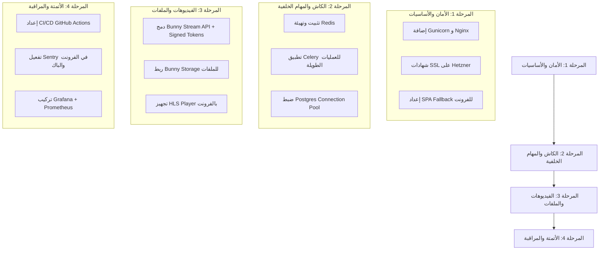

Listed directory mkanak
Listed directory Backend
Listed directory Frontend
Listed directory .agents
Searched for "wrangler|nginx|gunicorn|celery|bunny|sentry|prometheus|grafana|cloudflare|hetzner"
Listed directory config
Listed directory settings
Listed directory apps
Viewed requirements.txt:1-11
Viewed .env.example:1-16
Viewed base.py:1-191
Viewed production.py:1-29
Viewed package.json:1-94
Viewed vite.config.ts:1-41
Listed directory public
Listed directory .github
Listed directory workflows
Viewed ci.yml:1-27
Searched for "celery|redis|bunny|sentry|prometheus|grafana|gunicorn"
Searched for "sentry|bunny|cloudflare"
Searched for "hls|video"
Listed directory src
Viewed App.tsx:1-109
Searched for "import.meta.env|VITE_"
Viewed .env.example:1-12
Searched for "axios|baseURL"
Listed directory services
Listed directory lib
Viewed http.ts:1-204
Viewed ROADMAP.md:1-44

بناءً على الفحص الشامل المباشر لمستودع الكود (Codebase) وملفات الإعدادات والاعتمادات في المنصة، نقدم فيما يلي **تقرير الفحص الشامل وتقييم الفجوات (Gap Analysis)** مقارنة بالبنية المستهدفة (Target Stack)، متبوعاً بدليل إصلاح تفصيلي خطوة بخطوة، والقيود التقنية التي يجب مراعاتها.

---

## 📊 1. جدول فحص الفجوات الشامل (Gap Analysis)

| الطبقة / العنصر | البنية المستهدفة | الوضع الحالي في الكود والملفات | الحالة | ملاحظات وتوصيات |
|---|---|---|---|---|
| **1. Frontend** | React + Vite | React `18.3.1` + Vite `5.4.1` مع React Router و TanStack Query و Code Splitting | ⚠️ | الأساس ممتاز، لكن ينقصه دمج Sentry و Bunny Stream Player، وإعدادات SPA Fallback. |
| **2. Frontend Hosting** | Cloudflare Pages | لا يوجد `wrangler.toml` ولا ملفات `_redirects` / `_headers` في المجلد العام `public/` | ⚠️ | يتطلب إضافة `_redirects` لمنع خطأ 404 عند تحديث الصفحات + ربط Cloudflare Dashboard. |
| **3. Reverse Proxy** | Nginx | غير موجود في الكود (لا توجد ملفات إعدادات Nginx أو SSL proxies) | ❌ | يجب إنشاء ملف `nginx.conf` كامل وإعداد Reverse Proxy لـ Gunicorn و rate limiting و Security Headers. |
| **4. Backend** | Django + DRF | Django `5.1.4` + DRF `3.15.2` مع SimpleJWT وتأمين `production.py` | ⚠️ | الهيكل موجود ومقسّم، لكن ينقصه ربط Redis، Celery، Sentry، ومكتبات Bunny Storage/Stream. |
| **5. App Server** | Gunicorn | غير مدرج في `requirements.txt` ولا توجد ملفات إعدادات systemd service | ❌ | يجب تثبيته، وإضافة `gunicorn.conf.py` وتعديل عدد الـ workers والـ socket على السيرفر. |
| **6. Database** | PostgreSQL | `psycopg 3.2.3` و `DATABASES` مُعد لـ PostgreSQL في Django | ⚠️ | الاتصال بالكود مظبوط، لكن ينقص Connection Pooling (Pgbouncer) وسكريبتات Backup التلقائي. |
| **7. Cache** | Redis | `CACHES` في `base.py` شغال على `LocMemCache` وسلة `django-redis` غير مثبتة | ❌ | يجب تثبيت `django-redis` وتغيير Cache Backend وربطه بـ Redis شغال. |
| **8. Background Jobs** | Celery | مكتبة `celery` غير مثبتة ولا يوجد `celery.py` أو `tasks.py` | ❌ | يجب إضافة Celery مع Redis Broker وإنشاء ملفات الإدارة والخدمات لـ Worker و Beat. |
| **9. Video** | Bunny Stream | لا توجد أي مكتبات أو خدمات لربط Bunny Stream API أو Signed Tokens | ❌ | يجب بناء integration كامل لرفع الفيديوهات (TUS)، إنشاء روابط مشفرة، ومعالجة Webhooks. |
| **10. Files** | Bunny Storage | الملفات ترفع محلياً (`MEDIA_ROOT`) بدون `django-storages` أو Bunny Storage API | ❌ | يجب ربط Bunny Storage لتخزين الصور والملفات الخاصة بحسابات المستخدمين مع Signed URLs. |
| **11. CDN** | Bunny Pull Zone | غير مهيأ في Django Settings لإرجاع روابط CDN للملفات Static/Media | ❌ | يجب ضبط `MEDIA_URL` و `STATIC_URL` لخدمة الصور عبر Pull Zone الخاص بـ Bunny. |
| **12. SSL** | Let's Encrypt | يتطلب ضبط Certbot على سيرفر Hetzner لربط Nginx بالشهادة التلقائية | ❌ | السيرفر يحتاج تثبيت Certbot وأمر Auto-renewal عبر systemd timer. *(الفرونت محمي تلقائياً من Cloudflare)*. |
| **13. Domain & DNS** | Cloudflare / Namecheap | يستلزم التحقق اليدوي من سجلات DNS (A / CNAME) والـ Orange Cloud | ⚠️ | يتطلب مطابقة الـ A Record لـ API السيرفر مع IP Hetzner والـ CNAME لـ Cloudflare Pages. *(تحقق يدوي)* |
| **14. Server** | Hetzner Cloud | يتطلب فحص السيرفر المباشر (Firewall, SSH Keys, Swap, Unattended Upgrades) | ⚠️ | يحتاج تشغيل UFW firewall وضبط 2 GB Swap وتحديثات الأمن التلقائية. *(تحقق يدوي)* |
| **15. CI/CD** | GitHub Actions | يوجد pipeline بسيط للفرونت (`ci.yml`) فقط للـ lint/build بدون Deploy. الباك إند ليس له CI. | ❌ | يجب إضافة Workflow كامل لرفع الفرونت على Cloudflare Pages، وWorkflow لرفع الباك إند على Hetzner. |
| **16. Monitoring** | Grafana + Prometheus + Sentry | Sentry DSN موجود في `.env.example` فقط، بدون تثبيت SDK أو Prometheus/Grafana | ❌ | يجب تثبيت Sentry SDK في الفرونت والباك، وإعداد Prometheus exporters و Grafana Dashboards. |

---

## 🔍 2. الخطوات التفصيلية للإصلاح لكل فجوة (Detailed Step-by-Step Fixes)

### 1️⃣ الفرونت إند وتجهيز Cloudflare Pages (Frontend & Cloudflare Pages)

#### 📝 التعديلات المطلوبة:
1. **دعم SPA Routing على Cloudflare Pages**:
   إنشاء ملف `Frontend/public/_redirects`:
   ```text
   /*    /index.html   200
   ```
2. **إضافة Security Headers**:
   إنشاء ملف `Frontend/public/_headers`:
   ```text
   /*
     X-Frame-Options: DENY
     X-Content-Type-Options: nosniff
     Referrer-Policy: strict-origin-when-cross-origin
     Permissions-Policy: camera=(), microphone=(), geolocation=()
   ```

3. **تثبيت Sentry للفرونت إند**:
   في مجلد `Frontend`:
   ```bash
   npm install @sentry/react
   ```
   تعديل `Frontend/src/main.tsx` لإضافة تهيئة Sentry:
   ```typescript
   import * as Sentry from "@sentry/react";

   if (import.meta.env.VITE_SENTRY_DSN) {
     Sentry.init({
       dsn: import.meta.env.VITE_SENTRY_DSN,
       environment: import.meta.env.VITE_APP_ENV || "production",
       integrations: [Sentry.browserTracingIntegration()],
       tracesSampleRate: 0.2,
     });
   }
   ```

---

### 2️⃣ الباك إند وإدارة الاعتمادات (Backend Dependencies & Settings)

#### 📝 التعديلات المطلوبة في `Backend/requirements.txt`:
إضافة الحزم التالية إلى `Backend/requirements.txt`:
```text
gunicorn==23.0.0
redis==5.2.1
django-redis==5.4.0
celery==5.4.0
sentry-sdk==2.19.2
requests==2.32.3
tuspy==1.1.0
```

#### 📝 تحديث `Backend/config/settings/base.py`:
1. **تحديث إعدادات Redis و Caching**:
   ```python
   REDIS_URL = config("REDIS_URL", default="redis://127.0.0.1:6379/0")

   CACHES = {
       "default": {
           "BACKEND": "django_redis.cache.RedisCache",
           "LOCATION": REDIS_URL,
           "OPTIONS": {
               "CLIENT_CLASS": "django_redis.client.DefaultClient",
           }
       }
   }

   # Celery Configuration
   CELERY_BROKER_URL = config("CELERY_BROKER_URL", default="redis://127.0.0.1:6379/1")
   CELERY_RESULT_BACKEND = config("CELERY_RESULT_BACKEND", default="redis://127.0.0.1:6379/1")
   CELERY_ACCEPT_CONTENT = ["json"]
   CELERY_TASK_SERIALIZER = "json"
   CELERY_RESULT_SERIALIZER = "json"
   CELERY_TIMEZONE = "UTC"
   ```

2. **تهيئة Sentry في `Backend/config/settings/production.py`**:
   ```python
   import sentry_sdk
   from sentry_sdk.integrations.django import DjangoIntegration
   from sentry_sdk.integrations.celery import CeleryIntegration
   from sentry_sdk.integrations.redis import RedisIntegration

   SENTRY_DSN = config("SENTRY_DSN", default="")
   if SENTRY_DSN:
       sentry_sdk.init(
           dsn=SENTRY_DSN,
           integrations=[
               DjangoIntegration(),
               CeleryIntegration(),
               RedisIntegration(),
           ],
           traces_sample_rate=0.1,
           send_default_pii=False,
       )
   ```

3. **تطبيق Celery**:
   إنشاء `Backend/config/celery.py`:
   ```python
   import os
   from celery import Celery

   os.environ.setdefault("DJANGO_SETTINGS_MODULE", "config.settings.production")

   app = Celery("mkanak")
   app.config_from_object("django.conf:settings", namespace="CELERY")
   app.autodiscover_tasks()
   ```
   تحديث `Backend/config/__init__.py`:
   ```python
   from .celery import app as celery_app

   __all__ = ("celery_app",)
   ```

---

### 3️⃣ استضافة الباك إند و Nginx و Gunicorn على Hetzner

#### 📝 1. ملف إعدادات Gunicorn (`Backend/gunicorn.conf.py`):
```python
import multiprocessing

bind = "127.0.0.1:8000"
workers = multiprocessing.cpu_count() * 2 + 1
worker_class = "gthread"
threads = 2
timeout = 60
keepalive = 5
max_requests = 1000
max_requests_jitter = 50
accesslog = "-"
errorlog = "-"
loglevel = "info"
```

#### 📝 2. ملف خدمة Systemd لـ Gunicorn (`/etc/systemd/system/mkanak-backend.service`):
```ini
[Unit]
Description=Gunicorn daemon for mkanak Django Backend
After=network.target postgresql.service redis.service

[Service]
User=www-data
Group=www-data
WorkingDirectory=/var/www/mkanak/Backend
ExecStart=/var/www/mkanak/Backend/.venv/bin/gunicorn --config gunicorn.conf.py config.wsgi:application
Restart=always
RestartSec=3

[Install]
WantedBy=multi-user.target
```

#### 📝 3. ملف خدمة Systemd لـ Celery Worker (`/etc/systemd/system/mkanak-celery.service`):
```ini
[Unit]
Description=Celery Worker for mkanak
After=network.target redis.service

[Service]
User=www-data
Group=www-data
WorkingDirectory=/var/www/mkanak/Backend
ExecStart=/var/www/mkanak/Backend/.venv/bin/celery -A config worker --loglevel=INFO -c 4
Restart=always
RestartSec=5

[Install]
WantedBy=multi-user.target
```

#### 4. ملف Nginx (`/etc/nginx/sites-available/api.mkanak.com`):
```nginx
upstream django_backend {
    server 127.0.0.1:8000;
}

# Rate limiting zone for Login & Sensitive Endpoints
limit_req_zone $binary_remote_addr zone=auth_limit:10m rate=5r/m;
limit_req_zone $binary_remote_addr zone=api_limit:10m rate=30r/s;

server {
    listen 80;
    server_name api.mkanak.com; # استبدل بدومين الـ API الفعلي

    client_max_body_size 100M; # يسمح برفع الملفات حتى 100 ميجابايت

    location /static/ {
        alias /var/www/mkanak/Backend/staticfiles/;
        expires 30d;
        add_header Cache-Control "public, no-transform";
    }

    location /media/ {
        alias /var/www/mkanak/Backend/media/;
        expires 7d;
    }

    location /api/v1/auth/login/ {
        limit_req zone=auth_limit burst=3 nodelay;
        proxy_pass http://django_backend;
        include proxy_params;
    }

    location / {
        limit_req zone=api_limit burst=20 nodelay;
        proxy_pass http://django_backend;
        proxy_set_header X-Forwarded-For $proxy_add_x_forwarded_for;
        proxy_set_header X-Forwarded-Proto $scheme;
        proxy_set_header Host $http_host;
        proxy_redirect off;
    }
}
```

#### 📝 5. إصدار شهادة SSL تلقائياً عبر Let's Encrypt:
```bash
sudo apt update && sudo apt install -y certbot python3-certbot-nginx
sudo certbot --nginx -d api.mkanak.com --non-interactive --agree-tos -m admin@mkanak.com
```

---

### 4️⃣ تكامل خدمات Bunny (Bunny Stream, Storage, CDN)

#### 📝 1. إعدادات البيئة لـ Bunny في `Backend/.env.example`:
```env
BUNNY_STREAM_LIBRARY_ID=your-library-id
BUNNY_STREAM_API_KEY=your-stream-api-key
BUNNY_STREAM_TOKEN_KEY=your-token-authentication-key
BUNNY_STORAGE_ZONE_NAME=mkanak-storage
BUNNY_STORAGE_API_KEY=your-storage-api-key
BUNNY_PULL_ZONE_URL=https://cdn.mkanak.com
```

#### 📝 2. تطبيق خادم الفيديو والحماية (`apps/courses/services/bunny_stream.py`):
```python
import hashlib
import time
import requests
from django.conf import settings

class BunnyStreamService:
    @staticmethod
    def generate_signed_embed_url(video_id: str, expires_in_seconds: int = 3600) -> str:
        """
        يولد رابط مشفر ومؤقت لمشاهدة الفيديو لضمان عدم تسريب اللينك الأصلي.
        """
        expires = int(time.time()) + expires_in_seconds
        token_key = settings.BUNNY_STREAM_TOKEN_KEY
        # Bunny Token Hash Format: token_key + video_id + expiration
        hashable = f"{token_key}{video_id}{expires}"
        token = hashlib.sha256(hashable.encode("utf-8")).hexdigest()
        
        return (
            f"https://iframe.mediadelivery.net/embed/{settings.BUNNY_STREAM_LIBRARY_ID}/{video_id}"
            f"?token={token}&expires={expires}"
        )

    @staticmethod
    def create_video_placeholder(title: str) -> dict:
        """
        ينشئ خانة فيديو جديدة في Bunny Stream استعداداً للرفع عبر TUS.
        """
        url = f"https://video.bunnycdn.com/library/{settings.BUNNY_STREAM_LIBRARY_ID}/videos"
        headers = {
            "AccessKey": settings.BUNNY_STREAM_API_KEY,
            "Content-Type": "application/json",
        }
        response = requests.post(url, json={"title": title}, headers=headers)
        response.raise_for_status()
        return response.json() # يحتوي على guid الخاص بالفيديو
```

---

### 5️⃣ أتمتة CI/CD عبر GitHub Actions

#### 📝 1. خطة نشر الباك إند (`.github/workflows/deploy-backend.yml`):
```yaml
name: Deploy Backend to Hetzner

on:
  push:
    branches: [main]
    paths:
      - 'Backend/**'

jobs:
  deploy:
    runs-on: ubuntu-latest
    steps:
      - uses: actions/checkout@v4

      - name: Deploy via SSH
        uses: appleboy/ssh-action@v1.0.3
        with:
          host: ${{ secrets.HETZNER_HOST }}
          username: ${{ secrets.HETZNER_USER }}
          key: ${{ secrets.HETZNER_SSH_KEY }}
          script: |
            cd /var/www/mkanak/Backend
            git pull origin main
            source .venv/bin/activate
            pip install -r requirements.txt
            python manage.py migrate --noinput
            python manage.py collectstatic --noinput
            sudo systemctl restart mkanak-backend
            sudo systemctl restart mkanak-celery
```

#### 📝 2. خطة نشر الفرونت إند على Cloudflare Pages (`.github/workflows/deploy-frontend.yml`):
```yaml
name: Deploy Frontend to Cloudflare Pages

on:
  push:
    branches: [main]
    paths:
      - 'Frontend/**'

jobs:
  deploy:
    runs-on: ubuntu-latest
    defaults:
      run:
        working-directory: Frontend
    steps:
      - uses: actions/checkout@v4
      - uses: actions/setup-node@v4
        with:
          node-version: 20
          cache: npm
          cache-dependency-path: Frontend/package-lock.json

      - run: npm ci
      - run: npm run build

      - name: Publish to Cloudflare Pages
        uses: cloudflare/pages-action@v1
        with:
          apiToken: ${{ secrets.CLOUDFLARE_API_TOKEN }}
          accountId: ${{ secrets.CLOUDFLARE_ACCOUNT_ID }}
          projectName: mkanak-frontend
          directory: Frontend/dist
          gitMessageCommitHash: ${{ github.sha }}
```

---

### 6️⃣ المراقبة والتنبيهات (Prometheus + Grafana + Sentry)

#### 📝 الخطوات على السيرفر:
1. **تثبيت `node_exporter` و `postgres_exporter` على سيرفر Hetzner**:
   ```bash
   sudo apt install -y prometheus-node-exporter
   ```
2. **إعداد Prometheus Server & Grafana Container (عبر Docker على سيرفر المراقبة)**:
   ```yaml
   # docker-compose.monitoring.yml
   version: '3.8'
   services:
     prometheus:
       image: prom/prometheus:latest
       volumes:
         - ./prometheus.yml:/etc/prometheus/prometheus.yml
       ports:
         - "9090:9090"
     grafana:
       image: grafana/grafana:latest
       ports:
         - "3000:3000"
   ```

---

## 🎯 3. ترتيب أولويات التنفيذ (Priority Roadmap)



---

## ⚠️ 4. قيود تقنية وتحديات غير قابلة للحل الكامل (Technical Limitations)

من المهم جداً توضيح بعض الحدود والقيود التقنية الخاصة بالخدمات المستخدمة لتفادي أي تفاجؤ مستقبلي:

1. **حدود الـ Direct Upload بالفيديو في Bunny Stream**:
   - الرفع المباشر عبر المتصفح لملفات كبيرة (+2GB) قد يواجه الانقطاع إذا تذبذب اتصال الطالب.
   - **التقييد**: يتطلب بالضرورة تفعيل بروتوكول **TUS Resumable Upload**، وتطبيق Retry policy في الفرونت إند.
2. **صلاحية Signed URLs لفيديوهات المحاضرات الطويلة**:
   - إذا تم ضبط رابط الفيديو المشفر بمهلة صلاحية short-lived (مثلاً 15 دقيقة) لمنع التسريب، واستمر الطالب في مشاهدة فيديو مدته ساعتين دون إعادة طلب Token جديد، سينقطع البث أثناء المشاهدة عند إعادة طلب الـ Segments.
   - **التقييد**: يجب أن يقدم الفرونت إند آلية **Token Refreshing** تلقائية خلف الكواليس كل 30 دقيقة أثناء فتح مشغل الفيديو.
3. **مشاركة الموارد على سيرفر Hetzner واحد (Resource Contention)**:
   - عند تشغيل (PostgreSQL + Redis + Celery + Gunicorn) على نفس السيرفر، في حالة وجود ضغط عالي أثناء امتحان مجمع أو إطلاق كورس جديد، سيتنافس Celery و Postgres على الـ CPU/RAM.
   - **التقييد**: السيرفر الحالي يتحمل حتى 500-1000 مستخدم متزامن فقط. عند التوسع يتوجب فصل PostgreSQL على Hetzner Database Managed Service أو VPS منفصل.
4. **قيود Cloudflare Pages Free Tier**:
   - الحدود على عدد الـ Redirects والـ Custom Headers على خطة Cloudflare Pages المجانية.

---

## ⏱️ 5. الجدول الزمني التقديري للتنفيذ (Estimated Timeline)

| المرحلة | المهام الرئيسية | المدة التقديرية |
|---|---|---|
| **المرحلة 1** | إعداد Gunicorn, Nginx, SSL, وتجهيز الفرونت لـ Cloudflare Pages | **2 - 3 أيام** |
| **المرحلة 2** | دمج Redis, Celery, وتحديث إعدادات Django وتجهيز قاعدة البيانات | **3 - 4 أيام** |
| **المرحلة 3** | دمج Bunny Stream (Upload, Embed, Signed URLs) و Bunny Storage | **4 - 5 أيام** |
| **المرحلة 4** | بناء workflows الـ CI/CD وتثبيت Sentry و Prometheus/Grafana | **2 - 3 أيام** |
| **الإجمالي** | **جاهزية كاملة للإنتاج المستقر والآمن (Production Ready)** | **11 - 15 يوم عمل** |

---

## 🔐 6. ملاحظات التحقق اليدوي المطلوبة من لوحات التحكم (Manual Check Required)

الأجزاء التالية تتطلب الوصول المباشر للوحات التحكم أو السيرفر للتأكيد النهائي:
1. **Cloudflare Dashboard**: التأكد من ربط الدومين بالـ Cloudflare Pages وتفعيل SSL/TLS Mode إلى `Full (strict)`.
2. **Bunny Dashboard**: جلب الـ Library ID، API Keys، وتفعيل **Token Authentication** على مستوى الـ Video Library ومنع الـ Embed إلا من دومين المنصة (Allowed Domains).
3. **Hetzner Server**: التأكد من فتح البورتات (80, 443, 22) فقط في الـ Hetzner Firewall وإغلاق ما عدا ذلك (مثل 5432 و 6379).